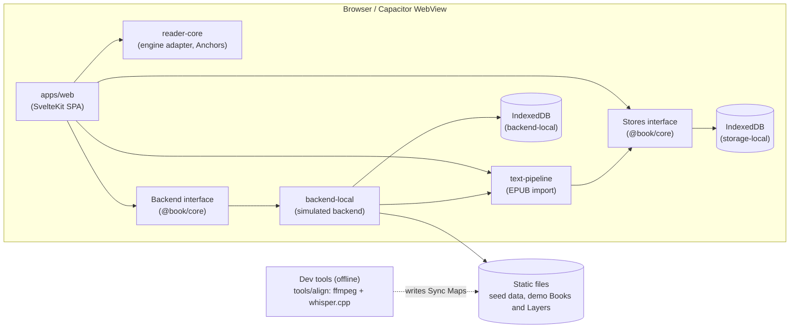
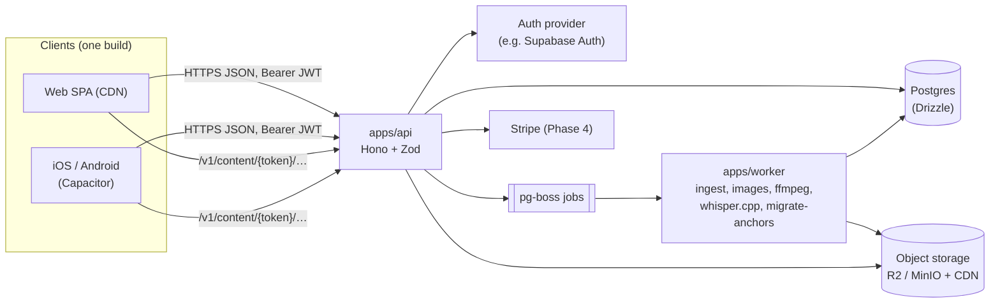

# Interactive Book Platform — Design Document

> **Status:** Draft v0.3 · **Owner:** Kasai · **Last updated:** 17 October 2026 (Phase 1.9: tester builds and the PoC review kit; D-029 to D-031. Phase 2 detailed and split into phases 2.1–2.13; D-032, OPEN-15. Phase 1.10: a new Book opens at its text; D-033, D-034. Front end first: phases 1.11–1.21 before any backend; D-035, OPEN-16. Phase 1.11: the device voice; D-036, ADR-006. Phase 1.12: search in the Book and focus mode. Phase 1.13: the table viewer, the sleep timer and the phone's top bar; D-037. Phase 1.14: recaps and glossary, the story so far; D-038. Phase 1.15: serial release schedules and `tools/align` for any Book; D-039. Phase 1.16: reading time left, stats, a streak and achievements on the device; D-040. Phase 1.17: share quote and custom page and text colours; D-041. Phase 1.18: wishlists, sale alerts and reviews, simulated; D-042)
> **Supersedes:** `docs/design-doc.md` (v0.1, 28 Sep 2026: product and vision) and `docs/DESIGN.md` (v0.1, 11 Oct 2026: engineering plan). Appendix A records what came from each and how conflicts were resolved.
> The two v0.1 drafts are kept for reference in `docs/archive/`. Decisions D-003, D-005, D-008, D-009, D-011 to D-014, D-019 and D-020 in §16 were confirmed by the owner on 11 October 2026.
> **v0.3 (11 October 2026)** adds the simulated backend for the PoC (§5.6), splits Phases 0 and 1 into smaller phases detailed in [IMPLEMENTATION-PLAN.md](IMPLEMENTATION-PLAN.md), and moves iOS work to [BACKLOG.md](BACKLOG.md). The owner confirmed D-021 to D-024 the same day.
> **Working name:** TBD (OPEN-07). Package scope: `@book/*` (already in the repo; rename when the product is named).

---

## 0. How to use this document

This is the source of truth for product scope, architecture, terminology and build order. It is written for humans and for coding agents.

**Before starting any task, an agent MUST:**

1. Read §2 Glossary and §3 Invariants. Use glossary terms exactly in code, comments, storage fields and (where sensible) UI copy.
2. Find the task by its ID (e.g. `P1-RDR-04`) in §13 and check that everything in its `Depends on` list is done. Its phase, UX notes and Try-it checklist are in `docs/IMPLEMENTATION-PLAN.md` §6.
3. Check §17 for any `OPEN-xx` question the task touches. **Do not silently resolve an OPEN item.** Propose a resolution in the PR description, and stop if the choice is hard to reverse (stored data format, public API, storage layout).

**While working:**

- Work only on tasks in the current phase unless told otherwise. Never build anything in §13.8 Parked.
- One branch and PR per phase of `docs/IMPLEMENTATION-PLAN.md` (D-025). Branch name: `p0-1-foundations`. At least one commit per task, with the task ID in the message.
- If a task conflicts with an Invariant, stop and flag it. Invariants win.
- Don't add a dependency without saying why in the PR. Prefer libraries already listed in §5.2.
- If you change a decision, update §16 Decision log in the same PR.
- A task is done only when it meets §12.5 Definition of Done **and** its own acceptance criteria.

**Current stage:** Phase 0/1 — local-first proof of concept. There is **no backend**. The server-side areas (store, Creator Studio, community, moderation) are built against a simulated backend that runs in the browser (§5.6), so the owner can try them before any hosting exists. The PoC targets web and Android; iOS is in `docs/BACKLOG.md` (D-024). **Front-end first (D-035):** every front-end feature worth building without a real backend comes before any backend work, as phases 1.10–1.21; Phase 2 starts only after them and the PoC review's go decision. Anything in this document marked *Proposed* (mainly the server stack) is a plan to confirm at the PoC review (§13.3), not a decision.

---

## 1. Product

### 1.1 Problem

Many people find books hard to get into. The two most common asks are audio and pictures, but pairing an audiobook with an ebook means two apps, two purchases and manual syncing. That friction is often enough to stop someone starting, or to make them give up partway.

### 1.2 Vision and pitch

A store, library and reader where a book can carry optional **Layers** — narration and illustrations — made by the author or, with the author's permission, by the community. Everything lives in one reader and stays in sync with the text automatically, whatever font, size or layout the reader picks.

**One-line pitch:** "Steam for books": you buy and own your books, then choose which add-ons (narration, illustration packs, bookmark designs) come with them. Community creators can give their work away or sell it, readers can tip, and readers can subscribe directly to a creator, for example to fund a serial that isn't finished yet, with no Patreon in the middle.

### 1.3 Core bet

If narration and illustrations are already attached to the text, in the same reader, with no setup, more people start and finish books. The proof of concept (§13.2) exists to test this before money is spent on hosting.

### 1.4 Users

| Persona | Needs | From phase |
|---|---|---|
| **Reluctant reader** | Low effort to start; audio and visual support; zero setup | 1 (PoC) |
| **Regular reader** | Comfortable typography, notes, bookmarks, progress across devices | 1 (local), 2 (sync) |
| **Author** (indie / web-serial, owns their rights) | Easy upload; control over official illustrations and narration; analytics; income | 2 |
| **Community creator** (illustrator, narrator) | A place to publish Layers for books they love; credit, feedback and income | 5 |
| **Moderator / admin** | Review queue with automatic flags, reports, takedowns (§10.6) | 2 (basic), 5 |

**Launch audience:** readers of web fiction and indie fantasy/LitRPG, and the authors who write it. These authors own their rights, already publish on web-serial platforms, and have no tool that offers synced narration or illustrations. The owner's own LitRPG novel is the launch title.

### 1.5 Goals

- Lower the barrier to starting and continuing a book.
- Keep illustrations, narration, notes and bookmarks attached to the text regardless of font, size, layout or later edits by the author.
- Let readers fully customise the reading experience.
- Give authors and community creators tools to enrich books and a reason to publish here.

### 1.6 Non-goals (until stated otherwise)

- A native (non-WebView) reader. iOS and Android ship the same web build inside Capacitor.
- Licensing traditionally published books from major publishers, or competing on catalogue size.
- Real-time co-reading, chat or social feeds.
- Heavy DRM (Readium LCP).

### 1.7 Product principles

1. **Reduce friction first.** Defaults give a good experience with zero choices: official Layers switched on, a "Complete edition" bundle as the default purchase, audio never auto-playing.
2. **The text is the spine.** Everything attaches to the text, never to pages (§3, §6.1).
3. **The book comes first.** The reading surface is calm and almost invisible; controls fade while reading. Personality lives in the app around it, and in the illustration panel, which is the showpiece.
4. **Authors control their books.** Community content exists for a book only if its author allows it.
5. **Accessible by default.** WCAG 2.2 AA, full keyboard use, screen readers, reduced motion, dyslexia-friendly and low-vision fonts.
6. **Private by default.** What someone reads is personal data. No ad or tracking SDKs.

---

## 2. Glossary (use these terms exactly)

| Term | Meaning |
|---|---|
| **Book** | A title. Has many Revisions. |
| **Revision** | An immutable, processed version of a Book's text. Exactly one is *current* at a time. Serial authors publish new Revisions when they add or edit chapters. (Replaces "edition" from the v0.1 drafts and the current code.) |
| **Chapter** | One spine item of a Revision (one XHTML document). Identified by `chapterId`. |
| **Block** | A block-level element in a Chapter (paragraph, heading, list item, table, figure). Gets a stable `data-b` index at ingest. |
| **Word** | A word-like token produced by the tokeniser (§7.1). Punctuation and whitespace are not Words. |
| **WordId** | Integer ID for a Word, unique within a Book across all Revisions and never reused. Unchanged Words keep their WordId across Revisions. **An identifier, not a position:** never compare WordIds to work out reading order. |
| **Ordinal** | A Word's position in reading order within one Revision (0-based, whole Book). Used for ordering and range checks. Only meaningful together with its `revisionId`. |
| **Anchor** | A position (`PointAnchor`) or span (`RangeAnchor`) in a Book's text, made of WordIds, Ordinals and a text quote for recovery (§6.1). The *only* way anything attaches to text. |
| **Locator** | The reader engine's internal position format (e.g. an EPUB CFI or a Readium Locator). Only `reader-core` converts between Anchor and Locator. **Never persisted.** |
| **Page** | A computed screenful for the current device and settings. Never stored. |
| **Visible range** | The Words currently on screen, emitted by the reader on every page turn or scroll. |
| **Layer** | An optional overlay a reader can enable on a Book: an Illustration Pack or an Audio Track. |
| **Illustration Pack** | A set of Illustrations for one Book by one creator. (Replaces "illustration set".) |
| **Illustration** | An image attached to an Anchor, with a placement (§8.2). |
| **Audio Track** | A set of audio for one Book. Kind is `narration`, or `ambient` (Parked). |
| **Sync Map** | Per-Chapter list of `[wordId, startMs, endMs, flags]` linking a narration Audio Track to Words (§7.2). |
| **Official / Community** | Official = made or endorsed by the Book's author. Community = made by another Creator with the author's permission. |
| **Creator** | Any user who publishes Products. Authors are Creators. |
| **Product** | Anything that can be listed, priced (including free) and owned. |
| **Entitlement** | A record that a user owns a Product. The single source of truth for access. |
| **Bundle** | A Product that grants Entitlements to other Products (e.g. "Complete edition"). |
| **Creator Subscription** | A recurring monthly payment from a reader to a Creator, cancellable at any time. Grants the Creator's subscriber benefits (e.g. early-access chapters) while active. |
| **Tip** | A one-off payment from a reader to a Creator. Not a Product; grants nothing. |
| **Illustration mode** | How a reader chooses to see Illustrations: `popup`, `per-page`, `spread` or `in-text` (§8.2). |
| **Flag** | An automatic or manual marker that puts content or an account in the review queue (§10.6). |
| **Bookmark Design** | A collectible cosmetic Product: the look of a bookmark. |
| **Placed Bookmark** | A user's saved position in a Book (a PointAnchor), drawn with one of their Bookmark Designs. Free and unlimited. |
| **Annotation** | A user's highlight, optionally with a note, on a RangeAnchor. |
| **Reading Progress** | A user's current position (PointAnchor + progression) and furthest position reached in a Book. |
| **Reader Preferences** | Typography, layout, theme and playback settings (§9.4). Global, with optional per-Book overrides. |
| **Stores** | The storage interfaces in `@book/core`. The app persists data only through them (§6.3). |
| **Backend** | The interface in `@book/core` for server-authoritative operations: catalogue, Entitlements, checkout, Tips and subscriptions, Layers, publishing, community, moderation and sessions. Implemented in the browser by `backend-local` in the PoC and by an HTTP client from Phase 2 (§5.6). |
| **Persona** | A seeded user (Reader, Author, Illustrator, Moderator) that the owner switches between in development builds. Stands in for sign-in until Phase 2. |
| **Simulated** | Built against `backend-local`: it works end to end, but with no real accounts, servers or money. Simulated UI that involves money is labelled as such. |

Don't use "page" to mean a stored position. Don't say "bookmark" without saying whether you mean a Bookmark Design or a Placed Bookmark. In UI copy, use the words readers use: "Narration", "Illustrations", "Bookmarks", not "Layers" or "Sync Maps".

---

## 3. Invariants (MUST / MUST NOT)

These are non-negotiable. Code that violates them is rejected.

1. **No stored page numbers.** Pages are computed at render time. Persist Anchors and progression only.
2. **Everything attached to text uses an Anchor**: Annotations, Placed Bookmarks, Reading Progress, Illustrations, Sync Maps, and later glossary entries and comments. No raw character offsets, CFIs or Locators in storage.
3. **WordIds are immutable and never reused** within a Book. New Words get new IDs from the Book's counter.
4. **Order comes from Ordinals, never from WordIds.** Ordinals are only compared within the same Revision.
5. **Selections snap to whole Words.** A RangeAnchor always starts and ends on a Word.
6. **Nothing appears ahead of the reader.** Illustration panels, previews, recaps and glossary entries only use content anchored at or before the reader's visible range (or furthest position, for recaps and glossary). Store-page previews only use Illustrations marked `spoilerSafe`.
7. **The app touches storage only through `Stores`, and server-authoritative operations only through `Backend`** (both in `@book/core`). The implementations are chosen in one file (`apps/web/src/lib/services.ts`).
8. **App code never imports the reader engine directly.** Only `packages/reader-core` adapters may import foliate-js / Readium.
9. **`@book/core` stays platform-neutral.** No framework, DOM or Node imports. (Zod is allowed once schemas are needed.) Shared types and schemas live there; never duplicate a type or DTO elsewhere.
10. **Book content is untrusted.** EPUB scripts are stripped, CSS is allowlisted, images are re-encoded, audio is transcoded (§7, §10). Chapters render in a sandboxed iframe.
11. **Audio never starts on its own.** Every audio feature is off until the reader opts in.
12. **Respect `prefers-reduced-motion`** in every animation, including page turns and crossfades.
13. **Svelte 5 runes only** (`$state`, `$derived`, `$effect`, `$props`). Shared reactive state lives in `.svelte.ts` modules.
14. **TypeScript strict everywhere.** No `any` without an explaining comment.

The next five govern the backend. 15, 17 and 19 are enforced inside the simulated backend (`backend-local`) from Phase 1 and in the API from Phase 2. 16 and 18 start in Phase 2:

15. **All access checks go through the Entitlements module.** No other code decides ownership. Free Products still need an Entitlement (created by "Add to library").
16. **Paid or gated content is never publicly readable.** It is served only through short-lived content access tokens (§10.3).
17. **Money is integer minor units plus an ISO 4217 currency code.** Never floats.
18. **Clients never connect to the database directly.** All data access goes through the API.
19. **Community content requires the author's policy to allow it** (§6.6).

---

## 4. Features

Every feature has a home phase so the vision and the roadmap are the same list. ★ marks the features most likely to prove the core bet. "1 (simulated)" means a working version in the PoC against the simulated backend (§5.6, D-021); the later phase is when it becomes real.

### 4.1 Reader

| Feature | Detail | Phase |
|---|---|---|
| Page navigation | Previous/next buttons; keyboard (←/→, PageUp/PageDown, Space, Home/End for chapter start/end); tap/click zones (outer 25% of width); swipe | 1 |
| Scrubber | Drag to any point. Shows chapter ticks, chapter name and percentage while dragging; jumps on release | 1 |
| "Back" after a jump | Returns to the position before the last scrubber, TOC, search or link jump | 1 |
| Table of contents | Drawer with chapter list and current chapter marked | 1 |
| Open at the text | A Book opened for the first time starts where its text does, not at a licence or contents page (§9.5) | 1 |
| Layout modes | Single page (narrow screens), two-page spread (≥ 1024 px wide), continuous scroll. `auto` picks for you | 1 |
| Page indicator | "Page X of Y in this chapter", recomputed live, never stored | 1 |
| Page-turn animation | None / slide / fade; forced to none under reduced motion | 1 |
| Page-curl animation | Realistic curl as an optional skin. Last of the front-end phases because it depends on the engine (ADR-001) and is costly on low-end phones | 1.21 |
| Text zoom | Pinch on the reading surface and Ctrl +/− change font scale and re-lay out, keeping the first visible Word on screen | 1 |
| Overview mode | 4-up page thumbnails for scanning. A navigation mode, not a reading mode: reflowable text is too cramped in four columns | 1.19 |
| Fixed-layout books | Picture books, comics, illustrated editions, with true zoom and pan | Parked |

### 4.2 Customisation

| Feature | Detail | Phase |
|---|---|---|
| Fonts | Curated, self-hosted reading fonts plus "Publisher default" (§11.3) | 1 |
| Typography | Font size, line height, paragraph spacing, margins, justification, hyphenation | 1 |
| Themes | Light, sepia, dark; standard / medium / high contrast; system mode | 1 |
| Custom colours | Choose a seed colour (theme generated from it); advanced: custom page and text colours with a live contrast check | 1 (seed), 1.17 (advanced) |
| Live apply | Every change re-lays out immediately, keeping position and all attached content | 1 |
| Per-Book overrides | Any preference can be overridden for one Book | 1 |
| Sync across devices | | 2 |

### 4.3 Illustrations ★

| Feature | Detail | Phase |
|---|---|---|
| Pop-up mode (default) | A picture button in the top-right of the page; tapping it opens the Illustration for the current part of the story over the book, and the reader closes it when done. A dot on the button shows when a new one is available (§8.2) | 1 (demo pack), 3 (authors) |
| Per-page mode | A panel to the left of the book that always shows the Illustration for the current part of the story, crossfading as the reader moves on | 1 (demo), 3 |
| Spread mode | A wide area above the book, sized for double-page artwork | 1 (demo), 3 |
| In-text mode | Illustrations appear in the text where the creator placed them: inline or as a full page, like a printed illustrated book | 1 (demo), 3 |
| Lightbox | Tap any Illustration to view it full screen with zoom, caption and artist credit | 1 |
| Several packs | Readers enable one or more packs in priority order, or turn illustrations off | 3 |
| Spoiler safety | Invariant 6 | 1 |

### 4.4 Narration ★

| Feature | Detail | Phase |
|---|---|---|
| Synced narration | Author-recorded audio aligned to the text (§7.2) | 1 (demo), 3 (authors) |
| Read-along highlighting | Highlights the current Word or sentence | 1 (demo), 3 |
| Auto page-turn | Turns the page when narration moves past it | 1 (demo), 3 |
| Tap to seek | Tapping a Word while narration plays jumps the audio there | 1 (demo), 3 |
| Playback controls | Play/pause, ±15 s, previous/next sentence, speed 0.5×–3× | 1 (demo), 3 |
| Background playback | Lock-screen and Media Session controls on iOS, Android and web | 1 (spike), 3 |
| Device text-to-speech | Fallback when a Book has no narration, using the same highlighting | 1.11 |
| AI narration | Cloud text-to-speech generated once per Revision, as a creator option. Depends on OPEN-09 | 4+ |
| Sleep timer | Stops narration or the device voice after a time, or at the end of the Chapter | 1.13 |

### 4.5 Notes, highlights and bookmarks

| Feature | Detail | Phase |
|---|---|---|
| Selection toolbar | Highlight (5 colours), Add note, Copy, Remove highlight. Right-click opens the same actions on desktop; long-press on touch | 1 |
| Share quote | Image or text card of a passage with title and author | 1.17 |
| Notes panel | All notes and highlights for the Book, grouped by chapter, filterable by colour, jump to, edit, delete | 1 |
| Export | Markdown (with chapter headings) and plain text | 1 |
| Placed Bookmarks | Free and unlimited; optional label; shown as a ribbon on the page edge; listed with notes; `B` shortcut | 1 |
| Bookmark Designs | Cosmetic Products. Everyone gets a default design; bought designs work in every Book | 1 (default; simulated store), 4 (store) |
| Orphan handling | If an author's edit deletes the text an Annotation or bookmark pointed to, it is kept and shown as "orphaned", never silently dropped | 2 |

### 4.6 Library and import

| Feature | Detail | Phase |
|---|---|---|
| Local library | Books stored in the browser; sample book preloaded | 1 |
| Import your own EPUB | Read any DRM-free EPUB with full customisation, notes and bookmarks (no community Layers) | 1 |
| Accounts and cloud library | | 2 |
| Offline downloads | Download Books and Layers for offline reading | 6 |

### 4.7 Authors and creators

| Feature | Detail | Phase |
|---|---|---|
| Upload and publish | EPUB upload, ingest report, preview, publish | 1 (simulated), 2 |
| New Revisions | Edit or append chapters; reader data migrates automatically (§6.2) | 1 (simulated), 2 |
| Illustration placement tool | Select text in Creator mode → "Attach illustration" → image, placement, alt text | 1 (simulated Studio pack builder), 3 |
| Narration upload and review | Per-chapter audio, automatic alignment, review screen for low-confidence parts | 1 (simulated; Sync Maps from `tools/align`), 3 |
| Serial publishing | Scheduled chapter releases with follower notifications | 1.15 (simulated), 6 |
| Author analytics | Reads, completion, drop-off by chapter, Layer usage | 6 |
| Monetisation | Paid Books, Bundles, early-access chapters, Tips, Creator Subscriptions, revenue share on Layers and cosmetics linked to their Books (§6.5) | 1 (simulated), 4 |
| Curation tools | Review queue for the author's own Books: approve, hide or remove community Layers; see flags and reports (§10.6) | 1 (simulated), 2 (own uploads), 5 (community) |
| DOCX / Markdown import | Via Pandoc into the EPUB pipeline | 3 (stretch) |

### 4.8 Community

| Feature | Detail | Phase |
|---|---|---|
| Community Layers | Packs and narration by other creators, subject to the author's policy (§6.6) | 1 (simulated), 5 |
| Per-Book hub | Browse, rate and enable community Layers, free or paid; "Author-endorsed" badge; top-rated first | 1 (simulated), 5 |
| Creator profiles | Portfolio across Books, follow, tip, subscribe | 1 (simulated), 5 |
| Paragraph comments | Comments on passages, hidden by default behind a count indicator | 1.20 (simulated), 6 |
| Popular highlights | Optionally show passages many readers highlighted | 1.20 (simulated), 6 |
| Reviews | Showing how far the reviewer read; wishlists and sale alerts | 1.18 (simulated), 6 |
| Reading groups | Shared progress and discussion for a small group | Parked |

### 4.9 Reading support and retention

| Feature | Detail | Phase |
|---|---|---|
| In-book search | Uses the word index; results jump and highlight | 1.12 |
| Reading time left | In chapter and Book, from the reader's own pace | 1.16 |
| Spoiler-safe recap | "Story so far" built only from chapters the reader has read to the end of; written by the author per Chapter, with AI drafts later (§7.4) | 1.14 (simulated), 6 |
| Spoiler-safe glossary | Characters, places and things, shown only after their first appearance, under the names the reader has met; entries written by the author; "In the glossary" for a name selected in the text | 1.14 (simulated), 6 |
| Tap-to-define | Dictionary lookup on a Word; the dictionary is OPEN-16 | 1.19 |
| Focus mode | Dims everything except the current paragraph | 1.12 |
| Cross-device prompt | "You were further ahead on another device. Jump there?" | 2 |
| Stats, streaks, achievements | Optional and easy to switch off | 1.16 (on this device) |
| Guided reading aids | Bionic-style emphasis and similar, opt-in | Parked |

### 4.10 Rich content

| Feature | Detail | Phase |
|---|---|---|
| Styled blocks ★ | LitRPG status windows, system messages and tables that stay readable in every theme and size (§9.6) | 1 |
| Table viewer | Tap a table squeezed by a narrow page or large text to open it full screen, where it pans and zooms like an image | 1.13 |
| Character art cards | Tap a character's name to see their portrait from the active pack | Parked |
| Maps | Interactive map whose locations link to passages | Parked |

---

## 5. Architecture

### 5.1 Overview

The architecture grows in two stages. Code is structured for the second stage from day one, so moving to it means adding implementations, not rewriting.

**Stage 1 — local-first proof of concept (now).** Everything runs in the browser or the Capacitor WebView. Imported Books are processed client-side by `text-pipeline` and stored in IndexedDB with all reader data. Server-authoritative operations (catalogue, Entitlements, checkout, publishing, community, moderation) go through the `Backend` interface to `backend-local`, a simulated backend with its own IndexedDB database and seeded demo Books and Layers (§5.6). Sample Layers (illustrations, narration Sync Maps) are prepared offline with developer tools and served as static files.



**Stage 2 — platform (Phase 2 onwards; *Proposed*, confirm at PoC review).** An API owns accounts, Entitlements and content delivery; a worker runs the same `text-pipeline` and `alignment` packages server-side; the app swaps `backend-local` for an HTTP client and its local Stores for synced ones (§5.6).



### 5.2 Technology stack

Status: **In repo** = already set up. **Phase n** = adopt when that phase starts. **Proposed** = the current plan for the backend, to confirm at the PoC review.

| Concern | Choice | Status | Notes |
|---|---|---|---|
| Language | TypeScript (strict) | In repo | Everywhere, including tools |
| Package manager | npm workspaces | In repo | Owner's preference. Add Turborepo only if builds get slow (it works with npm) |
| UI framework | Svelte 5 + SvelteKit, built as an SPA (`adapter-static`, `fallback: 'index.html'`) | In repo | One build runs on the web and in Capacitor. Server-rendered store pages come in Phase 6 (§5.5) |
| Mobile | Capacitor: Android now, iOS from the backlog (D-024) | Phase 0 | Native plugins only where web APIs fall short: background audio, deep links, filesystem |
| Simulated backend | `backend-local`: IndexedDB via `idb`, seed data validated with Zod | Phase 0 | §5.6. Replaced by `backend-http` in Phase 2 |
| Reader engine | foliate-js, pinned by git commit (ADR-001) | Phase 1 | Always behind the `ReaderEngine` interface (§9.1) |
| Local storage | IndexedDB via `idb` | In repo | `@book/storage-local` |
| Validation | Zod | Phase 1 | For imported data, stored data and (later) API contracts |
| Design system | Material 3 colour system and tokens (`@material/material-color-utilities`); our own components on Bits UI primitives (ADR-005) | Phase 1 | §11 |
| Icons | Material Symbols, self-hosted subset | Phase 1 | |
| Audio playback | HTML audio + Web Audio + Media Session; native plugin on mobile | Phase 1 | Behind a platform interface (§9.7). Howler.js only if ambient audio is ever un-parked |
| Speech alignment | whisper.cpp (binary) for word timings; alignment logic in TS | Phase 1 (dev tool), 3 (worker) | **Exception:** non-TS binary |
| Audio processing | ffmpeg (binary) | Phase 1 (dev tool), 3 (worker) | **Exception:** non-TS binary |
| Images | sharp | Phase 3 | Variants, EXIF stripping |
| EPUB validation | epubcheck (Java) | Phase 2 | **Exception:** non-TS. Report-only at first |
| API | Hono + Zod | Proposed (Phase 2) | Runs on Node, Deno, Bun or Cloudflare Workers, which keeps hosting open |
| Database | Postgres + Drizzle ORM + drizzle-kit migrations | Proposed (Phase 2) | Hosted Postgres (Supabase or any provider) |
| Auth | Supabase Auth (email magic link, Google, Apple) | Proposed (Phase 2) | API verifies JWTs. Check App Store sign-in rules |
| Jobs | pg-boss | Proposed (Phase 2) | Postgres-backed queue; no Redis |
| Object storage | Cloudflare R2 (prod), MinIO (local) | Proposed (Phase 2) | S3 API; no egress fees for audio |
| Payments | Stripe Checkout; Stripe Connect for payouts | Phase 4 | Merchant-of-record question is OPEN-04 |
| Search | Postgres full-text, then Meilisearch if the catalogue grows | Phase 6 | In-book search uses the word index |
| Testing | Vitest, @testing-library/svelte, Playwright (Chromium + WebKit) | Vitest in repo | WebKit matters: iOS runs WKWebView, and WebKit is the only iOS coverage until the backlog item is picked up |
| Lint / format | ESLint + eslint-plugin-svelte, Prettier + prettier-plugin-svelte, svelte-check | In repo | |
| Errors | Sentry (web, Capacitor, and later API and worker) | Phase 2 | Not needed for the local PoC |
| Analytics | Privacy-preserving, cookie-less, first-party (e.g. self-hosted Plausible plus a few documented events) | Phase 2 | §10.5 |

### 5.3 Repository structure

Existing folders are kept. New ones are added when their phase starts.

```
/
├─ AGENTS.md                    # short pointer to this doc + commands (Appendix C)   [Phase 0]
├─ docs/
│  ├─ DESIGN.md                 # this document
│  ├─ IMPLEMENTATION-PLAN.md    # phases 0.1–2.13: order, UX notes, Try-it checklists    [in repo]
│  ├─ BACKLOG.md                # deferred work and what brings it back (e.g. iOS)       [in repo]
│  └─ adr/                      # ADR-001-reader-engine.md, …                          [Phase 0]
├─ apps/
│  ├─ web/                      # SvelteKit SPA + Capacitor config                    [in repo]
│  │  ├─ src/routes/            # library/, read/[bookId]/, store/, book/[slug]/, creator/[handle]/,
│  │  │                         # studio/, you/, admin/, dev/ (IMPLEMENTATION-PLAN.md §5)
│  │  ├─ src/lib/
│  │  │  ├─ services.ts         # the one place Stores are chosen                    [in repo]
│  │  │  ├─ state/              # *.svelte.ts shared state (prefs, library, session)
│  │  │  ├─ reader/             # reader UI: toolbar, scrubber, panels, menus
│  │  │  └─ platform/           # web vs Capacitor adapters (audio, files, share, …)
│  │  ├─ static/books/          # bundled sample book(s)                              [in repo]
│  │  ├─ static/demo/           # demo Books, Layers and audio for backend-local      [Phase 0]
│  │  ├─ android/               # generated by Capacitor                              [Phase 0]
│  │  ├─ ios/                   # generated by Capacitor                              [backlog]
│  │  └─ capacitor.config.ts
│  ├─ api/                      # Hono API, one folder per module                      [Phase 2]
│  └─ worker/                   # pg-boss job handlers                                 [Phase 2]
├─ packages/
│  ├─ core/                     # domain types, Anchors, Stores + Backend interfaces, schemas [in repo]
│  ├─ domain/                   # pure business rules: Entitlements, Bundles, Flags…    [Phase 0]
│  ├─ contract-tests/           # shared suites for any Stores or Backend (dev only)    [Phase 0]
│  ├─ storage-local/            # IndexedDB implementation of Stores                   [in repo]
│  ├─ backend-local/            # simulated Backend in the browser: own DB, seed, Personas [Phase 0]
│  ├─ tokens/                   # design tokens, theme generation, reader tokens        [in repo]
│  ├─ text-pipeline/            # EPUB parse/sanitise, tokenise, WordIds, diff, index   [Phase 1]
│  ├─ reader-core/              # ReaderEngine interface, engine adapter, Anchor↔Locator [Phase 1]
│  ├─ alignment/                # transcript ↔ Word alignment, Sync Map format          [Phase 1]
│  ├─ ui/                       # Svelte components on top of tokens                    [Phase 1]
│  ├─ storage-remote/           # Stores backed by the API, with local cache + outbox   [Phase 2]
│  ├─ backend-http/             # Backend over the API, same schemas                    [Phase 2]
│  └─ db/                       # Drizzle schema, migrations, seed                      [Phase 2]
├─ tools/                       # dev-only CLIs: align, resolve-anchors, images         [Phase 1]
└─ fixtures/                    # test EPUBs, audio clips, images, seed/ (§12.2)        [Phase 0]
```

Reader UI lives in `apps/web/src/lib/reader/` until a second app needs it; extract it to a package then. Pure logic never lives in Svelte components.

**Dependency direction** (enforced with ESLint import rules): `apps/*` → `packages/*` → `core`. `core` imports nothing internal. `text-pipeline`, `alignment`, `reader-core` and `domain` import only `core`. `backend-local` imports `core`, `domain` and `text-pipeline`. `contract-tests` imports `core` (and Vitest). `ui` imports only `tokens`. No package imports from `apps/*`. Inside `apps/web`, only `src/lib/services.ts` may import `storage-local` or `backend-local`.

### 5.4 Runtime placement of shared packages

| Package | Stage 1 (PoC) | Stage 2 (platform) |
|---|---|---|
| `text-pipeline` | Browser (in a Web Worker, so import doesn't freeze the UI) | Worker job `ingest-epub` (same code) |
| `alignment` | `tools/align` CLI on the developer's machine | Worker job `align-narration` |
| `storage-local` | Primary store | Offline cache and outbox under `storage-remote` |
| `domain` | Inside `backend-local`, in the browser | Inside `apps/api` (same code) |
| `backend-local` | The backend (simulated) | E2E tests and offline demos, or removed |

`text-pipeline` must therefore use only APIs available in both browsers and Node (e.g. `DOMParser` substitutes passed in, `Intl.Segmenter`, Web Crypto).

### 5.5 Public store pages and SEO (Phase 6)

The SPA build stays the only build the apps use. For search engines, public Book pages are either prerendered at build/publish time or served by a separate web-only SvelteKit deployment with a server adapter. Decide in Phase 6; nothing earlier depends on it.

### 5.6 Backend seam and simulated backend (Phase 0 onwards, D-021, D-022)

The app reaches server-authoritative operations only through the `Backend` interface (Invariant 7), so the Store, Creator Studio, community and moderation areas can be built and tried in the PoC and later pointed at the real API without rewriting them. `docs/IMPLEMENTATION-PLAN.md` §4 has the detail.

- **Interface.** `packages/core/src/backend/` defines modules that mirror the planned API modules (§10.1): `session`, `catalogue`, `library`, `content`, `checkout`, `support` (Tips and Creator Subscriptions), `layers`, `studio`, `community`, `moderation`, `inbox` (in-app messages: moderation outcomes, submissions and decisions), and `events` for change notifications. Every input and output has a Zod schema. Failures are a `BackendError` carrying a §10.1 error code. Lists are paged as `{ items, nextCursor }`, and mutations that move money or create Entitlements take an idempotency key, even locally.
- **Content.** `content.open(bookId)` checks Entitlements, then returns the Revision, Chapter access, available Layers and a loader for the Book's files. Locally the loader reads from `backend-local`'s database; from Phase 2 it fetches under the content-token prefix (§10.3). `reader-core` only sees the loader.
- **`backend-local`** (Phase 0 to the PoC review) runs in the browser with its own IndexedDB database, separate from `Stores`. It loads versioned seed data from `fixtures/seed/` (validated with Zod), replaces sign-in with Personas, enforces roles and ownership itself (rejecting with `FORBIDDEN`, not just hiding UI), and offers simulation controls through the dev panel: latency, failure rate, offline, payment outcome, AI-detector verdict, and a clock that can be moved forward. It is lazy-loaded, and its seed is fetched as JSON rather than bundled.
- **Rules live in `packages/domain`**: Entitlement checks, Bundle expansion, subscription windows, price arithmetic, revenue splits, community policy checks, default Layer selection and Flag rules. `backend-local` uses them now and `apps/api` reuses them in Phase 2.
- **Contract tests** in `packages/contract-tests` run the same suites against every `Stores` and `Backend` implementation: the local ones now, `storage-remote` and `backend-http` against the Docker API in Phase 2. Passing them is the condition for swapping implementations in `services.ts`.
- **Simulations never resolve OPEN items quietly.** Where a rule isn't decided (OPEN-08, OPEN-10, OPEN-11, OPEN-12), `backend-local` uses an obviously placeholder value from one config file, marked `// SIMULATION:`, and the PR lists it.
- **Phase 2:** `backend-http` and `storage-remote` replace the local implementations in `services.ts`; `session` moves to the auth provider; first sign-in offers to upload the device's data (§6.3).

---

## 6. Domain model

### 6.1 Anchors

Defined in `packages/core/src/anchor.ts`:

```ts
/** Unique within a Book across all Revisions. Never reused. Not a position. */
export type WordId = number;

/** W3C Web Annotation TextQuoteSelector. prefix/suffix: up to 32 characters of surrounding text. */
export interface TextQuote {
  exact: string;
  prefix: string;
  suffix: string;
}

export interface PointAnchor {
  kind: 'point';
  bookId: string;
  revisionId: string; // the Revision this anchor was created on or last migrated to
  wordId: WordId;
  ordinal: number;    // position of wordId in revisionId's reading order
  quote: TextQuote;   // exact = the Word itself
}

export interface RangeAnchor {
  kind: 'range';
  bookId: string;
  revisionId: string;
  startWordId: WordId;
  endWordId: WordId;  // inclusive
  startOrdinal: number;
  endOrdinal: number;
  quote: TextQuote;
}

export type Anchor = PointAnchor | RangeAnchor;
export type AnchorStatus = 'ok' | 'migrated' | 'orphaned';
```

**Why WordIds and Ordinals both exist.** WordIds give *identity*: an unchanged Word keeps its ID when the author edits elsewhere, so attached content survives Revisions without searching. Ordinals give *order*: after a Revision inserts text, the new Words get high IDs from the counter, so WordId order no longer matches reading order. Storing the Ordinal lets anything be sorted or range-checked without loading the Book (e.g. "the latest Illustration at or before the reader's position").

Pure helpers in `core` (unit-tested, already partly written as `compareLocators`, `latestAtOrBefore`, etc.): `compareAnchors`, `isWithinRange`, `rangesOverlap`, `latestAtOrBefore`. They throw when given Anchors from different Revisions.

**Chapters** are found from Ordinals: each Chapter records `firstOrdinal` and `lastOrdinal` for its Revision.

**In storage** (IndexedDB now, Postgres later), Anchors are stored as typed fields (`revisionId`, `startWordId`, `endWordId`, `startOrdinal`, `endOrdinal`, `quoteExact`, `quotePrefix`, `quoteSuffix`, `anchorStatus`), not opaque JSON, so they can be indexed and migrated cheaply.

### 6.2 Revisions, WordId carry-forward and re-anchoring

Serial authors edit and append constantly, so Anchors must survive new Revisions.

**WordId assignment** (`text-pipeline`):

1. First Revision: tokenise (§7.1) and assign WordIds sequentially from 1. Record `nextWordId` on the Book.
2. New Revision: tokenise, then run a token-level diff (Myers) against the previous Revision's normalised tokens, Chapter by Chapter, with a whole-Book fallback for moved Chapters.
   - Unchanged tokens inherit their WordId.
   - Inserted tokens get new IDs from `nextWordId`.
   - Deleted WordIds are recorded for the new Revision.
3. Compute Ordinals for the new Revision.

**Re-anchoring** (`migrate-anchors`, runs when a Revision is published; in the PoC, when a newer copy of an imported Book replaces an older one):

For every Anchor on the previous Revision:

1. All referenced WordIds still exist → set `revisionId` to the new Revision, refresh Ordinals and `quote`, status `migrated`.
2. Otherwise search the new Revision for `quote` (exact, then fuzzy; same Chapter first) → if found, rewrite WordIds and Ordinals, status `migrated`.
3. Otherwise status `orphaned`: keep the old data and tell the owner (the reader for Annotations and Placed Bookmarks; the creator for Illustrations). Reading Progress falls back to the nearest surviving Word before it.

Narration Sync Maps for changed Chapters become `stale` and re-alignment is queued (§7.2); unchanged Chapters' Sync Maps move to the new Revision as they are, since their WordIds are the same.

Readers' own Anchors live on their devices until Phase 2 sync, so they move when the reader next opens the Book: `Backend.content.migrateAnchors` runs the same function where the Revisions are (P1-STU-01; from Phase 2 `POST /v1/books/:bookId/migrate-anchors`, which also serves Anchors made offline on an older Revision). The Book's WordId counter covers every Revision processed, published or not, so an abandoned draft never hands out an ID a later Revision reuses.

### 6.3 Local-first data and sync

The PoC stores everything locally, and Phase 2 adds sync. To avoid a rewrite, every user-owned record follows these rules from Phase 1:

- `id`: UUIDv7, generated on the device (time-sortable; works offline).
- `createdAt`, `updatedAt`: ISO 8601 UTC strings.
- `deletedAt`: soft delete (tombstone), so deletions can sync. Hard-deleted only after sync confirms.
- Records are written to the local store first; the UI never waits on the network.

**Phase 2 sync** (`storage-remote` wraps `storage-local`):

- Local writes also go to an outbox; the outbox is flushed when online.
- Pull is incremental (`?since=<cursor>`).
- Conflicts: last write wins per record by `updatedAt`, except Reading Progress (§9.5).
- First sign-in offers to upload the device's existing local library and reader data ("Keep my notes and bookmarks").

**`Stores` interfaces** (`packages/core/src/storage.ts`) grow to cover: `library` (imported Books, Revisions, processed content blobs), `annotations`, `placedBookmarks`, `progress`, `preferences`, `layerSelection` and `readingStats`, plus `exportAll()` (every record, for "Export all data") and `deleteAll()` ("Delete my data on this device"), both in the contract suite. Catalogue Books and all Layers, including the PoC's demo Illustration Packs and Sync Maps, come through `Backend` (§5.6), so Layer code is the same in the PoC and in Phase 3. In the PoC, user-owned data is kept per Persona (`book-reader:<userId>`), which rehearses per-account data. **Reading stats stay on the device** (`readingStats`: reading time per day and Book, Books finished, the reader's pace; P1-RDR-14, P1-RDR-15, D-040): they never go through `Backend`, and Phase 2's sync leaves them out; they're in the export, and cleared with everything else.

**Local IDs for imported Books:** `revisionId` = SHA-256 of the EPUB file (re-importing the same file is a no-op). `bookId` = the EPUB's `dc:identifier` if present, else a new UUIDv7. A different file with the same `bookId` becomes a new Revision and triggers re-anchoring.

### 6.4 Database tables (Phase 2 onwards)

"Phase" = when the table is first needed. Create tables only when their phase starts, but **reserve the listed columns** so later phases don't need disruptive migrations. IDs are UUIDv7; timestamps are `timestamptz` in UTC.

| Table | Purpose | Phase |
|---|---|---|
| `users` | Profile linked to the auth provider's user ID; `role` (`reader` / `creator` / `moderator` / `admin`) | 2 |
| `creators` | Creator profile (display name, bio, payout status) | 2 |
| `books` | Title, slug, author `creator_id`, `current_revision_id`, `next_word_id`, `community_policy`, `community_ai`, `ai_use`, `listing_state`, `lang`, `content_rating`, `content_warnings` | 2 |
| `book_revisions` | `revision_no`, status (`processing` / `ready` / `published` / `failed`), manifest key, word count, ingest report | 2 |
| `chapters` | Per Revision: `spine_index`, `href`, `title`, `first_word_id`, `last_word_id`, `first_ordinal`, `last_ordinal` | 2 |
| `revision_deleted_words` | WordIds removed in a Revision | 2 |
| `products` | `kind`, `ref_id`, `book_id`, `creator_id`, `is_official`, `price_minor`, `currency`, `status`, `revenue_split` | 2 |
| `entitlements` | `user_id`, `product_id`, `source`, `order_id`, `parent_entitlement_id`, `granted_at`, `revoked_at` | 2 |
| `annotations` | Highlight colour, optional note, Anchor columns, `deleted_at` | 2 |
| `placed_bookmarks` | PointAnchor columns, `bookmark_design_product_id`, optional label, `deleted_at` | 2 |
| `reading_progress` | Current PointAnchor columns + `progression`; furthest PointAnchor columns + `furthest_progression`; `device_id`, `updated_at` | 2 |
| `reader_preferences` | `user_id`, nullable `book_id` (per-Book override), `prefs` JSON validated by Zod | 2 |
| `assets` | Storage key, MIME, bytes, sha256, dimensions/duration, `moderation_state` | 2 |
| `uploads` | Presigned upload tracking and processing status | 2 |
| `illustration_packs` | `book_id`, `creator_id`, `is_official`, `status`, `approval_state`, `ai_use`, `content_rating` | 3 |
| `illustrations` | `pack_id`, `asset_id`, Anchor columns, `placement`, `span` (`single` / `double`), `alt_text` (required), `caption`, `credit`, `spoiler_safe` | 3 |
| `audio_tracks` | `book_id`, `creator_id`, `kind`, `is_official`, `status`, `approval_state`, `ai_use`, narrator credit, licence | 3 |
| `audio_files` | `track_id`, `chapter_id`, `asset_id`, `duration_ms` | 3 |
| `sync_maps` | `track_id`, `revision_id`, `chapter_id`, storage key, `coverage`, `status` (`ready` / `stale` / `needs_review`) | 3 |
| `user_layer_selection` | `user_id`, `book_id`, ordered `illustration_pack_ids`, `narration_track_id` | 3 |
| `bundle_items` | Bundle → Product membership | 4 |
| `moderation_flags` | `target_type`, `target_id`, `rule` (e.g. `upload_volume`, `ai_untagged_suspected`, `report`), `details`, `state` (`open` / `cleared` / `actioned`), `assigned_to` | 2 |
| `moderation_actions` | Who did what to which target and why (approve, hide, delist, remove, warn, suspend); append-only audit log | 2 |
| `moderation_reports` | User reports with reason; each creates a Flag | 2 |
| `orders`, `order_items`, `payments`, `refunds` | Commerce | 4 |
| `tips` | `from_user_id`, `creator_id`, optional `book_id`, `amount_minor`, `currency`, `payment_id`, optional message | 4 |
| `subscription_plans` | `creator_id`, `name`, `price_minor`, `currency`, `interval` (`month`), benefits (e.g. early access to listed Books), `status` | 4 |
| `creator_subscriptions` | `user_id`, `plan_id`, `status` (`active` / `cancelling` / `ended`), `current_period_end`, Stripe subscription ID | 4 |
| `payout_accounts`, `payout_ledger` | Creator earnings and Stripe Connect state | 4 |
| `reviews`, `wishlists`, `achievements`, `comments` | Discovery and retention | 6 |

Reading Progress keeps two positions on purpose: the **furthest Anchor** gates spoiler-sensitive features to the Word (Invariant 6), while **`furthest_progression`** is a simple number for reviews ("read 80%") and refund rules.

### 6.5 Products and Entitlements (Phase 2 model, Phase 4 money)

```ts
export type ProductKind =
  | 'book' | 'illustration_pack' | 'audio_track'
  | 'cover' | 'bookmark_design' | 'bundle'
  | 'early_access'; // PoC placeholder for OPEN-10: a serial's early-access Chapters, granted only by Creator Subscriptions

export type EntitlementSource = 'free_claim' | 'purchase' | 'bundle' | 'subscription' | 'grant';
```

- Every Book, Illustration Pack, Audio Track, Cover and Bookmark Design has exactly one Product row (more later only if regional pricing is added).
- `price_minor = 0` means free. Free Products are claimed with "Add to library", which creates an Entitlement (`source: 'free_claim'`). Library and access checks stay uniform.
- Buying a Bundle creates a parent Entitlement and child Entitlements (`source: 'bundle'`). Refunding the Bundle revokes the children.
- Every user owns one default Bookmark Design from sign-up.
- A Creator holds a `grant` Entitlement to every Product they create, so previewing their own work goes through the same access check as everyone else (P1-STU-01).
- `revenue_split` is stored per Product as basis points `{ platformBps, authorBps, creatorBps }` summing to 10 000, and copied onto order items at purchase so later changes don't rewrite history.
- One access function: `entitlements.check(userId, productId)` plus a batch variant. Content access tokens are only issued after it passes.
- **Community content can be free or paid.** Its creator sets the price (0 = free), within any limits the Book's author sets (OPEN-08).
- **Bookmark Designs work in every Book**, however they were obtained.
- **Tips** are one-off payments to a Creator, optionally linked to a Book. They grant nothing and are not Products.
- **Creator Subscriptions** replace Patreon-style support. A Creator offers one or more monthly plans; a reader subscribes or cancels at any time from the Creator's profile or a Book page. While a subscription is active it grants Entitlements (`source: 'subscription'`) to the plan's benefits, typically early-access chapters of unfinished serials (OPEN-10). When it ends, those Entitlements are revoked at the end of the paid period. Anything the reader **bought** is unaffected: purchases are permanent.
- No platform-wide "read everything" subscription. Readers own what they buy, as on Steam.
- No random drops, trading or loot boxes (gambling-regulation risk). Bookmark Designs are direct purchases only.

### 6.6 Community content policy (fields in Phase 2, behaviour in Phase 5)

`books.community_policy`:

- `closed` — no community Layers can be submitted. **Default.**
- `approval` — submissions need the author's approval before listing.
- `open` — submissions list automatically, subject to moderation; the author can delist.

`books.community_ai` (`allowed` / `refused`, default `allowed`): whether AI-generated community Layers may be submitted for the Book (§10.6).

`is_official = true` can be set only by the Book's author, or on a community Product the author has endorsed. *The PoC keeps endorsement separate: an endorsed community Layer gets an "Author-endorsed" badge and sorts first in the hub, but isn't switched on by default the way official Layers are (§8.1); proposed in the Phase 1.8 PR.*

States for Books and Layers (P1-COM-01, P1-ADM-02): `draft`, `pending` (waiting for the author's approval), `listed`, `held` (for a moderator; private), `declined`, `delisted` (hidden from the store; owners keep it) and `removed`.

### 6.7 Object storage layout (Phase 2 onwards)

```
uploads/tmp/{uploadId}                                        # raw uploads, deleted after processing
books/{bookId}/rev/{revisionId}/manifest.json                 # engine manifest (format per ADR-001)
books/{bookId}/rev/{revisionId}/content/{chapterHref}         # sanitised XHTML (marking per ADR-002)
books/{bookId}/rev/{revisionId}/index/{chapterId}.words.json  # word index (§7.1)
books/{bookId}/rev/{revisionId}/res/{path}                    # images, CSS, fonts from the EPUB
packs/{packId}/img/{assetId}/{w640|w1280|w2048}.webp
tracks/{trackId}/audio/{chapterId}.m4a
tracks/{trackId}/sync/{revisionId}/{chapterId}.json
cosmetics/{productId}/{file}
```

Revision folders are immutable once written. Never overwrite; write a new Revision.

---

## 7. Content pipelines

### 7.1 EPUB ingestion (`text-pipeline`; browser in Phase 1, job `ingest-epub` from Phase 2)

EPUB 3 (and well-formed EPUB 2) only. Authors can export EPUB from Vellum, Atticus, Scrivener, Calibre and similar.

1. **Validate:** ZIP structure, `mimetype`, `META-INF/container.xml`, OPF parse. Fatal failures produce a readable reason. From Phase 2, run epubcheck where available and attach its output to the ingest report (non-blocking at first).
2. **Sanitise:**
   - Remove `<script>`, `<iframe>`, `<object>`, `<embed>`, forms, event-handler attributes and `javascript:` URLs.
   - Remove references to resources outside the EPUB.
   - Filter CSS to an allowlist (typography, colour, borders, spacing, tables, lists). Author colours are kept but are re-mapped to theme tokens at render time (§9.6).
3. **Mark Blocks:** give each block-level element a `data-b` index in reading order.
4. **Tokenise:** walk text nodes in reading order and split them into Words with `text-pipeline`'s own deterministic, versioned word tokeniser (D-026, resolving OPEN-14): UAX #29-style word rules over Unicode properties, with no `Intl.Segmenter`, so every runtime (Chromium, WebKit, Node) gives the same Words and WordIds. Han, Hiragana, Katakana and Thai text is one Word per character until a later tokeniser version handles those scripts. The tokeniser version is recorded on each Revision. Never split a Word across element boundaries. Use the Book's `lang` from the OPF. Words are marked by Block offsets (ADR-002), not spans.
5. **Assign WordIds and Ordinals** (§6.2).
6. **Emit:** sanitised XHTML, the per-Chapter word index (for each Word in reading order: WordId, Block, text, and offsets if ADR-002 needs them), the engine manifest (ADR-001), TOC, Chapter records with first/last WordId and Ordinal, and the landmarks that say where the text starts (EPUB 3 `bodymatter`, EPUB 2 guide `text`), resolved to Ordinals like TOC entries (P1-RDR-09).
7. **Report:** word count, chapter count, warnings (CSS removed, images missing alt text, and so on). The author sees this before publishing.
8. **Publish** (separate action, Phase 2): sets the current Revision, then queues `migrate-anchors` and re-alignment for changed Chapters.

`text-pipeline` is pure, deterministic and unit-tested: the same EPUB always produces byte-identical output.

### 7.2 Narration alignment (`alignment`; `tools/align` in Phase 1, job `align-narration` from Phase 3)

Input: one audio file per Chapter. One file with chapter markers is a later enhancement.

1. **Transcode** with ffmpeg to AAC in `.m4a`, mono, about 64 kbps, loudness-normalised (target −18 LUFS integrated; configurable).
2. **Transcribe** with whisper.cpp, producing word-level timestamps.
3. **Normalise** both sides: lowercase, strip punctuation, expand numbers both ways ("42" ↔ "forty-two"), collapse hyphenation and contractions.
4. **Align** transcript tokens to the Chapter's word index with a global sequence alignment (Needleman–Wunsch on normalised tokens; fuzzy match by edit distance).
5. **Fill gaps:** unmatched Words get interpolated times between matched neighbours and an `interpolated` flag.
6. **Score:** `coverage = matched / total`. Below 0.90 (configurable) the status is `needs_review`, and the creator gets a review screen that jumps to low-confidence regions (runs of interpolated Words, merged when fewer than three heard Words apart). The creator marks each region checked after listening; once all are, the Chapter counts as reviewed (`ready`). An uploaded Sync Map's coverage is recomputed, never trusted.
7. **Write** the Sync Map:

```json
{
  "version": 1,
  "trackId": "…",
  "revisionId": "…",
  "chapterId": "…",
  "audioKey": "tracks/…/audio/ch03.m4a",
  "durationMs": 1834000,
  "coverage": 0.97,
  "words": [[1201, 0, 320, 0], [1202, 320, 610, 0], [1203, 610, 900, 1]]
}
```

`words` entries are `[wordId, startMs, endMs, flags]`, sorted by `startMs`; `flags & 1` = interpolated.

The narration is generated or aligned **once per Revision, never per reader**, and only changed Chapters are redone. This is what keeps narration costs flat as readership grows.

Prior art worth reading before building: **Storyteller**, an open-source, self-hosted platform that aligns ebooks with audiobooks using whisper.cpp, ffmpeg and Readium and outputs EPUB 3 Media Overlays. Check its licence before reusing any code.

### 7.3 Image processing (job `process-image`, Phase 3)

Accept JPEG, PNG, WebP and AVIF up to 25 MB. Decode and re-encode with sharp (strips EXIF and embedded payloads). Generate WebP variants at 640, 1280 and 2048 px on the long edge. Record dimensions and a dominant colour for loading placeholders. `alt_text` is required before an Illustration can be published.

### 7.4 AI-assisted features (Phase 4 onwards)

All AI output is a **suggestion** the author can review, edit or reject before readers see it, and it is labelled under the AI policy (§10.6).

- **AI narration:** text-to-speech per Chapter, generated once per Revision. If the TTS service returns word timings, use them directly; otherwise run §7.2 steps 3–7.
- **Recaps and glossary:** generated per Chapter when a Revision is published, stored, and assembled on request only from Chapters before the reader's furthest position.
- **Ambient scene tagging:** only if ambient audio is un-parked (§8.4).

Providers sit behind internal interfaces so they can be swapped.

---

## 8. Layers

### 8.1 Layer selection

Per user, per Book:

- Zero or more Illustration Packs, in priority order.
- At most one narration Audio Track at a time.
- **Default on first open:** every *official* Layer the user is entitled to is on, except that audio waits for the reader to press play (Invariant 11).
- Only Layers the user has Entitlements for can be enabled. `backend-local` enforces this in the PoC (simulated Entitlements), and the API from Phase 2.

### 8.2 Illustrations

**Illustration modes** (the reader's choice in Reader Preferences, switchable at any time from the toolbar):

| Mode | What the reader sees | Notes |
|---|---|---|
| `popup` (**default**) | A picture button in the top-right corner of the page. Tapping it opens the current Illustration over the book in a card the reader can close (tap outside, close button, Esc or swipe down). A small dot on the button shows when a new Illustration has become available since the last look | The calmest mode: the text layout never changes. The first time a Book with Illustrations opens, a one-off hint points at the button so readers know pictures exist |
| `per-page` | A panel to the **left** of the book showing the current Illustration, crossfading as the reader moves on | Medium and expanded screens. Compact screens have no room beside the text, so the panel sits above it, collapsible to a thumbnail strip |
| `spread` | A wide area **above** the book, sized for double-page artwork (`span: 'double'`). Single-page Illustrations are shown centred, or two consecutive ones side by side | Best on landscape screens and in spread layout. On compact portrait screens the area is shorter and can be collapsed |
| `in-text` | Illustrations appear inside the text where the creator placed them (`inline` or `full_page`, below). Those left at the default placement appear inline at their Anchor | Like a printed illustrated book. Pagination recalculates around them |
| `off` | No Illustrations | |

**Current Illustration rule** (used by `popup`, `per-page` and `spread`): the Illustration with the latest start Anchor at or before the **last** visible Word (it's on screen, so it can't be a spoiler). It stays current until a later one comes into view, so the picture reflects the current scene instead of disappearing between pictures. If several enabled packs have a candidate, show the highest-priority pack's and let the reader swipe to the others. Changes crossfade (instant under reduced motion).

**Creator settings per Illustration:**

- `placement` (used in `in-text` mode): `panel` (default; shown inline at its Anchor), `inline` (a `<figure>` injected after the Block containing the Anchor's end Word), or `full_page` (a page break before and after, scaled to fit the page).
- `span`: `single` (default) or `double` for double-page artwork. `spread` mode shows double-page art at full width; other modes scale it to fit.

Injection happens at render time through `ReaderEngine.injectFigures()`, and only in `in-text` mode. Illustrations are **never** baked into Revision content, because Layers and modes are chosen per user.

**Lightbox:** tapping any Illustration in any mode opens it full screen with pinch/scroll zoom, caption and credit.

### 8.3 Narration playback

- Audio drives position. The current Word is highlighted through an engine decoration (`group: 'narration'`) at Word or sentence granularity (preference).
- When the highlighted Word leaves the visible range, the reader turns the page (preference, default on).
- If the reader turns pages by hand while narration plays, auto-turn pauses and a "Back to narration" chip appears. Following resumes when they tap it or when the narration reaches the visible range. Auto-turn must never fight the reader.
- Tapping a Word while narration plays seeks to its `startMs`.
- Controls: play/pause, ±15 s, previous/next sentence, speed 0.5×–3×.
- Time → Word uses binary search on the Sync Map; Word → time uses a `Map<WordId, index>` built on load. Sentences come from the Chapter's Words (`sentenceSpans` in `domain`): they end at a Block's end, or after `.`, `!`, `?` or `…` when the next Word starts like a sentence, never at an abbreviation or an initial.
- The reader pages by hand (or jumps) while the player is open: auto-turn waits until the narration reaches the page or the reader taps "Back to narration", playing or paused. When the narration moves to the next Chapter, the reader turns to it as its recording starts.
- On mobile, background playback with lock-screen and Media Session controls is required.
- Narration updates Reading Progress the same way manual reading does.
- Pauses when the app is backgrounded only if narration isn't the thing playing.
- **The device voice** (P1-LAY-08, ADR-006) follows the same rules with the device's own text-to-speech: a sentence at a time (`sentenceSpans`), its position from the voice's Word boundaries, the sentence highlighted when a voice reports none. Only on-device voices are offered, and it stands in wherever the reader can't play narration, including a narration they don't own (D-036). Labelled "Device voice", never as narration.

### 8.4 Ambient audio (Parked)

Ambient music, ambience and sound-effect cues are Parked (§13.8). A silent reader's exact position can't be known, so cues could only fire when an Anchor becomes visible. Booktrack built ebook soundtracks paced to reading position and retired its ebook platform in 2019, after reviewers noted it was confined to its own app.

If evidence of demand appears (for example from the PoC review), the design to start from is: four channels (narration, music, ambience, effects) each with its own volume and mute; ambient segments anchored to RangeAnchors that loop and crossfade over about 2 seconds when the visible range enters a new segment, rather than playing on a timeline; effects that fire once when their Anchor becomes visible; preloading of the next few segments; a visible "now playing" indicator for accessibility; off by default. Assignment would come from AI scene tagging with author review (§7.4).

---

## 9. Reader architecture

### 9.1 ReaderEngine interface (`packages/reader-core`)

App code talks only to this interface. Each candidate engine gets an adapter.

```ts
export type LayoutMode = 'paginated-single' | 'paginated-spread' | 'scroll';

export interface VisibleRange {
  chapterId: string;
  first: PointAnchor;
  last: PointAnchor;
  progression: number;                              // 0..1 across the whole Book
  pageInChapter?: { index: number; count: number }; // display only, never stored
  cause?: 'turn' | 'navigation' | 'link' | 'scroll'; // what moved it (the chrome hides on turn/scroll)
}

export interface Decoration {
  id: string;
  anchor: RangeAnchor;
  style: 'highlight' | 'underline' | 'narration' | 'search' | 'focus'; // focus: P1-RDR-11
  color?: string; // token name, never a raw hex
}

export interface FigureInjection {
  id: string;
  anchor: Anchor;
  placement: 'inline' | 'full_page';
  src: string;      // local blob URL (PoC) or content-token URL (Phase 2+)
  srcset?: string;
  alt: string;
  caption?: string;
  width?: number;   // the image's size, so its space is kept while it loads
  height?: number;
}

export interface TableView {                         // a squeezed table, copied for the table viewer
  table: HTMLTableElement;                           // rebuilt in the app's document from an allowlist
  background: string; color: string;                 // the page's colours around it
  caption: string | null;
}

// EngineOptions (besides layout, typography, theme, page turn, fonts, start):
//   tableButton?: { label: string; icon: string }   // the "Open table" button's text and icon path (P1-RDR-12)

export interface EngineEvents {
  relocated: VisibleRange;
  selection: {                                       // snapped to whole Words, once it settles
    anchor: RangeAnchor; text: string; clientRect: DOMRect;
    pointer: 'mouse' | 'touch' | 'pen' | 'keyboard';
  } | null;
  wordActivated: { wordId: WordId; anchor: PointAnchor; clientRect: DOMRect }; // tap/click on a Word
  contextMenu: {                                     // right-click; preventDefault() replaces the browser's menu
    anchor: RangeAnchor | null; word: PointAnchor | null; x: number; y: number;
    pointer: 'mouse' | 'touch' | 'pen'; preventDefault: () => void;
  };
  figureActivated: { id: string };
  tableActivated: TableView;                         // "Open table" above a squeezed table (P1-RDR-12)
  tap: { x: number; y: number };                     // outside links and Words (tap zones, §9.2)
  keydown: KeyboardEvent;                            // keys pressed while focus is in the book
  externalLink: { href: string };                    // the app decides how to open it
  pinch: { scale: number; done: boolean };           // pinch or Ctrl+wheel: text zoom (§4.1)
  error: { code: string; message: string };
}

export interface ReaderEngine {
  mount(el: HTMLElement, publication: PublicationHandle, opts: EngineOptions): Promise<void>;
  destroy(): void;

  goTo(target: Anchor | { progression: number } | { chapterId: string }): Promise<void>;
  next(): Promise<void>;
  prev(): Promise<void>;

  setLayout(mode: LayoutMode): Promise<void>;
  setTypography(t: TypographySettings): Promise<void>;
  setTheme(tokens: ReaderThemeTokens): void;
  setPageTurn(turn: PageTurn): void;

  setDecorations(group: string, items: Decoration[]): void; // replaces the group
  injectFigures(items: FigureInjection[]): void;            // replaces all figures; re-paginates, keeping place
  relayout(change: () => void | Promise<void>): Promise<void>; // the mount element changes size (a panel opens)

  getVisibleRange(): VisibleRange | null;
  select(range: { startOrdinal: number; endOrdinal: number } | null): void; // keyboard selection
  rectOf(anchor: Anchor): DOMRect | null;                                    // where it is on screen
  chapterText(chapterId: string): Promise<ChapterText>; // a Chapter's Words with their text (narration's sentences)
  on<E extends keyof EngineEvents>(event: E, cb: (payload: EngineEvents[E]) => void): () => void;
}
```

- The adapter maps engine Locators ↔ Anchors using the Word marking chosen in ADR-002.
- Changing typography or layout MUST keep the first visible Word on screen.
- `relocated` is the **single source of truth for position**. The illustration panel, narration player, progress saving and page indicator all subscribe to one shared reactive value fed by it.
- Decorations should use the CSS Custom Highlight API where the engine allows it (supported in Chromium, Safari 17.2+ and Firefox 140+). It paints highlights without changing the DOM, so highlighting never triggers re-pagination.
- The `focus` decoration (focus mode, P1-RDR-11) marks the paragraph to keep bright: the engine dims the Chapter's other innermost Blocks with opacity, set by attributes. Opacity never changes the layout, keeps the focused text's own colours (AA in every theme) and dims pictures too, which a highlight can't.
- **Squeezed tables (P1-RDR-12, §4.10):** a table is squeezed when the page can't fit it without breaking its words (its narrowest layout with whole words is wider than the room it has). The engine checks each Chapter's tables after layout, when the fonts load, when a table's size changes and after a typography change, and puts an "Open table" row above each squeezed one (`data-injected`, so the word map skips it; foliate-js keeps the place as the layout changes). Pressing it emits `tableActivated` with a copy of the table for the app's viewer, rebuilt from an allowlist of elements and attributes with the computed look inlined, since Book content is untrusted (Invariant 10).

### 9.2 Layout and navigation

- Layout modes: `paginated-single`, `paginated-spread` (offered when the viewport is ≥ 1024 px wide), `scroll`. `auto` (default) = spread on wide screens, single otherwise.
- Navigation inputs as listed in §4.1. Tap zones are the outer 25% of the width; the centre toggles the toolbars (also Esc).
- In focus mode (P1-RDR-11) →, ↓ and Space (and ←, ↑, Shift+Space back) and the side tap zones move the focus a paragraph at a time, turning the page when the next paragraph isn't on it; Page Down and Page Up and swipes still turn pages, and the focus goes to the first paragraph on the new page.
- Display "page X of Y in this chapter" from `pageInChapter`; never persist it. The scrubber works in progression and Chapter boundaries, so no whole-Book page map is needed.
- Page-turn animation: `none` / `slide` / `fade`; forced to `none` under reduced motion. `curl` is reserved for Phase 6.
- Rendering stays virtualised by Chapter: only the current Chapter (and a neighbour, for fast turns) is laid out.

### 9.3 Selection, Annotations and Placed Bookmarks

- Desktop: selecting text shows a floating toolbar; right-click on a selection opens the same actions in a context menu.
- Touch: long-press starts native selection and the same toolbar appears. How to suppress or extend the native selection menu is validated in P0-07 on Android, and in backlog item IOS-05 on iOS.
- Actions: Highlight (5 colours from theme tokens), Add note, Copy, Remove highlight. Share quote comes later.
- Selections snap to whole Words (Invariant 5).
- Notes panel: grouped by Chapter, filter by colour, jump to Anchor, edit, delete, export as Markdown or plain text. Orphaned items appear in their own section with their quoted text.
- Placed Bookmarks: unlimited; added from the toolbar or `B`; placed on the first visible Word; drawn as a ribbon on the page edge in the chosen Bookmark Design; listed in the same panel as notes.

### 9.4 Reader Preferences

Zod schema in `core`; stored globally per user with optional per-Book overrides. Stored preferences are always merged over defaults, so adding a field never breaks old data.

```ts
export interface ReaderPreferences {
  layout: 'auto' | LayoutMode;
  fontFamily: FontId;            // curated list only (§11.3), or 'publisher'
  fontScale: number;             // 0.75–2.5, step 0.05
  lineHeight: number;            // 1.2–2.0
  paragraphSpacing: number;      // em, 0–1.5
  margins: 'narrow' | 'normal' | 'wide';
  justify: boolean;
  hyphenate: boolean;
  theme: {
    mode: 'system' | 'light' | 'dark' | 'sepia';
    contrast: 'standard' | 'medium' | 'high';
    seedColor?: string;          // hex; generates the scheme (§11.2)
  };
  pageTurn: 'none' | 'slide' | 'fade';
  illustrations: 'popup' | 'per-page' | 'spread' | 'in-text' | 'off';
  focusMode: boolean;            // P1-RDR-11; off by default
  timeLeft: boolean;             // P1-RDR-14: time left at the reader's pace; on by default; off stops learning the pace
  narration: {
    rate: number; autoTurn: boolean; highlight: 'word' | 'sentence' | 'off';
    sleepTimer?: 5 | 15 | 30 | 60 | 'chapter'; // P1-LAY-09: the last choice, marked in the player; never armed by itself
  };
  deviceVoice: { rate: number; voices: Record<string, string> }; // P1-LAY-08: its own speed, a voice per language
  hintsSeen: string[];           // one-off hints dismissed ('illustrations', 'narration'), global only
  hideAiGenerated: boolean;      // P1-STO-05 (§10.6), global only
  readingStats: boolean;         // P1-RDR-15: keep stats, a streak and achievements on this device; on by default; global only
}
```

Changes apply live without reloading the Chapter and keep position (§9.1). Defaults: `layout: 'auto'`, serif reading font, `fontScale: 1`, `lineHeight: 1.6`, `paragraphSpacing: 0.8`, `margins: 'normal'`, theme mode `system`, contrast `standard`, `pageTurn: 'slide'`, `illustrations: 'popup'`.

### 9.5 Reading Progress

- Save on `relocated`, debounced to 2 s, and when the app is backgrounded or closed.
- Update the furthest position whenever the current one passes it.
- A Book with no Reading Progress opens at its text, past any front matter (P1-RDR-09, D-034): the EPUB 3 `bodymatter` landmark, else the EPUB 2 guide's `text`, else a heuristic over the TOC, else the first Chapter with Words. The rule is `textStart` in `domain`; the reader opens at a PointAnchor on that Word.
- Phase 2 conflict rule: last write wins by `updated_at`. If, on open, the server position differs from the local one by more than 1% progression and came from another device, ask: "You were further ahead on another device. Jump there?"

### 9.6 Styled blocks (LitRPG status windows and similar)

Web fiction, especially LitRPG, uses boxed blocks for status windows, system messages and stat tables. Usually these are monospaced-text hacks or images that break in dark mode or at large sizes.

- Ingestion preserves these blocks' structure and allowlisted CSS (borders, backgrounds, padding, monospace, tables).
- Author colours are re-mapped onto theme tokens at render time (author background → `surface-container`, author border → `outline`, author text → `on-surface`), so blocks stay readable in light, dark and sepia and at every font size.
- A small hand-made fixture EPUB with status windows and stat tables is part of every reader test suite. (The PoC demo uses *Alice* only; the launch title is tested from Phase 2.)
- Later: an optional semantic markup convention (e.g. a class authors can use for a "system window") so authors get consistent styling without writing CSS.

### 9.7 Platform differences

`apps/web/src/lib/platform/` exposes one interface per capability, each with a `web` and a `capacitor` implementation: `audio` (HTML audio + Media Session vs native plugin), `speech` (the Web Speech API vs our native plugin on Android's `TextToSpeech`, ADR-006), `files` (file picker / IndexedDB vs Capacitor Filesystem), `share`, `haptics`, `deepLinks`. Feature code imports the interface, never an implementation.

The sleep timer (P1-LAY-09) is part of `audio` and `speech`, not the page: on Android the WebView's timers sleep with the screen locked, so the native plugins count, fade and stop by themselves (`SleepTimer.kt`, beside the player). It counts only playing time. A recording fades out over its last 6 s; "End of chapter" stops at the end of the item (ExoPlayer pauses there) ready at the start of the next. The device voice can't fade mid-sentence, so it finishes its sentence and stops before the next one.

### 9.8 Sandboxing

Chapter content renders in a sandboxed iframe (as both candidate engines do). Only our own injected scripts run inside it. Content gets a strict Content-Security-Policy: no inline scripts from the book, no external origins.

---

## 10. API, security and privacy

### 10.1 API conventions (Phase 2, Proposed)

- REST over JSON under `/v1`. One Hono router per module in `apps/api/src/modules/` (books, revisions, entitlements, annotations, progress, uploads, content, packs, tracks).
- Every request body, query and response is validated with a Zod schema exported from `@book/core`. `storage-remote` uses the same schemas.
- Errors: `{ "error": { "code": "ENTITLEMENT_REQUIRED", "message": "…", "details": { … } } }`. Codes are a string enum in `core` (`VALIDATION_FAILED`, `UNAUTHENTICATED`, `FORBIDDEN`, `NOT_FOUND`, `CONFLICT`, `ENTITLEMENT_REQUIRED`, `PAYMENT_DECLINED`, `RATE_LIMITED`, `UPLOAD_TOO_LARGE`, `INGEST_FAILED`, …). Messages say what happened and what to do.
- Pagination: cursor-based, `?cursor=&limit=` → `{ items, nextCursor }`. Sync pulls use `?since=`.
- Auth: `Authorization: Bearer <JWT>`. Only public catalogue reads are unauthenticated.
- Mutations that move money or create Entitlements accept an `Idempotency-Key` header.
- CORS: the web origin plus Capacitor origins (`capacitor://localhost` on iOS, `https://localhost` on Android).

**Initial endpoints:**

| Method & path | Purpose |
|---|---|
| `GET /v1/me`, `PATCH /v1/me`, `DELETE /v1/me` | Profile; account deletion (required by the App Store when sign-up exists) |
| `GET /v1/me/export` | Download all personal data (UK GDPR) |
| `POST /v1/uploads` | Presigned upload URL |
| `POST /v1/books`, `GET/PATCH /v1/books/:bookId` | Author Book management |
| `POST /v1/books/:bookId/revisions` | Start ingest from an upload |
| `GET /v1/books/:bookId/revisions/:revisionId` | Status and ingest report |
| `POST /v1/books/:bookId/revisions/:revisionId/publish` | Publish a Revision |
| `GET /v1/catalogue` | Public list of Books |
| `POST /v1/products/:productId/claim` | Add a free Product to the library |
| `GET /v1/library` | The user's Entitlements, grouped by Book |
| `POST /v1/books/:bookId/open` | Entitlement check → content token, manifest URL, Layers, progress, preferences |
| `GET /v1/content/:token/*` | Content delivery (§10.3) |
| `POST /v1/books/:bookId/migrate-anchors` | Moves a reader's Anchors from an older Revision to the current one (§6.2) |
| `GET/PUT /v1/books/:bookId/progress` | Reading Progress |
| `GET/POST/PATCH/DELETE /v1/books/:bookId/annotations[/:id]` | Annotations |
| `GET/POST/PATCH/DELETE /v1/books/:bookId/placed-bookmarks[/:id]` | Placed Bookmarks |
| `GET/PUT /v1/preferences[?bookId=]` | Reader Preferences |

### 10.2 Upload safety

- Size limits: EPUB 100 MB, image 25 MB, audio 1 GB per file.
- Sniff file types from content, not the extension.
- Sanitise EPUBs (§7.1), re-encode images (§7.3), transcode audio (§7.2). Delete originals from `uploads/tmp/` after processing.
- Malware-scan uploads before processing.
- Per-user rate limits on uploads, job creation, comments and auth endpoints.

In the PoC the same sanitising runs on locally imported EPUBs, because a malicious EPUB is a risk on the device too.

### 10.3 Content access tokens

`POST /v1/books/:bookId/open` checks Entitlements and returns a short-lived token (HMAC-signed; claims: `userId`, `bookId`, `revisionId`, allowed `packIds` and `trackIds`, `exp` = 1 hour).

Content is served at `/v1/content/{token}/{path}`. Because the token is a **path prefix**, relative URLs inside chapter XHTML (images, stylesheets, fonts) resolve under the same prefix and are authorised automatically, with no per-resource signing. The reader refreshes the token before it expires.

At first the Node API streams from object storage with `Cache-Control: private`. Moving delivery to an edge worker is OPEN-03. Heavy DRM is Parked; watermarking is a Phase 4 consideration.

### 10.4 Content rating and safety

- Books, Illustration Packs and Audio Tracks carry a content rating and content warnings set by the creator.
- An age policy decides what is shown to whom (OPEN-12, before Phase 5).
- Images are screened by a moderation API before community content is listed (Phase 5). Flags go to the review queue (§10.6).

### 10.5 Privacy

- What people read is personal data. No third-party ad or tracking SDKs.
- Analytics are first-party, cookie-less and minimal, and every event is documented in `docs/analytics.md`. Events record chapter-level milestones, never book text or note contents.
- Users can export all their data and delete their account.
- Comply with UK GDPR and PECR: privacy policy, lawful basis per data type, consent where storage or tracking needs it. Take advice before public launch.
- The PoC stores everything on the device and sends nothing anywhere.

### 10.6 AI disclosure, moderation and curation tools

**Policy (D-019):** AI-generated or AI-assisted Books, Illustrations and narration are allowed, but must be labelled.

- At upload, the creator answers "Was AI used to make this?" (`none` / `assisted` / `generated`) for every Book Revision, Illustration Pack and Audio Track. The answer is shown on the store page and in the reader's Layer list.
- Readers can hide AI-generated content everywhere with one setting.
- Authors can refuse AI-generated community Layers on their Books (a `community_ai` setting next to `community_policy`).
- Mislabelling AI content breaks the upload terms and can lead to removal and account action.

**Automatic Flags** (rules in one module, thresholds configurable, every rule unit-tested):

| Rule | Triggers when | Effect |
|---|---|---|
| `upload_volume` | An account publishes 10 or more Books (or new Revisions of different Books) in 30 days. Similar limits for Packs and Tracks | Flag for review. Content stays listed **if** it is labelled AI |
| `ai_untagged_suspected` | `upload_volume` fires **and** the content is not labelled AI; or an AI-detection check (text or image) scores above its threshold on unlabelled content | **Held for manual review:** the content stays private (the creator can still preview it) until an admin approves it, asks for the label to be corrected, or removes it |
| `report` | A reader reports content (reason required) | Flag; several reports on one item raise its priority |
| `rapid_new_account` | A new account uploads paid content within its first days | Flag for review |

Detection scores are evidence for a human, never an automatic verdict, because AI detectors make mistakes.

**Admin review queue** (Phase 2, basic): a list of open Flags with filters by rule and priority; a detail view showing the content, the creator's history, the rule that fired and any detector scores; actions to approve, require relabelling, hide, remove, warn or suspend, each with a reason. Every action is written to the append-only `moderation_actions` log, and the creator is told what happened and how to appeal. Requiring relabelling holds the content and keeps its Flag open until the creator answers the AI question again and a moderator approves.

**Author curation tools** (Phase 2 for their own uploads, Phase 5 for community content): authors see Flags and reports on their own Books, choose `community_policy` and `community_ai`, approve or decline community submissions, hide or delist community Layers on their Books, and endorse the ones they like.

Admins and moderators are a `role` on `users` (`reader` / `creator` / `moderator` / `admin`); the admin screens live in a separate route group that requires that role on the API, not only in the UI.

---

## 11. Design system and UI

### 11.1 Direction

Material 3's colour system and token roles, with our own brand on top. Customisation means changing token values, never components.

Two layers with different jobs:

| Layer | Contents | Styling |
|---|---|---|
| **App layer** | Library, store, Book pages, Creator tools, settings, profiles | Brand seed colour, UI typography, M3 components |
| **Reader layer** | Reading surface, toolbars, panels | Minimal chrome; user-controlled typography and colours; toolbars auto-hide |

The illustration panel sits in the reader layer but may be more expressive (rounded frame, crossfades, caption styling), because it's the product's showpiece. Optional author-provided Book skins may change app-layer and panel tokens only, never the reader's chosen text settings.

### 11.2 Colour and theming

- Generate schemes with `@material/material-color-utilities` from one seed colour, for light and dark modes and three contrast levels. Output CSS custom properties named after M3 roles: `--md-sys-color-primary`, `--md-sys-color-on-primary`, `--md-sys-color-surface`, `--md-sys-color-surface-container`, `--md-sys-color-on-surface`, `--md-sys-color-outline`, etc.
- Generation lives in `packages/tokens` and is pure (seed + mode + contrast → token map), so it runs identically in every environment.
- Users choose a seed colour (or one of about 8 presets), mode and contrast. **Sepia** is a reader-surface override on the light scheme. **High contrast** is the `high` contrast level in either mode (replacing the separate "high-contrast" theme in the current code).
- **Custom** (P1-UI-04) is the reader's own page and text colours: a reader-surface override like sepia, over the light or dark scheme that suits the page. Muted text, styled blocks, borders, links and highlights are derived from the pair so they stay readable wherever the pair is. A pair below AA needs the reader's choice after a warning, with the nearest readable colour offered (D-041).
- Highlight colours (5) are defined per scheme so they stay legible in dark mode.
- Don't ship M3's baseline purple (`#6750A4`) as the default; it reads as an unbranded template. Pick a brand seed with the product name (OPEN-07).
- Reader content, including author-styled blocks, uses the same tokens (§9.6).

### 11.3 Typography

- **UI font: Arial Rounded MT** (the owner's choice for the brand), regular weight, with **Nunito** as the fallback:
  `--font-ui: 'Arial Rounded MT', 'Arial Rounded MT Std', 'Nunito', system-ui, sans-serif;`
  - Arial Rounded MT is a commercial Monotype font. It is used only through `local()` / the font stack when the device already has it installed (many Windows PCs with Microsoft Office do). It **must not be bundled or self-hosted** in the web build or the apps without buying a Monotype web/app licence.
  - Nunito (SIL OFL) is self-hosted, so phones, Macs and other devices get a close rounded look. If a licence for Arial Rounded MT is bought later, bundle it and keep Nunito as the fallback.
  - Because the two fonts differ slightly in width, layouts must not depend on exact text widths (no fixed-width buttons sized to their label).
- Reading fonts (curated, self-hosted, no font CDN so they work offline): Literata, Source Serif 4, Merriweather, Nunito, Atkinson Hyperlegible, OpenDyslexic, plus "Publisher default" (the EPUB's own font, where its licence allows embedding). Verify each licence before bundling (expected: SIL OFL).
- M3 type-scale tokens for UI text. Reading line length defaults to at most about 75 characters on wide screens, controlled by `margins`.

### 11.4 Components (Phase 1 set, `packages/ui`)

Button (filled, tonal, outlined, text), IconButton, Segmented button, Slider, Switch, Radio, Checkbox, TextField, Menu, Dialog, Bottom sheet, Side sheet, Navigation bar, Navigation rail, Snackbar, Card, Chip, Tabs, Progress indicator, Tooltip. OPEN-02 decides how they are built.

### 11.5 Layout

- M3 window size classes: compact < 600 px, medium 600–839 px, expanded ≥ 840 px.
- App navigation: bottom navigation bar on compact; navigation rail on medium and expanded.
- Main areas: Library, Store, Studio (Creators only) and You (profile, purchases, subscriptions, Bookmark Designs, Settings; Admin for moderators). In the PoC, Store, Studio and Admin run against the simulated backend (§5.6) and feature flags can hide them. The Reader is full screen, outside the app navigation.
- The reader is full screen. Toolbars auto-hide and toggle with a centre tap or Esc. On compact screens its top bar keeps Back, the Book and Chapter titles, the bookmark and the contents; search, Illustrations and reading preferences go under "More reading options", so the titles stay readable (D-037).
- Respect safe-area insets (`--safe-*` tokens) everywhere; nothing depends on hover.

### 11.6 UI copy

- Sentence case. Active, specific verbs: "Add to library", "Publish revision", "Save note".
- An action keeps its name through the flow: "Publish" produces a "Published" snackbar.
- Errors say what happened and how to fix it, without apologising. Empty states say what to do next ("Your library is empty. Import an EPUB or open the sample book.").
- Use readers' words ("Narration", "Illustrations"), not internal ones ("Layers", "Sync Maps").

### 11.7 Accessibility floor

- WCAG 2.2 AA across the app layer and reader chrome.
- Touch targets at least 48 × 48 px (`--touch-target`), comfortably above WCAG 2.2 AA's 24 px minimum.
- Visible keyboard focus; full keyboard operation of the reader with documented shortcuts.
- Labelled controls; page turns and chapter changes announced through a live region.
- Book text is real text in the DOM and must read naturally in VoiceOver and TalkBack. Word marking must not break screen reader output (verified in P0-05 with TalkBack, and in backlog item IOS-03 with VoiceOver).
- Reduced motion disables animated page turns and crossfades.
- Narration needs no captions (the text is the transcript).

---

## 12. Quality

### 12.1 Test layers

| Layer | Tool | Required for |
|---|---|---|
| Unit | Vitest | `core` (Anchors, preferences), `text-pipeline`, `alignment`, `reader-core` mapping, theme generation, `storage-local` (with `fake-indexeddb`) |
| Contract | Vitest suites in `packages/contract-tests` | Every `Stores` and `Backend` implementation (§5.6) |
| Golden files | Vitest snapshots | Ingestion: fixture EPUB → expected XHTML, word index and manifest |
| Component | @testing-library/svelte | `ui`, reader components |
| End to end | Playwright (Chromium **and** WebKit) | Each phase's acceptance flows |
| API integration | Vitest + Docker Postgres + MinIO | Every API module (Phase 2+) |
| Device smoke | Manual checklist (`docs/device-checklist.md`) | Every mobile build, on the owner's Android phone. iPhone checks are in `docs/BACKLOG.md` (D-024) |

### 12.2 Fixtures (`fixtures/`)

- *Alice's Adventures in Wonderland* (already in the repo, from Project Gutenberg). Consider adding the Standard Ebooks edition (CC0, clean EPUB 3) as the well-formed reference.
- A LibriVox recording (public domain) of the first few chapters of the same work. A different source edition gives realistic text/audio mismatches for alignment tests.
- John Tenniel's 1865 illustrations for *Alice* (public domain) as the demo Illustration Pack.
- An image-heavy EPUB.
- A small hand-made EPUB with LitRPG status windows, system messages and stat tables.
- A sample chapter of the launch title (Phase 2).
- An EPUB with a right-to-left language and one with a CJK language, for tokeniser tests (Phase 2).
- Demo content for the simulated backend (D-023): seed data in `fixtures/seed/`; 4–6 Standard Ebooks titles (CC0) as store filler; Arthur Rackham's 1907 *Alice* illustrations (public domain) as the demo community pack; the status-window EPUB grown into a short demo serial of about 6 chapters by a seeded author (labelled AI-generated if an agent writes it).

Large audio files stay out of git: a script downloads them into place. `fixtures/LICENSES.md` records the source and licence of every file.

### 12.3 Performance budgets

Reference device: a mid-range Android phone from 2023–24 (Samsung Galaxy A15 class), over 4G. Day-to-day testing uses the owner's Android phone; if it is much faster than the reference class, budgets are also checked with Chrome's CPU throttling.

| Measure | Budget |
|---|---|
| Open a Book to the first readable page (network, cold) | < 2 s |
| Open a cached 10 000-word Chapter | < 1 s |
| Page turn, input to first frame | < 100 ms; animations hold 60 fps |
| Re-layout after a typography change, first visible Word kept | < 300 ms |
| Narration highlight lag behind audio | < 100 ms |
| Reader route JavaScript, excluding the engine | < 250 KB gzipped |
| Import of a 150 000-word EPUB in the browser (PoC) | < 10 s, with progress shown and the UI responsive |

Illustrations load lazily as responsive WebP with a dominant-colour placeholder.

### 12.4 CI (GitHub Actions)

On every PR: `npm ci`, `npm run check`, `npm run lint`, `npm test`, `npm run build`, and Playwright E2E against a preview build (plus Docker services from Phase 2). From Phase 2, main deploys to staging.

### 12.5 Definition of Done

- [ ] The task's acceptance criteria are met and demonstrated by tests.
- [ ] `npm run check`, `npm run lint`, `npm test` and `npm run build` pass.
- [ ] No new `any` without an explaining comment; no `@ts-ignore` without a linked issue.
- [ ] New types and schemas live in `@book/core`.
- [ ] Stored-data changes ship with a migration: an IndexedDB version bump with an upgrade step (now), or a drizzle-kit migration and updated seed (Phase 2+).
- [ ] UI is keyboard-operable, labelled, and respects reduced motion.
- [ ] Glossary terms used correctly; this document updated if a decision changed.
- [ ] No secrets committed (the one exception is the PoC APK signing key, D-030); new environment variables added to `.env.example` with a comment.

---

## 13. Roadmap

Phases are sequential. Each ends with an exit review: acceptance flows pass, ADRs are written, and this document is updated.

| Phase | Goal | Outcome |
|---|---|---|
| 0 | Foundations and spikes | Groundwork aligned with this document; the technical unknowns de-risked |
| 1 | Local-first proof of concept | The full reading experience, with demo illustrations and synced narration, plus simulated store, Creator Studio, community and moderation, on web and Android, with no backend (iOS in the backlog). Then, before any backend, every front-end feature worth building without one (phases 1.10–1.21, D-035) |
| PoC review | Test the core bet | Go/no-go on the platform, and on hosting |
| 2 | Platform | Accounts, sync across devices, author publishing, free library |
| 3 | Official Layers | Authors add their own illustrations and narration |
| 4 | Commerce | Paid Products, Bundles, cosmetics |
| 5 | Community | Community Layers with author permission, payouts, moderation |
| 6 | Discovery and retention | Store SEO, offline, analytics for authors, and the server side of what phases 1.14–1.20 simulate (reviews, recaps, glossary, comments) |

**Phases 0, 1 and 2 are split into smaller phases**, each ending in a build the owner can try on desktop and on their Android phone. This section defines the tasks; `docs/IMPLEMENTATION-PLAN.md` gives their order, UX notes and Try-it checklists. Phases 1.4–1.5 (Layers track) and 1.6–1.8 (Platform track) can run in parallel, and so can Phase 2's Reader track (2.4–2.5), Author track (2.6–2.8) and Operations (2.12–2.13). Phase 1.10 holds small frontend fixes for the PoC review (D-033). **Phases 1.11–1.21 bring forward every front-end feature worth building before the backend (D-035)**, from Phases 3 and 6 and the backlog; they work against `backend-local`, so they wait on nothing in Phase 2, and the Reader track (1.11–1.13, 1.16, 1.17, 1.19, 1.21) and Platform track (1.14, 1.15, 1.18, 1.20) can run in parallel. The owner may reorder or drop any of them after the PoC review.

| Phase | Tasks |
|---|---|
| 0.1 Foundations | P0-01, P0-02, P0-03, P0-08, P0-09 |
| 0.2 De-risk the reader | P0-04 to P0-07, P0-10, P0-11 |
| 1.1 App shell and design system | P1-UI-01 to P1-UI-03, P1-APP-01, P1-APP-02 |
| 1.2 Read a book | P1-ING-01, P1-ING-02, P1-RDR-01 to P1-RDR-05, P1-RDR-08, P1-APP-03 |
| 1.3 Make it yours | P1-RDR-06, P1-RDR-07, P1-ING-03, P1-APP-04 |
| 1.4 Illustrations ★ | P1-LAY-01, P1-LAY-02, P1-LAY-06, P1-LAY-07 |
| 1.5 Narration ★ | P1-LAY-03, P1-LAY-04 |
| 1.6 Store and ownership (simulated) | P1-STO-01 to P1-STO-05 |
| 1.7 Creator Studio (simulated) | P1-STU-01 to P1-STU-04, P1-LAY-05 |
| 1.8 Community and moderation (simulated) | P1-COM-01, P1-COM-02, P1-ADM-01, P1-ADM-02 |
| 1.9 Android build and PoC readiness | P1-MOB-01, P1-QA-01 to P1-QA-03 |
| 1.10 PoC review fixes (D-033) | P1-RDR-09 |
| 1.11 Any Book read aloud ★ | P1-LAY-08 |
| 1.12 Search and focus | P1-RDR-10, P1-RDR-11 |
| 1.13 Comfortable on a phone | P1-RDR-12, P1-LAY-09 |
| 1.14 The story so far (simulated) | P1-STU-05, P1-RDR-13 |
| 1.15 Serials (simulated) | P1-STU-06, P1-STU-07 |
| 1.16 Your reading | P1-RDR-14, P1-RDR-15 |
| 1.17 Share and colour | P1-RDR-16, P1-UI-04 |
| 1.18 Wishlists and reviews (simulated) | P1-STO-06, P1-STO-07 |
| 1.19 Overview and look-up | P1-RDR-17, P1-RDR-18 |
| 1.20 Readers together (simulated) | P1-COM-03, P1-COM-04 |
| 1.21 Page curl | P1-RDR-19 |
| 2.1 Server foundations | P2-OPS-01 |
| 2.2 The app on the real API | P2-APP-01 |
| 2.3 Sign in | P2-AUTH-01 |
| 2.4 Sync across devices | P2-SYNC-01, P2-RDR-01 |
| 2.5 Your data and your account | P2-SYNC-02, P2-ACC-01 |
| 2.6 Upload to the server | P2-ING-01 |
| 2.7 Open Books from the server | P2-CAT-02, P2-CAT-03 |
| 2.8 Publish and the free library | P2-CAT-01, P2-CAT-04 |
| 2.9 New Revisions keep readers' notes | P2-ING-02 |
| 2.10 Flags and held content | P2-MOD-01 |
| 2.11 Review queue | P2-MOD-02 |
| 2.12 Staging | P2-OPS-02 |
| 2.13 Errors and analytics | P2-OPS-03 |

### 13.1 Phase 0 — Foundations and spikes

Spikes produce ADRs in `docs/adr/` and throwaway code under `apps/web/src/routes/spike/` (deleted at the end of the phase). Don't build product features in Phase 0; the backend seam (P0-08) and dev panel (P0-09) are infrastructure.

#### P0-01 Tooling and CI
Depends on: —
- Already in place: npm workspaces, strict TypeScript, ESLint, Prettier, Vitest, static SvelteKit build.
- Add: ESLint import-boundary rules from §5.3, Playwright (Chromium + WebKit), `test:e2e` script, GitHub Actions CI per §12.4, `AGENTS.md` (Appendix C).

Acceptance:
- [ ] From a clean clone, `npm ci && npm run check && npm run lint && npm test && npm run build` succeeds.
- [ ] CI runs on pull requests and fails on a deliberate type error.
- [ ] Importing `apps/web` code from a package fails lint.

#### P0-02 Align groundwork with this document
Depends on: P0-01
- Apply Appendix B: `Locator`/`TextRange` → `Anchor` model with WordIds and Ordinals; `editionId` → `revisionId`; illustration set → Illustration Pack; settings → `ReaderPreferences`; UUIDv7 IDs and `deletedAt`; IndexedDB version 2 with an upgrade step; README and code comments point at this document's sections.

Acceptance:
- [ ] Anchor helpers (`compareAnchors`, `isWithinRange`, `rangesOverlap`, `latestAtOrBefore`) have full unit coverage, including the different-Revision error.
- [ ] No `cfi`, `charOffset` or `editionId` remains in stored types.
- [ ] The Stores contract suite (P0-08) passes against `storage-local`.

#### P0-03 Capacitor shell
Depends on: P0-01
- Add Capacitor with the Android project; `cap:sync` and `cap:android` scripts. The iOS project is in `docs/BACKLOG.md` (D-024).
- Builds install on the owner's Android phone over USB or wireless debugging (no emulator), and the dev server runs with `--host` so the phone's browser can open it over Wi-Fi.
- `lib/platform/` interfaces (§9.7) with stub implementations.

Acceptance:
- [ ] The same build runs in a desktop browser and on the owner's Android phone, both as the Capacitor app and as the dev server opened in the phone's browser.

#### P0-04 Spike: reader engine (resolves OPEN-01)
Depends on: P0-03, P0-11
Evaluate foliate-js and Readium ts-toolkit on all fixtures in `/spike/reader`, a side-by-side page the owner also scores for feel on desktop and on their phone. Score each on:
1. Paginated single, paginated spread and scroll modes.
2. Changing font size or family keeps the first visible Word on screen.
3. A decorations API (or access to the iframe) usable for highlights and narration, ideally via the CSS Custom Highlight API.
4. Selection events mappable to Word ranges.
5. Injecting a `<figure>` re-paginates correctly.
6. Works inside Android WebView via Capacitor, and in Playwright WebKit as the stand-in for iOS WKWebView until backlog item IOS-02.
7. A 10 000-word Chapter with Word marking meets §12.3 budgets.
8. Feasibility of a later page-curl skin.
9. Licence, maintenance activity, documentation.
10. Manifest format and how content URLs resolve (must work with both local blob URLs and the §10.3 path-prefix tokens).

If both fail, consider a minimal in-house CSS-columns paginator over our own sanitised XHTML, and record why.

Acceptance:
- [ ] `docs/adr/ADR-001-reader-engine.md` with scores, the chosen engine and manifest format.

#### P0-05 Spike: Word marking (resolves OPEN-13)
Depends on: P0-04
Compare on the fixtures:
- **A. Word spans:** wrap every Word in `<span data-w="{wordId}">`. Simple DOM ↔ WordId mapping; adds one element per Word.
- **B. Block index + offsets:** only Blocks carry `data-b`; the word index stores each Word's character offsets in its Block, and `reader-core` builds DOM Ranges at runtime. Leaves the DOM untouched; mapping depends on identical text normalisation at ingest and render.

Measure DOM size, file size growth, layout time, highlight cost, and whether TalkBack and a desktop screen reader read the text naturally (VoiceOver is backlog item IOS-03).

Acceptance:
- [ ] `docs/adr/ADR-002-word-marking.md`, including the word index format.

#### P0-06 Spike: narration alignment
Depends on: P0-01, P0-11
- Run whisper.cpp on two LibriVox chapters of *Alice*; implement a minimal Needleman–Wunsch aligner in `packages/alignment`.
- Report coverage, CPU time per hour of audio, and recommended model size.
- A spike page (`/spike/narration`) plays an aligned chapter with Word highlighting, so the owner can feel the result early.

Acceptance:
- [ ] Coverage ≥ 0.95 on clean narration of the matching text.
- [ ] `docs/adr/ADR-003-alignment.md`, including hosting implications (CPU vs GPU) for Phase 3.

#### P0-07 Spike: mobile platform capabilities
Depends on: P0-03
All on the owner's Android phone; the iOS equivalents are backlog items IOS-04 to IOS-08.
- Background audio with lock-screen controls.
- Long-press text selection inside the reader iframe with our own floating toolbar.
- Importing a file from the device into the app; safe-area handling.
- Whether the OS can clear WebView storage and, if so, how processed Books are kept (e.g. Capacitor Filesystem).

Acceptance:
- [ ] `docs/adr/ADR-004-mobile-platform.md`, naming the plugins used and any limitations.

#### P0-08 Backend seam (§5.6)
Depends on: P0-02
- `Backend` interface in `packages/core/src/backend/`: Zod schemas for every input and output, `BackendError` with the §10.1 codes, paged lists, idempotency keys.
- New packages: `domain` (rules module and its import boundary), `contract-tests` (Stores and Backend suites), `backend-local` (own IndexedDB database, seed loader for `fixtures/seed/`, `session` with Personas, `catalogue` reads, simulation controls, injectable clock).
- `services.ts` exposes `getStores()` and `getBackend()`; `backend-local` is lazy-loaded and its seed fetched as JSON.

Acceptance:
- [ ] The Stores and Backend contract suites pass against `storage-local` and `backend-local`.
- [ ] At a 100% failure rate, every Backend call rejects with a typed `BackendError`.
- [ ] An invalid seed file fails with a readable error.
- [ ] Importing `backend-local` or `storage-local` anywhere in `apps/web` except `services.ts` fails lint.

#### P0-09 Dev panel and feature flags
Depends on: P0-08
- `/dev`: Persona switcher; latency, failure rate and offline; payment outcome; AI-detector verdict; move the clock forward; reset demo data; wipe device data.
- Feature flags `store`, `studio`, `community`, `admin` and `devPanel`; build profiles `owner` and `tester` chosen with `VITE_PROFILE` and documented in `.env.example`.

Acceptance:
- [ ] Switching Persona reloads the app as that user, with their own Stores data.
- [ ] The `tester` profile hides the dev panel and every flagged-off area, routes included.

#### P0-10 Spike: UI components (resolves OPEN-02)
Depends on: P0-01
Build Button, Slider, Bottom sheet and Menu with `m3-svelte` and with Bits UI styled by our tokens. Compare Svelte 5 runes support, theming from generated tokens (§11.2), keyboard and screen-reader behaviour, bundle size and maintenance.

Acceptance:
- [ ] `docs/adr/ADR-005-components.md` records the choice.

#### P0-11 Fixtures and demo content
Depends on: —
- The fixtures in §12.2, including the demo content from D-023.
- A script downloads the LibriVox audio into place; large files are never committed.

Acceptance:
- [ ] `fixtures/LICENSES.md` records the source and licence of every file, and every source is public domain or CC0.

**Phase 0 exit:** ADR-001 to ADR-005 accepted; *Alice* readable on web and on the owner's Android phone, with a font-size change keeping position; contract suites passing against `storage-local` and `backend-local`; CI green.

### 13.2 Phase 1 — Local-first proof of concept

No backend. User data goes through `Stores`; server-authoritative operations go through `Backend`, simulated in the browser by `backend-local` (§5.6).

**Library and ingestion**

| ID | Task | Depends on | Acceptance |
|---|---|---|---|
| P1-ING-01 | `text-pipeline`: validate, sanitise, mark Blocks, tokenise, assign WordIds and Ordinals, emit word index and manifest (§7.1) | ADR-001, ADR-002 | Golden-file tests pass for all fixtures; output is byte-identical across runs; scripts and external resources removed |
| P1-ING-02 | Local library: bundled sample, "Import EPUB" on web and mobile, processing in a Web Worker with progress, import report | P1-ING-01, P0-07 | A 150 000-word EPUB imports within budget; a corrupt EPUB shows a readable reason; re-importing the same file is a no-op |
| P1-ING-03 | Re-import as new Revision, with WordId carry-forward and local `migrate-anchors` (§6.2) | P1-ING-02, P1-RDR-06 | Editing one paragraph keeps all other Annotations on the same WordIds; an Annotation on deleted text is re-found by quote if moved, else shown as orphaned |

**Reader**

| ID | Task | Depends on | Acceptance |
|---|---|---|---|
| P1-RDR-01 | Engine adapter implementing `ReaderEngine`; Anchor ↔ Locator mapping | ADR-001, ADR-002 | Unit tests round-trip Anchors through Locators for every fixture |
| P1-RDR-02 | Reader shell and navigation (§9.2), TOC, scrubber, "back" | P1-RDR-01 | Every input in §4.1 works; "back" returns to the pre-jump position |
| P1-RDR-03 | Layout modes including `auto`; page-turn animations | P1-RDR-02 | Switching modes keeps the first visible Word on screen; reduced motion forces `none` |
| P1-RDR-04 | Reader Preferences UI, persistence, per-Book overrides, live apply, pinch-to-zoom (§9.4) | P1-RDR-02, P1-UI-01 | Every setting re-lays out within budget and keeps position |
| P1-RDR-05 | Reading Progress: save, resume, furthest position (§9.5) | P1-RDR-02 | Closing and reopening resumes at the same Word |
| P1-RDR-06 | Selection toolbar, Annotations, notes panel, export (§9.3) | P1-RDR-01 | Works with mouse, keyboard and long-press; selections snap to whole Words; export is valid Markdown with chapter headings |
| P1-RDR-07 | Placed Bookmarks with the default Bookmark Design | P1-RDR-06 | Unlimited bookmarks; drawn as ribbons; survive font changes |
| P1-RDR-08 | Styled block theming (§9.6) | P1-RDR-04 | The status-window fixture meets AA contrast in light, dark and sepia |
| P1-RDR-09 | Open a new Book at its text (§9.5; was BACKLOG RDR-02): ingest records the EPUB 3 `bodymatter` landmark and EPUB 2 guide `text`; `textStart` in `domain` picks the start, with a TOC heuristic when there's neither (D-034) | P1-RDR-05, P1-ING-01 | Every seeded Book, and an imported EPUB without landmarks, opens at its first chapter, at a PointAnchor; the heuristic never skips more than a tenth of a Book; a Book with Reading Progress resumes; the welcome's Start reading still opens *Alice* at Chapter I |

**Layers demo**

| ID | Task | Depends on | Acceptance |
|---|---|---|---|
| P1-LAY-01 | Layer records and loader served by `Backend.layers`, with files through the same loader as Book content; `layerSelection` store | P0-02, P0-08 | The Tenniel pack and the narration demo load through `backend-local` |
| P1-LAY-02 | Illustrations: all four modes (`popup` default, `per-page`, `spread`, `in-text`), current-Illustration rule, new-picture dot, first-use hint, lightbox (§8.2) | P1-LAY-01, P1-RDR-03 | No mode ever shows an Illustration anchored after the last visible Word; switching modes keeps position; `in-text` re-paginates correctly after injection; works at compact, medium and expanded widths |
| P1-LAY-03 | `tools/align` CLI and Sync Maps for the first 3 chapters of *Alice* (§7.2) | ADR-003 | Coverage ≥ 0.95 per chapter |
| P1-LAY-04 | Narration player: highlighting, auto-turn, tap-to-seek, speed, background playback (§8.3), through the `lib/platform` audio adapter | P1-LAY-03, ADR-004 | Highlight within 100 ms of the audio; plays with the screen locked on Android (iOS is backlog item IOS-04) |
| P1-LAY-05 | Placement tool, grown into the Studio pack builder: reader in Creator mode → select text → "Attach illustration" → image (re-encoded on the device), placement, span, alt text, caption, credit, `spoilerSafe`; publish the pack | P1-LAY-02, P1-STU-01 | Placements are stored as Anchors and survive re-import of an edited Revision; a pack can't be published while any Illustration lacks alt text |
| P1-LAY-06 | Demo packs: Tenniel (official) and Rackham (community). Illustrations written as text quotes; `tools/resolve-anchors` resolves them to Anchors against the *Alice* Revision; `tools/images` makes WebP variants (640, 1280, 2048 px) and dominant colours | P1-ING-01, P0-11 | Each Illustration resolves to exactly one Anchor or the tool fails; every Illustration has alt text |
| P1-LAY-07 | Layers menu in the reader: packs with Official badge, AI label and credit; enable, disable and reorder; Illustration mode picker | P1-LAY-02 | On first open, every official Layer is on and audio is off (§8.1) |

**UI and mobile**

| ID | Task | Depends on | Acceptance |
|---|---|---|---|
| P1-UI-01 | Theme generation and tokens (§11.2); migrate existing token names | P0-02 | Same seed/mode/contrast → same tokens; every text role meets AA |
| P1-UI-02 | Component set (§11.4) | P1-UI-01, P0-10 | Each component has keyboard, focus and reduced-motion tests |
| P1-UI-03 | App navigation, responsive layout, Settings with theme customisation (§11.5) | P1-UI-02 | Correct at compact, medium and expanded widths; theme changes apply instantly |
| P1-MOB-01 | Android build of the whole Phase 1 flow; icons and splash screen (iOS is backlog items IOS-01 and IOS-09) | P0-07, P1-LAY-04 | Device checklist passes on the owner's Android phone |

**App shell and data safety**

| ID | Task | Depends on | Acceptance |
|---|---|---|---|
| P1-APP-01 | Skeleton screens backed by `backend-local`: Library, Store home, Book page, Creator profile, You, Studio dashboard, Admin queue (role-gated); read-only, with loading, empty, error and offline states | P1-UI-03, P0-09 | Every state can be forced from the dev panel and renders at compact, medium and expanded widths; Studio and Admin appear only for Personas with the role |
| P1-APP-02 | State layer in `lib/state/`: a `resource()` rune helper (data, loading, error, refresh), refresh on `Backend.events`, one map from error codes to UI copy, a snackbar service | P0-08 | The helper is unit-tested; every error code has copy |
| P1-APP-03 | Opening Books: catalogue Books through `Backend.content.open()` (`backend-local` processes seeded EPUBs with `text-pipeline` and caches them), imported Books from `Stores.library`; one Library list with "Continue reading". *Alice* is granted to every Persona at seed | P1-APP-01, P1-ING-02, P1-RDR-05 | The reader behaves the same whatever a Book's source; a catalogue Book without an Entitlement shows a "Get this book" sheet |
| P1-APP-04 | Data safety (§18): request persistent storage after the first highlight or import; say clearly that data lives on this device; export all data (JSON) and notes (Markdown); delete device data | P1-RDR-06 | The export contains every Stores record; You → Data shows whether persistent storage was granted |

**Store and ownership (simulated)**

| ID | Task | Depends on | Acceptance |
|---|---|---|---|
| P1-STO-01 | Catalogue and Book page: shelves, search, Illustration previews (shown once P1-LAY-02 is done), narration sample, AI labels, content rating and warnings, "Read sample" | P1-APP-01, P1-APP-03 | Previews use only `spoilerSafe` Illustrations (Invariant 6) |
| P1-STO-02 | Products, Entitlements and Bundles, with the rules in `domain`: "Add to library", simulated checkout with idempotency keys, "Complete edition" as the default choice, purchases in You; `content.open` and Layer enabling gated by Entitlements | P1-STO-01 | Invariants 15 and 17 hold inside `backend-local`; refunding a Bundle (dev panel) revokes its children; a double-tapped purchase creates one order |
| P1-STO-03 | Bookmark Designs: a small shop with 3–4 seeded designs; a default design and a design per Placed Bookmark | P1-STO-02, P1-RDR-07 | A bought design is usable in every Book immediately |
| P1-STO-04 | Tips and Creator Subscriptions: Tip sheet; plans; subscribe and cancel; subscription Entitlements unlock early-access Chapters of the demo serial (placeholder rule; OPEN-10 and OPEN-11 stay open); renewals follow the dev clock | P1-STO-02 | Access lasts to the end of a cancelled period, then early access ends; purchased Products are unaffected |
| P1-STO-05 | AI labels wherever Books and Layers appear; "Hide AI-generated content" setting | P1-STO-01 | With the setting on, AI-generated content disappears from the store, community hub and Layers menu |

**Creator Studio (simulated)**

| ID | Task | Depends on | Acceptance |
|---|---|---|---|
| P1-STU-01 | Upload and publish: EPUB → `text-pipeline` in a Web Worker → ingest report → preview → publish → listed. Uploading to an existing Book creates a new Revision; readers' Anchors migrate when they next open it (reusing P1-ING-03); Sync Maps for changed Chapters become `stale` | P1-ING-03, P1-STO-01 | The Phase 2 exit flow, locally: an edited paragraph is published and the Reader Persona's other notes and bookmarks are unaffected |
| P1-STU-02 | Book settings: details, cover, price (simulated), content rating and warnings, the AI-use answer, `community_policy`, `community_ai` | P1-STU-01 | Publishing is blocked until the AI-use question is answered |
| P1-STU-03 | Narration manager: per-Chapter audio plus a Sync Map from `tools/align`; coverage and status (`ready`, `stale`, `needs_review`); a review screen that steps through low-confidence regions | P1-LAY-04, P1-STU-01 | Coverage below 0.90 gives `needs_review`, and each low-confidence region is one tap away |
| P1-STU-04 | Support set-up: Creator Subscription plans and benefits; a simulated earnings dashboard using placeholder revenue splits (OPEN-08 stays open) | P1-STO-04 | Every simulated figure is labelled; splits come from one placeholder config |

**Community and moderation (simulated)**

| ID | Task | Depends on | Acceptance |
|---|---|---|---|
| P1-COM-01 | Community submissions: the Illustrator Persona makes a pack or track for another author's Book, free or paid. `closed` blocks it, `approval` queues it for the author, `open` lists it subject to moderation; the AI-use answer is required, and AI-generated Layers are refused where `community_ai` is `refused` | P1-LAY-05, P1-STU-02 | Invariant 19 holds inside `backend-local` for every policy combination (contract-tested) |
| P1-COM-02 | Per-Book community hub and Creator profiles: browse, rate and enable community Layers; "Author-endorsed" badge; endorsed first, then top-rated; follow; portfolio | P1-COM-01 | One rating per user per Layer; endorsed Layers sort first |
| P1-ADM-01 | Flag rules in `domain` (`upload_volume`, `ai_untagged_suspected`, `report`, `rapid_new_account`) with configurable thresholds; a stub AI detector driven from the dev panel; the held-for-review state (§10.6) | P0-08, P1-STU-01 | Every rule is unit-tested below, at and above its threshold |
| P1-ADM-02 | Review and curation: a reader "Report" action (reason required); the admin queue, Flag detail and actions with reasons; the append-only action log; outcomes in the creator's in-app inbox; an author curation view for their own Books | P1-ADM-01, P1-COM-01 | Admin actions reject with `FORBIDDEN` for non-moderator Personas inside `backend-local`, not only in the UI |

**Quality and release**

| ID | Task | Depends on | Acceptance |
|---|---|---|---|
| P1-QA-01 | Performance pass against §12.3 on the owner's Android phone (with CPU throttling if it's much faster than the reference class); budget checks in CI where measurable (bundle size, fixture import time) | P1-LAY-04 | Every budget is met, or an issue is filed with measurements |
| P1-QA-02 | Accessibility pass: axe on every route in Playwright; TalkBack and desktop screen-reader walkthroughs of the reader; keyboard map in Help; reduced-motion audit | P1-LAY-04, plus the last task of each of phases 1.6–1.8 kept in scope | No axe violations at WCAG 2.2 AA; walkthrough notes are in the device checklist |
| P1-QA-03 | Tester build and PoC review kit: the `tester` profile; a first-run welcome; a static deploy of the web build; Android internal testing or an APK; `docs/poc-review.md` (session script, observation sheet, §13.3 questions) | P1-MOB-01 | A tester with only a link or an invite reaches the first page of *Alice* within a minute, unaided |

**Front-end phases 1.11–1.21 (D-035)**

Brought forward from Phases 3 and 6 and from `docs/BACKLOG.md` so the front end is complete before any backend work. Each works against `backend-local`. "(simulated)" means the data lives in `backend-local` as in phases 1.6–1.8, until the feature's original phase serves it from the API. Placeholder rules are marked `// SIMULATION:` and listed in their PR.

| ID | Task | Depends on | Acceptance |
|---|---|---|---|
| P1-LAY-08 | **Device voice** (§4.4): any Book read aloud by the device's own text-to-speech when it has no narration, with the narration player's highlighting, auto-turn, tap-to-seek and speed. Starts with a spike on Chromium, WebKit and the Android WebView (voices, word-boundary events, background speech), recorded in ADR-006; a `speech` adapter in `lib/platform` (Web Speech API on the web; on Android our own small plugin on `TextToSpeech`, as D-027 did for audio). Labelled "Device voice", never as narration | P1-LAY-04, ADR-004 | Off until the reader starts it (Invariant 11); the highlight follows the spoken Word or sentence in every seeded Book and an imported one; pages turn with it; a Chapter with narration offers the narration first; ADR-006 records whether it keeps speaking with the screen locked on Android |
| P1-RDR-10 | **Search in the Book** (§4.9): over the word indexes, Words not characters; results by Chapter with their context; jump, and the match painted with the `search` decoration | P1-RDR-02, P1-ING-01 | Finds every occurrence in *Alice* of a word and of a phrase across a line break or inline markup, ignoring case and accents; results jump to the right Word in every layout; "Back" returns from a result; searching a 150 000-word Book stays within the §12.3 interaction budget |
| P1-RDR-11 | **Focus mode** (§4.9): dims everything but the current paragraph; next and previous move it | P1-RDR-04 | Works in every layout and theme with AA contrast on the focused text; the keyboard moves it; reduced motion removes the transition |
| P1-RDR-12 | **Table viewer** (§4.10; was BACKLOG RDR-01): tap a squeezed table to open it full screen, where it pans and zooms like the image lightbox | P1-RDR-08, P1-LAY-02 | The status-window fixture's stat table at 200% on a 360 px phone opens in the viewer, unwrapped and readable; page swipes still turn pages outside the viewer; Esc and Back close it |
| P1-LAY-09 | **Sleep timer** (§4.4): stop narration or the device voice after 5–60 minutes or at the end of the Chapter, fading out | P1-LAY-04, P1-LAY-08 | Stops on time on the web and with the screen locked on Android; the player shows the time left; the last choice is remembered |
| P1-STU-05 | **Recaps and glossary in the Studio** (simulated; §7.4 without the AI drafts): an author writes a recap per Chapter and glossary entries (name, description, optional picture); each entry's first appearance is found in the text and stored as an Anchor; published with the Book | P1-STU-01 | First appearances re-anchor when a new Revision is published (§6.2); an entry whose name isn't in the text can't be published; AI-written text needs the AI-use answer (§10.6) |
| P1-RDR-13 | **The story so far** (§4.9): the reader's recap of the Chapters before their furthest position, and a glossary of the entries first seen at or before it, in the Contents sheet | P1-STU-05, P1-RDR-05 | Invariant 6: nothing from ahead of the furthest position, tested at a Chapter boundary; works offline once the Book has been opened; empty states say why |
| P1-STU-06 | **Serial release schedules** (simulated; §4.7): an author schedules Chapters of a Revision; followers get an inbox message when one comes out; the dev clock releases them | P1-STO-04, P1-COM-02, P1-ADM-02 | A scheduled Chapter is locked until its time on the dev clock, then readable and announced once to each follower; early-access rules (P1-STO-04) still apply |
| P1-STU-07 | **`tools/align` for any Book** (was BACKLOG STU-01): `npm run narration -- --epub … --audio … --chapter …` writes the Sync Map the narration manager imports | P1-STU-03 | Aligning the status-window fixture against a recording made for it gives coverage ≥ 0.95; the Studio imports the result |
| P1-RDR-14 | **Reading time left** (§4.9): in the Chapter and the Book, from the reader's own pace (Words per minute while reading, ignoring pauses and jumps) | P1-RDR-05 | Starts from a stated default pace and converges on a scripted reader's pace within 10%; never shows while narration sets the pace |
| P1-RDR-15 | **Stats, streaks and achievements** (§4.9): time read, Words, Books finished, a daily streak, a few achievements; on this device through a new `Stores` record (with its IndexedDB upgrade); off with one switch, which also stops collecting | P1-RDR-05, P1-APP-04 | Turning it off hides and stops it; the export includes the records; the contract suite covers the new store; nothing leaves the device |
| P1-RDR-16 | **Share quote** (§4.5): from the selection toolbar, a text or image card of the passage with title and author, in the reader's theme, through the share adapter | P1-RDR-06 | The card shows the snapped Words exactly; the image has alt text; long passages are shortened with an ellipsis; works on the web and through the Android share sheet |
| P1-UI-04 | **Advanced custom colours** (§4.2, §11.2): the reader's own page and text colours, with a live contrast check | P1-UI-01, P1-RDR-04 | A pair below AA can't be saved without a clear warning and the nearest passing colour offered; styled blocks stay readable (§9.6) |
| P1-STO-06 | **Wishlists and sale alerts** (simulated): add a Book to a wishlist from its page; an inbox message when its simulated price drops | P1-STO-02, P1-ADM-02 | A price change in the Studio alerts each wishlisting reader once; owning the Book removes it from the wishlist |
| P1-STO-07 | **Reviews** (simulated; §13.7): rate and review a Book you own, showing how far you'd read when you wrote it; other readers' reviews come from seed data | P1-STO-01, P1-RDR-05 | One review per reader per Book; it shows the reviewer's furthest progression; it can be reported into the moderation queue (P1-ADM-02) |
| P1-RDR-17 | **Overview mode** (§4.1): 4-up page thumbnails of the current Chapter to scan and jump from | P1-RDR-03 | Jumping from a thumbnail lands on that page's first Word; keyboard-operable; it never lays out more than the current and next Chapter (§9.2) |
| P1-RDR-18 | **Tap-to-define** (§4.9): look up a Word from the selection toolbar. Starts by proposing OPEN-16 | P1-RDR-06, OPEN-16 | Works offline if OPEN-16 chooses an offline dictionary; the looked-up Word never leaves the device unless the owner chose an online source and the reader is told |
| P1-COM-03 | **Paragraph comments** (simulated; §4.8): comments on passages, hidden by default behind a count; reply and report | P1-COM-02, P1-ADM-02, P1-RDR-06 | Comments attach with RangeAnchors and survive a new Revision; off by default; reports reach the moderation queue; seeded comments come from other Personas |
| P1-COM-04 | **Popular highlights** (simulated; §4.8): opt-in, shows passages many readers highlighted | P1-RDR-06 | Off by default; shown only above a minimum number of readers (placeholder, `// SIMULATION:`); counts come from seed data; never names a reader |
| P1-RDR-19 | **Page-curl skin** (§4.1, D-013): a realistic page curl as an optional page turn | P1-RDR-03, ADR-001 | Meets the §12.3 page-turn budget on the reference phone class; forced to `none` under reduced motion; the curl never shows a page ahead of the one turning to |

**Phase 1 exit (automated on web, manual on the owner's Android phone):**
A reader opens *Alice*, changes font size and layout (position kept), opens Illustrations from the pop-up button and tries the other modes, turns on narration, listens through a chapter with the screen locked while pages turn, highlights a sentence with a note, places three bookmarks, closes the app and resumes at the same Word. Re-importing an edited copy of the EPUB keeps their notes.

**Simulated areas exit (automated on web):** as the Reader, the owner buys a Complete edition and a Bookmark Design, tips and subscribes to the demo serial's author, and reads an early-access Chapter. As the Author, they publish a Book and then a new Revision (the Reader's notes survive), attach Illustrations, and import a Sync Map. As the Illustrator, they submit a community pack that the Author approves and endorses. As the Moderator, they resolve a Flag. Steps from any of phases 1.6–1.8 dropped before the PoC review are skipped.

### 13.3 PoC review (go/no-go)

Put the PoC in front of 5–10 readers from the launch audience, including some who describe themselves as reluctant readers, and the owner's own beta readers. Use the `tester` build profile and choose which areas each session shows (the reading experience alone, or with the simulated store). Testers with iPhones use the web build in Safari and note anything that breaks (D-024).

- **Observe:** do they turn on illustrations and narration unprompted? Do they keep them on? Does narration with highlighting help them keep going? Does anything feel slow or confusing?
- **Ask:** would they read the launch title this way? What would they pay for?
- **Decide and record in §16:** go/no-go on Phase 2; confirm or change the Proposed backend stack (§5.2); hosting (OPEN-06); whether ambient audio stays Parked.

### 13.4 Phase 2 — Platform

Starts after the front-end phases 1.10–1.21 (or those the owner keeps, D-035) and the PoC review's go decision, which also confirms the backend stack (D-004). Split into phases 2.1–2.13 (D-032); `docs/IMPLEMENTATION-PLAN.md` §6 gives their order, UX notes and Try-it lists. Each task adds its module to `apps/api` and `backend-http` (or its records to `storage-remote`) with contract cases run against the Docker API, so the simulated and the real backend stay interchangeable (§5.6). Phase 2 is a free library: prices stay at zero until Phase 4. Sign in with Apple and the other iOS work stay in `docs/BACKLOG.md` (D-024).

**Foundations**

| ID | Task | Depends on | Acceptance |
|---|---|---|---|
| P2-OPS-01 | `apps/api` (Hono, `/v1/health`, error middleware, Zod helper, CORS for the web and Capacitor origins), `apps/worker` (pg-boss), `packages/db` (Drizzle), `docker-compose.yml` (Postgres, MinIO), `.env.example`; import boundaries for the new workspaces; API integration tests in CI (§12.1, §12.4) | PoC review (go; D-004 confirmed) | One command starts Postgres, MinIO, the API and the worker, and `/v1/health` reports each; a request that fails validation answers 400 with `VALIDATION_FAILED` in the §10.1 envelope; an integration test queues a job the worker runs; CI runs the integration tests against Docker services |
| P2-APP-01 | `packages/backend-http`: `Backend` over `fetch` with the same Zod schemas, §10.1 errors as `BackendError`, `NETWORK_ERROR` when offline, `Idempotency-Key`, paging; the Backend contract suite runnable per module; `services.ts` chooses `backend-local` or `backend-http` per build; areas the API doesn't serve yet hidden in API builds; an API test mode (Persona sign-in, settable clock) for contract tests and E2E; `session` over HTTP | P2-OPS-01 | `backend-http` passes the `session` contract cases against the Docker API, and `backend-local` still passes every case; the API refuses to start in test mode in a production build; an API build shows only the areas the API serves, and the dev panel names the backend in use |

**Accounts and sync**

| ID | Task | Depends on | Acceptance |
|---|---|---|---|
| P2-AUTH-01 | Sign-in with an email magic link and Google on web and Android (Apple: BACKLOG IOS-14); the API verifies JWTs and upserts `users`; `GET/PATCH /v1/me`; roles from `users.role`; sign out; `Stores` kept per account | P2-APP-01 | Both methods reach the same account on the web and in the Android app (returning through its deep link); an expired or forged token is refused with `UNAUTHENTICATED`, and the app asks to sign in again without losing data on the device; Studio and Admin calls are refused for accounts without the role in the API, not only in the UI |
| P2-SYNC-01 | `storage-remote` wrapping `storage-local`: local writes plus an outbox flushed when online, incremental pull (`?since=`), last write wins by `updatedAt` with Reading Progress per §9.5 (§6.3); tables and routes for Annotations, Placed Bookmarks, Reading Progress and Reader Preferences (§10.1). Layer selection stays on the device until Phase 3 | P2-AUTH-01, OPEN-15 | The Stores contract suite passes against `storage-remote` with the Docker API; changes made offline on one device reach another once both reconnect; deletions sync as tombstones; no reader action waits on the network |
| P2-RDR-01 | Cross-device progress prompt (§9.5) | P2-SYNC-01 | Opening a Book offers to jump only when the synced position came from another device and differs from this one's by more than 1% progression |
| P2-SYNC-02 | "Keep my notes and bookmarks": on first sign-in, offer to copy the device's data from before sign-in (signed out, or a PoC build's Reader) into the account (§6.3) | P2-SYNC-01 | A PoC tester's Annotations and Placed Bookmarks reach their account on the same Words and appear on another device; nothing is uploaded without the reader's yes; doing it twice creates no duplicates |
| P2-ACC-01 | Account data export (`GET /v1/me/export`) and deletion (`DELETE /v1/me`), from You → Data (§10.5) | P2-SYNC-01 | The export holds every personal record the API keeps for the account, and a test fails if a table holding personal data is left out; deletion removes the account's personal data and signs it out everywhere; what happens to Books an author has published is proposed in the PR |

**Publishing and the free library**

| ID | Task | Depends on | Acceptance |
|---|---|---|---|
| P2-ING-01 | Presigned uploads (`POST /v1/uploads`) with §10.2's limits and checks; the `ingest-epub` job running `text-pipeline` in the worker, with epubcheck's output in the report (non-blocking); Revisions, Chapters and deleted WordIds stored per §6.4 and §6.7, the Book's `next_word_id` covering every Revision processed (§6.2); the ingest report; a first upload makes a draft Book | P2-AUTH-01 | The worker's output for every fixture is byte-identical to the golden files (D-026); a corrupt EPUB ends `failed` with a readable reason; the same file again returns its existing Revision; the raw upload is deleted from `uploads/tmp/` after processing; non-Creators are refused with `FORBIDDEN` |
| P2-CAT-02 | Products and Entitlements (§6.5): `entitlements.check` and its batch variant, reusing `domain`; a `grant` to each Creator for what they create; "Add to library" (`POST /v1/products/:productId/claim`); a default Bookmark Design for every account; the cloud Library (`GET /v1/library`) | P2-ING-01 | Invariants 15 and 17 hold in the API (contract cases); claiming twice creates one Entitlement; every new account owns the default Bookmark Design |
| P2-CAT-03 | `POST /v1/books/:bookId/open` after the Entitlement check, content tokens and `/v1/content/:token/*` (§10.3); a Creator's preview of their own Revisions | P2-CAT-02 | Opening without an Entitlement rejects with `ENTITLEMENT_REQUIRED`; content is readable only under an unexpired token for that Book (Invariant 16), and relative URLs inside Chapters resolve under it; the reader behaves the same with either backend; the cold open meets §12.3 |
| P2-CAT-01 | Book management: settings (details, cover, content rating and warnings, the AI-use answer, `community_policy`, `community_ai`), publishing and listing states (§6.6); Creator profiles | P2-ING-01, P2-CAT-02 | Publishing is refused until the AI-use question is answered; only a Book's author can change or publish it (`FORBIDDEN` in the API); a draft is never listed |
| P2-CAT-04 | Catalogue (`GET /v1/catalogue`), search, and the public Book and Creator pages, readable signed out | P2-CAT-01 | These are the only reads that work signed out (§10.1); only listed Books appear; search finds a Book by words from its title, Creator or description |
| P2-ING-02 | `migrate-anchors` on publish: a worker job moves every reader's synced Annotations, Placed Bookmarks and Reading Progress on the Book to the new Revision (§6.2); `POST /v1/books/:bookId/migrate-anchors` moves Anchors made offline on an older Revision when that device next opens the Book; orphan notifications in the in-app inbox | P2-CAT-01, P2-SYNC-01 | The Phase 2 exit flow passes against the Docker API; a note on deleted text is re-found by its quote, or marked orphaned and its reader told; running the job twice changes nothing |

**Moderation**

| ID | Task | Depends on | Acceptance |
|---|---|---|---|
| P2-MOD-01 | AI-use labels from the API and the "Hide AI-generated content" setting on its data; Flag rules `upload_volume`, `ai_untagged_suspected` and `rapid_new_account` from `domain`, run on publish with thresholds in one config; the held-for-review state (§10.6) | P2-CAT-01, the rest of OPEN-09 | Every rule fires in an integration test at its threshold and not below it; held content is private, though its creator can still preview it; with the setting on, AI-generated Books disappear from the store and search |
| P2-MOD-02 | Reader reports (reason required) raising `report` Flags; the admin review queue, Flag detail, actions with reasons (approve, require relabelling, hide, remove, warn, suspend) and the append-only `moderation_actions` log; outcomes and how to appeal in the creator's inbox; authors see Flags and reports on their own Books (§10.6) | P2-MOD-01 | Moderation calls are refused with `FORBIDDEN` for non-moderators in the API; no route changes or deletes a logged action; requiring relabelling holds content until its creator answers again and a moderator approves |

**Operations**

| ID | Task | Depends on | Acceptance |
|---|---|---|---|
| P2-OPS-02 | Staging: API and worker containers, managed Postgres, R2, the web app on a CDN, `main` deploying to staging (§12.4), backups; an Android build pointed at staging | P2-OPS-01, OPEN-06 | A merge to `main` reaches staging with no manual steps; the E2E specs of every Phase 2 phase done so far pass against staging; a backup restores into a fresh database; no secret is in the repository |
| P2-OPS-03 | Error reporting (Sentry) in the web app, the Android app, the API and the worker; privacy-preserving analytics (§10.5) | P2-OPS-02 | A test error from each reaches Sentry with its release and no personal data (emails, book text, notes); every analytics event is documented in `docs/analytics.md`, none carries book text or note contents, and analytics set no cookies |

**Phase 2 exit (automated against the Docker API; by hand on staging, on desktop and on the owner's Android phone):** an author uploads the launch-title EPUB, reviews the ingest report and publishes. A reader signs up (bringing their PoC notes with them), adds the Book to their library, reads and annotates on one device and carries on at the same Word on another. The author publishes a Revision that edits one paragraph; the reader's other notes and bookmarks are unaffected.

### 13.5 Phase 3 — Official Layers (outline)

- Illustration Packs: upload, `process-image`, the placement tool from P1-LAY-05 in Creator mode, rendering through content tokens.
- Narration: per-Chapter audio upload, `transcode-audio`, `align-narration` with the creator review screen, re-alignment when a Revision is published (`stale` → `ready`).
- Layer selection UI with official Layers on by default; several packs in priority order.
- Stretch: DOCX/Markdown import via Pandoc. (In-book search and the device-voice fallback moved to phases 1.12 and 1.11, D-035.)

**Exit:** the launch title has an official Illustration Pack and official narration for at least three Chapters, toggleable on web, iOS and Android.

### 13.6 Phase 4 — Commerce (outline)

- Stripe Checkout on web; paid Products; receipts.
- Tips to Creators, optionally linked to a Book, with an optional message.
- Creator Subscriptions (Stripe Billing): Creators set up monthly plans with benefits such as early-access chapters; readers subscribe and cancel in one tap from the Creator's profile or a Book page; benefits end with the paid period; purchases are never affected.
- Stripe Connect payouts for authors (tips, subscriptions and sales of their own Books and Layers).
- Bundles, with "Complete edition" (Book + official Layers) as the default purchase on the Book page.
- Covers and Bookmark Designs as cosmetic Products; a simple cosmetics shop.
- Refund policy based on `furthest_progression`.
- Early-access chapters for serials (OPEN-10).
- Tax handling (OPEN-04) and mobile purchasing (OPEN-05).
- AI narration as a creator option, labelled under §10.6.
- Evaluate watermarking.

### 13.7 Phase 5 — Community and Phase 6 — Discovery and retention (outline)

**Phase 5:** community creator onboarding and payouts with an earnings ledger; author settings for `community_policy` and `community_ai`; community Pack and Track submission (free or paid) → author approval (if required) → moderation → listing; author curation tools for community content (§10.6); image moderation API; takedowns; revenue splits (OPEN-08); "Author-endorsed" badge; per-Book hub with ratings; creator profiles.

**Phase 6:** server-rendered store pages; author analytics (drop-off by Chapter, Layer usage); offline downloads; and the server side of what phases 1.14–1.20 simulate: reviews, wishlists and sale alerts, serial release schedules and follower notifications, recaps and glossary (with AI drafts, §7.4), paragraph comments and popular highlights. The reader-side features once listed here (share quote, reading time, focus mode, tap-to-define, stats and achievements, overview mode, page curl, sleep timer, advanced custom colours) moved to phases 1.12–1.21 (D-035).

### 13.8 Parked (do not build without explicit approval)

- Ambient audio and sound-effect cues (§8.4).
- Random bookmark drops, trading or any loot-box mechanic.
- Heavy DRM (Readium LCP).
- A native (non-WebView) reader.
- Fixed-layout books (picture books, comics) and facing-page Illustrations in spread mode.
- Maps and character art cards.
- Reading groups, real-time co-reading or chat.
- Bionic-style reading aids.

---

## 14. Success metrics

**PoC (qualitative, §13.3):** testers enable Layers unprompted and keep them on; they say they would read the launch title this way; no blocking usability or performance problems.

**Platform (measured from Phase 2):**

| Metric | Definition |
|---|---|
| Activation | Share of new readers who get past the first Chapter |
| Completion | Book completion rate, with Layers vs without (the core bet) |
| Feature use | Share of reading sessions with illustrations on, and with narration on |
| Retention | Readers returning weekly |
| Creator health | Active authors, official and community Layers published, author satisfaction |

---

## 15. Competitive landscape

| Product | Overlap | Difference |
|---|---|---|
| **Kindle Whispersync / Immersion Reading** | Ebook and narration in sync | Needs a separate Audible purchase; no illustrations; closed ecosystem |
| **Apple Books read-along** | Narration with highlighting | Limited titles; Apple devices only |
| **Storyteller** (open source) | Aligns your own ebooks and audiobooks | Self-hosted, bring-your-own files; no store, illustrations or community |
| **Booktrack** | Soundtracks paced to reading position | Audio only; retired its ebook platform in 2019. Lesson: extra audio must be optional and finely controlled |
| **Wattpad, Royal Road, Webnovel, Tapas** | Serial fiction, community, comments | Plain-text readers; no illustration packs or synced narration |
| **Webtoon** | Visual storytelling | Comics rather than prose |
| **Scribd / Everand** | Ebooks and audiobooks in one subscription | Separate experiences, not synced |
| **Internet Archive / Open Library** | Flip-book reading UI | Scanned books; no enrichment |

**Differentiator:** selectable, author- and community-made illustration packs together with synced narration, in one reader, built for the web-fiction authors who own their rights.

---

## 16. Decision log

| ID | Decision | Status |
|---|---|---|
| D-001 | npm workspaces, TypeScript strict, `@book/*` scope | Accepted (owner preference) |
| D-002 | Svelte 5 + SvelteKit built as an SPA; the same build wrapped by Capacitor for iOS/Android | Accepted |
| D-003 | No backend until the PoC review; all persistence behind `Stores` | Accepted (owner decision) |
| D-004 | Backend: Hono API, Postgres + Drizzle, pg-boss, R2, Supabase Auth; clients never touch the database | Proposed — confirm at PoC review |
| D-005 | Everything attaches via Anchors (WordIds for identity, Ordinals for order, text quote for recovery); no stored pages, CFIs or offsets. Replaces the v0.1 CFI + paragraph + offset Locator | Accepted |
| D-006 | "Revision" replaces "edition"; "Illustration Pack" replaces "illustration set" | Accepted |
| D-007 | EPUB is the only import format until Phase 3 | Accepted |
| D-008 | "Steam for books": every purchasable is a Product (Books, Packs, narration, Bookmark Designs usable in any Book, Bundles); community content free or paid; Tips; Creator Subscriptions instead of Patreon; no platform-wide subscription; access only via Entitlements | Accepted (model from Phase 2, money from Phase 4) |
| D-009 | Material 3 colour system and tokens with our own brand; user-customisable seed, mode and contrast; high contrast is a contrast level; UI font Arial Rounded MT where installed, Nunito fallback | Accepted |
| D-010 | Community content default `closed`; the author controls policy | Accepted |
| D-011 | Narration before anything else audio; ambient audio Parked | Accepted |
| D-012 | Illustrations: reader chooses `popup` (default), `per-page` (left panel), `spread` (wide area above, for double-page art) or `in-text` (creator placements), or off | Accepted |
| D-013 | Page turns: none / slide / fade now; page curl later as a skin | Accepted |
| D-014 | The PoC uses *Alice* only (Tenniel illustrations, LibriVox narration); status windows tested with a hand-made fixture | Accepted; amended by D-023 |
| D-015 | Reader engine: foliate-js behind our `ReaderEngine` adapter, pinned by git commit (ADR-001). Resolves OPEN-01 | Accepted (owner decision, 12 Oct 2026); Android checks run on the emulator in Phase 1 (D-028) |
| D-016 | Word marking and word index format: Blocks carry `data-b`; a per-Chapter word index holds `[wordId, block, start, end]` with a per-Block check (ADR-002). Resolves OPEN-13 | Accepted (owner decision, 12 Oct 2026). P1-QA-02: on the emulator, TalkBack gets each paragraph whole (the marking splits no Words); the spoken walkthrough is on `docs/device-checklist.md` |
| D-017 | Alignment model and hosting: whisper.cpp `base.en` with DTW token timestamps (`-ojf -nfa --dtw`), per-chapter bias correction, CPU hosting (about 0.3–0.6 CPU-hours per audio hour), no GPU (ADR-003) | Accepted (owner decision, 12 Oct 2026) |
| D-018 | Mobile audio, selection and files (ADR-004): native playback with a native media session for background narration; native selection plus our toolbar; `<input type=file>`; Capacitor SystemBars insets. Amended by D-027 | Accepted (owner decision, 12 Oct 2026); device checks on the emulator in Phase 1 (D-028) |
| D-019 | AI-generated content allowed but must be labelled; readers can hide it; authors can refuse it on their Books (§10.6). Resolves the former OPEN-09 | Accepted |
| D-020 | Automatic Flags (upload volume, suspected unlabelled AI, reports, new accounts) with a manual admin review queue and author curation tools, from Phase 2 (§10.6) | Accepted |
| D-021 | The PoC includes simulated store, Creator Studio, community and moderation areas behind feature flags, so the owner can try every area of the product before a backend exists. Real accounts, sync and money stay in Phase 2 onwards. Phases 0 and 1 are split into smaller phases (0.1–1.9) per `docs/IMPLEMENTATION-PLAN.md` | Accepted (owner decision, 11 Oct 2026) |
| D-022 | A `Backend` interface in `core`, implemented by `backend-local` in the PoC and `backend-http` from Phase 2, guarded by shared contract tests, with business rules in `packages/domain` (§5.6). Chosen over mocking HTTP with a service worker (unreliable in iOS WKWebView, awkward for binary content) and over running the API in the browser (would commit to D-004 early) | Accepted (owner decision, 11 Oct 2026) |
| D-023 | Demo content adds Standard Ebooks filler titles (CC0, no Layers), Arthur Rackham's *Alice* illustrations as the demo community pack, and a short demo serial grown from the status-window fixture (§12.2). Amends D-014 | Accepted (owner decision, 11 Oct 2026) |
| D-024 | iOS builds and iOS device testing are deferred to `docs/BACKLOG.md` until the owner has a Mac (or a cloud macOS build service) and an iPhone. The PoC targets web and Android, tested on the owner's Android phone rather than an emulator. Code stays iOS-ready: Playwright WebKit on every PR, `lib/platform` adapters only, safe areas everywhere. iOS remains a product target | Accepted (owner decision, 11 Oct 2026) |
| D-025 | One branch and PR per phase of `docs/IMPLEMENTATION-PLAN.md` (e.g. 0.1, 0.2) instead of one per task, with at least one commit per task carrying its task ID; the PR may be merged once CI is green | Accepted (owner decision, 11 Oct 2026) |
| D-026 | Words come from `text-pipeline`'s own deterministic, versioned tokeniser (UAX #29-style rules over Unicode properties), not `Intl.Segmenter`. The tokeniser version is stored on each Revision, and a golden test checks Chromium, WebKit and Node give identical WordIds. Han, Hiragana, Katakana and Thai are one Word per character in version 1. Resolves OPEN-14 | Accepted (owner decision, 12 Oct 2026) |
| D-027 | Background narration on Android uses our own small Capacitor plugin on AndroidX Media3 (ExoPlayer and `MediaSessionService`, Apache-2.0) in the app's Android project. Capawesome Audio Player, which ADR-004 named, is available only with a paid Capawesome Insiders licence. Amends D-018 | Accepted (owner decision, 12 Oct 2026) |
| D-028 | During Phase 1, Android testing runs on the Android Studio emulator (API 36, Google APIs, x86_64; a Pixel 7 profile and a 360 dp small-phone profile) instead of the owner's phone, which is busy with another project. Hardware-dependent checks are repeated on the phone when it is free. Amends D-024's "rather than an emulator" for Phase 1 only | Accepted (owner decision, 12 Oct 2026) |
| D-029 | Tester builds are hosted on GitHub Pages, deployed by a workflow run by hand (`.github/workflows/tester.yml`) with the built-in `GITHUB_TOKEN` only: no other tokens or secrets. The build stays host-agnostic: the folder it's served from comes from `BASE_PATH` at build time, and `404.html` is the SPA fallback most static hosts read, so moving host changes only the deploy job. The signed APK is served beside the app. GitHub Pages needs a public repository, or a paid plan for a private one | Accepted (owner decision, 13 Oct 2026); first deploy by the owner |
| D-030 | The PoC's tester APK is signed with a key committed to the repository with a published password (`apps/web/android/app/poc-release.jks`), so CI and any checkout build the same installable APK without secrets. An explicit exception to §12.5's "no secrets committed", for the PoC app ID `io.github.totallynotkasai.bookpoc` only; the named product (OPEN-07) gets its own app ID and a private key. Testers install the APK directly rather than through Play Console internal testing (BACKLOG AND-01). Debug builds use the `.dev` app ID, so the owner's build and the tester APK install side by side | Accepted (owner decision, 13 Oct 2026) |
| D-031 | One tester build for every PoC review session. A facilitator link turns on simulated areas on the device that opens it, which remembers them: `?areas=store,community` on the web, `bookpoc://open?areas=…` in the Android app, and `?areas=none` to go back to reading only. The dev panel can never be turned on this way. Amends P0-09, where only a build (`VITE_FLAGS`) could add areas | Accepted (owner decision, 13 Oct 2026) |
| D-032 | Phase 2 is split into phases 2.1–2.13 in `docs/IMPLEMENTATION-PLAN.md`, each about one large or two medium tasks, roughly half a Phase 1 phase, because Phase 1's phases were too large for one working session. To fit, P2-ING-01's preview and publishing moved to P2-CAT-03 and P2-CAT-01; P2-CAT-01's catalogue and public pages became P2-CAT-04; P2-SYNC-01's first-sign-in upload became P2-SYNC-02; P2-MOD-01's review queue and action log became P2-MOD-02; P2-OPS-02's Sentry and analytics became P2-OPS-03; and P2-APP-01 adds `backend-http` and choosing the backend per build. Every Phase 2 task now has acceptance criteria (§13.4). D-025's one PR per phase still applies | Accepted (owner request, 13 Oct 2026) |
| D-033 | Phase 1.10 "PoC review fixes": small frontend fixes found while preparing or running the PoC review, picked up from `docs/BACKLOG.md` while Phase 2 waits for its go decision. They work against `backend-local`, so none waits on the backend. The first is P1-RDR-09 (was BACKLOG RDR-02). One branch and PR (`p1-10-poc-review-fixes`, D-025); later fixes may get a phase of their own | Accepted (owner decision, 16 Oct 2026) |
| D-034 | A Book with no Reading Progress opens at its text (P1-RDR-09, §9.5). Ingest records the EPUB 3 nav's `bodymatter` landmark and the EPUB 2 guide's `text` reference as Ordinals (an optional manifest field, left out when there are none, so Revisions without them are unchanged); `textStart` in `domain` decides from the manifest. Without either, a heuristic over the TOC, each step trusted only if it skips at most a tenth of the Book's Words: (a) the first entry headed like a chapter or part ("Chapter", "Prologue", "Part I", a bare number such as "1." or "IV:"); (b) the first Chapter with Words after the contents page; (c) the first entry not named like front matter (title page, copyright, contents, licence, Project Gutenberg, dedication…). Else the first Chapter with Words, as before. Like publishers' `bodymatter`, (a) skips an introduction or preface ahead of Chapter 1 | Accepted (owner decision, 16 Oct 2026) |
| D-035 | **Front end first.** Every front-end feature worth building without a real backend comes before any backend work, as phases 1.11–1.21 after 1.10: from Phase 3, in-book search and the device-voice fallback; from Phase 6, focus mode, sleep timer, reading time left, stats, share quote, advanced custom colours, overview mode, tap-to-define and the page-curl skin; from the backlog, the table viewer (RDR-01) and `tools/align` for any Book (STU-01); and, simulated in `backend-local` as phases 1.6–1.8 were, recaps and glossary, serial release schedules, wishlists, reviews, paragraph comments and popular highlights, which become real in their original phases. Phase 2 starts only after these phases (or those the owner keeps after the PoC review) and the review's go decision. Left where they were, because they need a server or real readers: store SEO, offline downloads, author analytics, the cross-device prompt, AI narration and AI drafts, DOCX import; also covers as cosmetic Products (Phase 4), which would repeat Bookmark Designs; iOS still waits for a Mac (D-024); the Parked list (§13.8) is unchanged. Amends D-003's order only: still no backend before the PoC review | Accepted (owner decision, 16 Oct 2026) |
| D-036 | **The device voice (P1-LAY-08, ADR-006):** only on-device voices are offered (the web's `localService` voices; Android voices that need no network), so the text being read never leaves the device (principle 6); online voices such as Chrome's "Google …" and Edge's "Online (Natural)" are never listed. The device voice is offered wherever the reader can't play a Book's narration: Chapters it doesn't cover, Books without it, **and narration the reader doesn't own**, where the player says the narration is in the store. An author's switch to turn the device voice off for their Book is BACKLOG STU-02 | Accepted (owner decision, 16 Oct 2026) |
| D-037 | **Comfortable on a phone (Phase 1.13; P1-LAY-09, P1-RDR-12):** the sleep timer counts only listening time, so pausing freezes it; the reader's last choice is remembered in Reader Preferences and marked in the player's menu, but never turns the timer on by itself (Invariant 11's spirit: nothing audio-related acts on its own). On compact screens the reader's top bar moves reading preferences and Illustrations under a "More reading options" menu; search went there too, since without it a Book with no pictures would gain no room for its titles (proposed in the Phase 1.13 PR). Also chosen in the phase, not by the owner: only the "Open table" button opens the viewer (a tap on the table keeps its meaning: tap zones, tap to seek), and when its time is up the device voice finishes its sentence rather than fading | Accepted (owner decision, 16 Oct 2026; search under More proposed) |
| D-038 | **The story so far (Phase 1.14; P1-STU-05, P1-RDR-13):** an author's recaps and glossary are a **draft until they publish them** from the Book's Story so far tab, independent of Revisions; publishing asks the AI question (§10.6) and refuses while an entry's name isn't in the text. A glossary entry has a name and **other names it's "also called"**, each with its own first appearance; a reader sees an entry once one of its names has appeared, under the first name they met, and only the names they've met. **A Chapter's recap appears once the reader has reached its last Word** (the last page), not only from the next Chapter. **Opening a Book not read for seven days or more offers the story so far**, when there's something to show. Also chosen in the phase, not by the owner (proposed in the Phase 1.14 PR): "reached" is the furthest of the saved furthest position (§9.5) and the last Word on screen; first appearances are found again in each new Revision rather than migrated by WordIds (§6.2), since a first appearance is defined by the text; a capitalised Word in a name only matches a capitalised Word; the reader filters on the device with `storySoFarAt` (`domain`), and the backend leaves out Chapters the reader can't open; a Book with no story so far has no tab in Contents; an "also called" name not in the text is allowed and unused until it is | Accepted (owner decision, 17 Oct 2026; the rest proposed) |
| D-039 | **Serials (Phase 1.15; P1-STU-06, P1-STU-07):** a scheduled Chapter is locked for every reader until its time, and **early access (P1-STO-04) still applies once it's out**: the author's subscribers read it at once, everyone else who owns the Book 30 days later. **The early-access window starts again at each release** (a Chapter coming out with its version or on its day), not at each publish, and never shortens; still OPEN-10's placeholder, which stays open. **`tools/align`'s acceptance recording is synthetic**: the status-window fixture read by an on-device Windows voice on the owner's PC, not committed; its transcripts are. Also chosen in the phase, not by the owner (proposed in the Phase 1.15 PR): release times are kept per Book and Chapter, so they carry across Revisions; Chapters come out in reading order (a Chapter with no time follows the scheduled one before it), only after every Chapter already out, and never the first; Chapters still to come show in Contents, locked, with their day; the Book page says "Next chapter: Friday 24 October"; followers get one message per Chapter linking to it, also for Chapters published with no time, but not for a Book's first version or a Book held for review; releases happen when something looks (no timer), as renewals do; the Studio matches a Sync Map made from the same EPUB file to a later version's WordIds by position | Accepted (owner decision, 17 Oct 2026; the rest proposed) |
| D-040 | **Your reading (Phase 1.16; P1-RDR-14, P1-RDR-15):** **two switches**: Time left (Reading preferences → Page) shows the time left and learns the reader's pace, and Keep reading stats (You → Your reading, Settings) keeps the stats, streak and achievements; each turned off hides its part and stops collecting it. **Both are on by default**, on the device only (§6.3). **Listening counts** (narration or the device voice) as time and towards the streak, but never teaches the reading pace. **A day counts towards the streak after 5 minutes** of reading or listening. Also chosen in the phase, not by the owner (proposed in the Phase 1.16 PR): a default of 238 Words a minute (Brysbaert, 2019); a page teaches the pace only at 60–900 Words a minute, and older pages count less (half after 4,000 Words); one pace for every Book; reading time stops after 5 minutes without a turn, tap, key or selection; listening with the screen off counts in full if it's still playing when the app looks again, else 2 minutes; "the last 7 days" rather than a calendar week; seven achievements (First book finished, Five books finished, A week in a row, A month in a row, Ten hours, 100,000 words, An hour of listening); Clear reading history deletes the days and finishes for good | Accepted (owner decision, 17 Oct 2026; the rest proposed) |
| D-041 | **Share and colour (Phase 1.17; P1-RDR-16, P1-UI-04):** **a shared quote is at most about 60 Words**, then an ellipsis, for the picture and the text alike, so a share never gives away a page of an author's Book. **A custom page and text pair below WCAG AA can be kept after a warning**: it shows only in the editor's sample until the reader chooses "Use nearest readable colour" or "Keep these colours", since some readers need low contrast (light sensitivity). Also chosen in the phase, not by the owner (proposed in the Phase 1.17 PR): Custom is a fifth theme mode and colours only the reading page, the app taking the light or dark scheme that suits the page; the nearest readable colour keeps the hue and chroma and moves the lightness (HCT tone) of the colour changed last, just far enough; five suggested pairs; the card is a 1080 × 1350 PNG in the reader's font and page colours with the title and author, and no app name or link until the product is named (OPEN-07) and has public store pages (Phase 6); Android shares through the Share plugin, the web copies and downloads, and offers the browser's share sheet where it can send files | Accepted (owner decision, 17 Oct 2026; the rest proposed) |
| D-042 | **Wishlists and reviews (Phase 1.18; P1-STO-06, P1-STO-07; simulated):** **a sale alert comes when a wishlisted Book's price falls below the price the reader last saw** (when they added it, or in their last alert): one message per drop, none for a rise, and none for a price they've already been told about. **A review can be marked "Contains spoilers"**: other readers see its words only when they choose to. Also chosen in the phase, not by the owner (proposed in the Phase 1.18 PR): the price compared is the Book alone (the Studio doesn't price Bundles; BACKLOG STO-01); owning a Book, however it was got, takes it off the wishlist; stars are required and words optional (up to 4,000 characters); a review's "how far" is the reader's furthest Reading Progress, sent by the device until Phase 2 syncs it, updated when they change the review, and 99% or more reads as finished; readers' reviews are a report target, and a moderator can approve, hide (only its writer still sees it, and editing doesn't bring it back), remove or warn; authors don't see reports on reviews of their own Books; the average shows on the Book page, not on store cards (BACKLOG STO-02) | Accepted (owner decision, 17 Oct 2026; the rest proposed) |

---

## 17. Open questions

| ID | Question | Resolve by |
|---|---|---|
| OPEN-01 | *Resolved by D-015 (ADR-001): foliate-js.* | P0-04 |
| OPEN-02 | *Resolved by ADR-005: our own components on Bits UI primitives, styled with our tokens; not m3-svelte.* | P0-10 |
| OPEN-03 | Keep content delivery in the API or move it to an edge worker? | When traffic justifies it; before Phase 4 |
| OPEN-04 | Stripe + Stripe Tax, or a merchant of record for digital-goods VAT/sales tax, given creator payouts later? | Before Phase 4 |
| OPEN-05 | Mobile purchasing. Default: "reader app" model (buy on the web, read anywhere, as the Kindle app does). Store rules are changing: as recorded on 11 Oct 2026, US iOS link-outs carry no Apple commission while a court sets a fee (Apple has proposed 5–15%), and Google has cut its rate to 10%. Re-check before deciding | Before Phase 4 |
| OPEN-06 | Hosting for API and worker (the worker needs ffmpeg and whisper.cpp; GPU per ADR-003) | PoC review |
| OPEN-07 | Product name and brand seed colour. Until then, P1-UI-01 uses a placeholder seed (recommended: a deep teal; not M3 purple) | Before public launch |
| OPEN-08 | Revenue splits: platform fee on sales, Tips and Creator Subscriptions; split between author and community creator on community Layers; can authors set price limits for community Layers on their Books? | Before Phase 4 |
| OPEN-09 | *Resolved by D-019.* Remaining detail: which AI-detection services to use for text and images, and their thresholds | Before P2-MOD-01 |
| OPEN-10 | Chapter-range Products for early-access serial chapters. *The PoC simulates one `early_access` Product per serial, granted only by a Creator Subscription, covering its newest Chapters until a `freeAt` date (P1-STO-04); a proposal is in the Phase 1.6 PR* | Before Phase 4 |
| OPEN-11 | *Resolved by D-008* (no platform-wide subscription; Creator Subscriptions instead). Remaining detail: Creator Subscription rules: plan limits, refunds, what happens to early-access benefits when a serial finishes | Before Phase 4 |
| OPEN-12 | Age policy and content-rating scheme. *The PoC uses placeholder ratings `all_ages`, `teen` and `mature` with free-text warnings (P1-STO-01)* | Before Phase 5 |
| OPEN-13 | *Resolved by D-016 (ADR-002): Block indexes plus an offset word index.* | P0-05 |
| OPEN-14 | *Resolved by D-026.* Deterministic tokenisation: `Intl.Segmenter` takes its word boundaries from each runtime's ICU data, and the P0-05/P0-06 spikes found WebKit and Chromium gave the same EPUB different WordIds, which would break Sync Maps and cross-device Annotations. `text-pipeline` now uses its own versioned tokeniser | P1-ING-01 |
| OPEN-15 | Do a reader's imported Books sync between devices? Their notes, bookmarks and progress can sync cheaply, since the same file gives the same `bookId` and `revisionId` on every device (§6.3). Syncing the EPUB files themselves means storing readers' own files (storage cost, upload safety, rights). *Recommendation for Phase 2: sync the reader data for every Book, but keep an imported Book's file on the device that imported it; on another device the reader imports the same file and their notes appear* | Before P2-SYNC-01 |
| OPEN-16 | Which dictionary does tap-to-define use? An offline word list shipped with the app (download size; licence and attribution, e.g. WordNet or Wiktionary's CC BY-SA), an online dictionary service (it would learn which words a reader looks up, against principle 6, §1.7), or the device's own where one exists (Android offers "Define" in its text menu; the web has none). P1-RDR-18 starts with a proposal | Before P1-RDR-18 |

---

## 18. Risks

| Risk | Impact | Mitigation |
|---|---|---|
| The core bet is wrong | Months spent on a platform nobody wants | Local-first PoC with public-domain content; go/no-go review before any hosting spend |
| Two-sided marketplace cold start | No readers without books; no authors without readers | Launch with the owner's own title; target web-serial and indie authors who own their rights; free-first Phase 2; personal EPUB import gives readers a reason to stay |
| Alignment quality on real narration | Bad highlighting ruins the main feature | Spike P0-06; coverage threshold; creator review screen |
| WebView reader performance on low-end Android | Sluggish page turns, battery drain | Budgets in §12.3 measured from Phase 0; engine and Word marking chosen partly on them; Chapter virtualisation |
| Anchor drift when authors edit | Notes and illustrations in the wrong place | WordId carry-forward, text-quote recovery, orphan handling (§6.2) |
| Local PoC data lost on browser storage eviction | Testers lose notes | Request persistent storage (`navigator.storage.persist()`); Markdown export; clear wording that data lives on this device |
| Rights disputes over community content | Legal exposure, author distrust | Default `closed`; approval flow; takedown process; licences recorded per Layer |
| Moderation workload | Unsafe content, solo bandwidth swamped | Community is Phase 5; automated screening first; author controls; reporting |
| App store policy changes | Fees or rejection | Web-first sales; reader-app model; OPEN-05 |
| Too many purchase choices | Undermines the low-friction pitch | "Complete edition" default; official Layers on by default |
| Narration and AI costs at scale | Margins disappear | Generated once per Revision, never per reader; author-supplied recordings first |
| AI detectors wrong | Honest creators held up, or unlabelled AI slips through | Detector scores only ever trigger human review, never automatic removal; appeals; the volume rule catches bulk uploads regardless |
| Recurring payments complexity | Failed renewals, refunds, tax on subscriptions | Stripe Billing and Connect handle renewals and payouts; Creator Subscriptions launch after one-off purchases work; OPEN-04 settles tax |
| Pop-up default hides the showpiece | Readers never discover Illustrations | One-off hint on first open; new-picture dot; PoC review checks whether testers find it |
| Scope creep / solo bandwidth | Nothing ships | Strict phases, Parked list, exit reviews, PoC before platform |
| Simulated areas take time from the core bet (D-021) | Reader and Layers ship late | The Platform track (phases 1.6–1.8) starts after 1.3; each simulated task is a thin vertical slice; 1.8 and then 1.7 can be dropped before the PoC review |
| The simulated backend drifts from what a real one can do | Phase 2 becomes a rewrite after all | Shared contract tests; rules in `domain`; `backend-local` keeps its own database and enforces permissions itself (§5.6) |
| iOS untested during the PoC (D-024) | WebKit- or WKWebView-specific bugs and iOS background-audio limits surface late | Playwright WebKit on every PR; `lib/platform` adapters only; testers with iPhones use the web build in Safari; `docs/BACKLOG.md` lists what to verify |

---

## Appendix A — How the two drafts were combined

| Topic | `design-doc.md` (28 Sep) | `DESIGN.md` (11 Oct) | This document |
|---|---|---|---|
| Purpose | Product vision and features | Engineering plan for agents | Both: §1 and §4 from the first, §0, §2, §3, §6–§13 mostly from the second |
| Package manager | — | pnpm + Turborepo | **npm**, as in the repo and the owner's stated preference |
| Backend timing | Supabase from the start | Hono API from Phase 0 | **None until the PoC review**; the second draft's backend kept as the Phase 2 plan, marked Proposed |
| Mobile | Non-goal (PWA instead) | Capacitor | **Capacitor** (matches the repo) |
| Anchoring | CFI + paragraph ID + char offset (implemented in code) | WordIds + text quote | **WordIds + Ordinals + text quote.** Ordinals keep the first draft's insight (the code's `paragraphIndex`) that anchors must be orderable without loading the book; the second draft's WordIds alone can't be ordered after a Revision inserts text |
| Versions | Edition | Revision | **Revision** |
| Illustrations | Panel showing the latest image at or before the reader | Inline / full-page / rail ("rail" shown only while its anchor is visible) | **Owner's four modes:** pop-up button (default), per-page panel on the left, spread area above for double-page art, in-text placements. Keeps the first draft's "latest picture so far" rule and the second draft's inline and full-page placements |
| Audio | Narration + ambient (four channels, AI scene tagging) | Narration only; ambient Parked | **Narration first; ambient Parked**, with the first draft's ambient design kept in §8.4 for if it returns |
| AI | TTS, scene tagging, recaps, glossary | Policy open | Allowed but labelled, with automatic Flags, an admin review queue and author curation tools from Phase 2 (§10.6); AI features are later, author-reviewed suggestions (§7.4) |
| Page turns | Realistic curl by default | None / slide / fade; curl in Phase 5 | **Slide by default**; curl kept as a later skin |
| View modes | Single, spread, 4-up overview, scroll | Single, spread, scroll; overview later | Single, spread, scroll; overview in Phase 6 |
| Zoom | Font scale for text; real zoom for fixed layout | Lightbox only | Pinch maps to font scale; lightbox for images; fixed layout Parked |
| Design system | Own tokens, Bits UI, direction TBD | Material 3 | **M3 colour system and tokens with our own brand** (UI font Arial Rounded MT where installed, Nunito fallback) and the first draft's two-layer principle; Bits UI kept as the fallback in OPEN-02 |
| Themes | Light, sepia, dark, high contrast, custom | Mode + seed + contrast levels | Mode + seed + contrast (high contrast becomes a level); advanced custom colours later |
| Monetisation | Cosmetic bookmark designs; model open | Products + Entitlements, Bundles | "Steam for books": Products + Entitlements, community content free or paid, Tips, Creator Subscriptions instead of Patreon, no platform-wide subscription |
| Spoiler gating | `max_locator` | `furthest_progression` | **Both:** furthest Anchor for gating, furthest progression for reviews and refunds |
| Roadmap | Reader → Audio → Community → Monetisation → Stretch | Foundations → Reader + publishing → Layers → Commerce → Community → Steam | Foundations → **local PoC** → PoC review → Platform → Layers → Commerce → Community → Discovery |
| Only in the first | Personas incl. moderator, competitive landscape, success metrics, content ratings, UK GDPR, rich stretch list | | Kept (§1.4, §15, §14, §10.4, §10.5, §4) |
| Only in the second | | Glossary, invariants, ReaderEngine interface, ingestion and alignment pipelines, content tokens, Definition of Done, task IDs, ADRs | Kept, adapted to the repo |
| New in this version | | | Local-first sync rules (§6.3), runtime placement of shared packages (§5.4), Word-marking spike with the CSS Custom Highlight API (§9.1, P0-05), PoC Layers demo with public-domain content, PoC review gate, import performance budget, storage eviction risk |

## Appendix B — Changes needed to the current groundwork (task P0-02)

| Where | Now | Change to |
|---|---|---|
| `packages/core/src/locator.ts` | `Locator` (`editionId`, `cfi`, `paragraphId`, `paragraphIndex`, `charOffset`, `textQuote`), `TextRange` | `anchor.ts` with `PointAnchor` / `RangeAnchor` (§6.1). Keep the helper functions, re-implemented on Ordinals |
| `packages/core/src/models.ts` | `Bookmark`, `Annotation`, `ReadingProgress` (`maxLocator`), `Illustration`, `IllustrationSet` | `PlacedBookmark`, `Annotation` (highlight with optional note, rather than a `kind` field), `ReadingProgress` (current + furthest Anchor and progression), `Illustration` (+ `placement`, required `alt`), `IllustrationPack`. Add `deletedAt` to user records |
| `packages/core/src/settings.ts` | `ReaderSettings`: themes incl. `high-contrast`; fonts `serif`/`sans`/`dyslexic`; view mode incl. `overview`; transition default `curl` | `ReaderPreferences` (§9.4): theme mode + contrast + seed; curated font IDs; no `overview`; `pageTurn` default `slide` |
| `packages/core/src/storage.ts` | `Stores` with bookmarks, annotations, progress, settings | Add `library` and `layerSelection` (demo Layers come through `Backend`, §5.6); rename to match the glossary |
| `packages/storage-local` | IndexedDB v1; `crypto.randomUUID()` | v2 with an upgrade step (dropping v1 data is acceptable: no real users yet); UUIDv7 |
| `packages/tokens` | `--color-*` tokens, 4 hand-written themes, `--touch-target: 44px` | M3 role tokens generated from a seed (§11.2); `--font-ui` per §11.3 with self-hosted Nunito; `--touch-target: 48px`; keep `--reader-*`, `--safe-*`, spacing, radius and motion tokens |
| `apps/web` reader page | Illustration panel placeholder, settings popover | Unchanged in shape; wired to `reader-core` in Phase 1 |
| `README.md` and code comments | Link to `docs/design-doc.md` and its section numbers (§3.2, §3.5, §5.3, §6.3, §6.4) | Link to this document and its sections |

## Appendix C — `AGENTS.md` template (repo root)

```md
# AGENTS.md

Read docs/DESIGN.md §0–§3 before any task. Glossary terms and Invariants are binding.
Find your task ID in docs/DESIGN.md §13; check its dependencies and any OPEN items it touches.
Its phase, UX notes and Try-it checklist are in docs/IMPLEMENTATION-PLAN.md.
Current stage: local-first proof of concept. No backend: user data goes through Stores and server-side operations through Backend (simulated in the browser by backend-local), both in @book/core.
Front-end first (D-035): phases 1.10–1.21 come before any backend work; Phase 2 starts only after them and the PoC review's go decision.
Targets web and Android (tested on the owner's phone). iOS is deferred: see docs/BACKLOG.md.

## Commands
npm install
npm run dev              # web app at localhost:5173
npm run check            # svelte-check + tsc
npm run lint
npm test
npm run test:e2e
npm run build
npm run cap:sync | cap:android   (from apps/web)

## Rules
- One branch/PR per plan phase (branch: p0-1-foundations); the task ID in every commit message (D-025).
- Svelte 5 runes only. TypeScript strict. Types and schemas live in @book/core.
- Never import the reader engine outside packages/reader-core.
- In apps/web, only src/lib/services.ts may import storage-local or backend-local. Business rules go in packages/domain.
- Simulated features never decide an OPEN item: use placeholder values marked // SIMULATION: and list them in the PR.
- Never store page numbers, CFIs or offsets; attach everything with Anchors.
- Never bundle or self-host Arial Rounded MT (commercial font); use it only via the font stack, with Nunito as the fallback.
- Never resolve an OPEN-xx item silently; propose it in the PR.
- Meet the Definition of Done in docs/DESIGN.md §12.5.
```

If you use Claude Code, a `CLAUDE.md` containing the single line `@AGENTS.md` pulls these instructions in.
