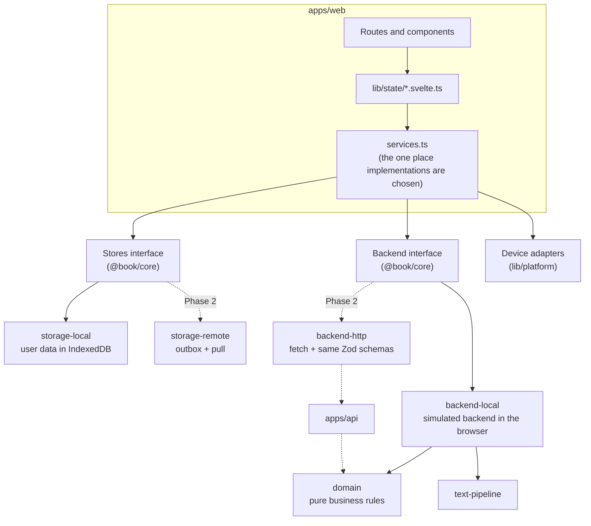
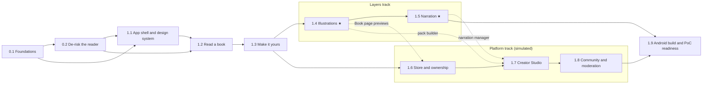

# Implementation plan: from groundwork to a product you can try

> **Status:** Accepted v1 · 11 October 2026 · Companion to [DESIGN.md](DESIGN.md) v0.3, which stays the source of truth.
> **Purpose:** the order of work that takes the repo from today's groundwork to a build the owner can use on desktop and on their Android phone to try every area of the product (reading, Illustrations, narration, notes, store, Creator Studio, community and moderation) with **no backend**, built so a real backend later replaces the simulated one without rewriting the app.
> **How it fits with DESIGN.md:** DESIGN.md §13 defines every task (its dependencies and acceptance criteria). This plan splits DESIGN.md's Phase 0 and Phase 1 into smaller phases that each end in something to try, and adds the architecture detail, UX notes and Try-it checklists. Decisions D-021 to D-024 (DESIGN.md §16) record what this plan changed. iOS work is in [BACKLOG.md](BACKLOG.md).

---

## 1. Summary

**Approach.** Build the core reading experience as DESIGN.md Phase 0 and Phase 1 describe. Alongside it, build a *simulated backend* that runs in the browser: a typed `Backend` interface in `@book/core`, implemented now by `@book/backend-local` (its own IndexedDB database, seeded demo data, simulated payments, a Persona switcher instead of sign-in) and in Phase 2 by an HTTP client for the real API. Shared contract tests prove both implementations behave the same. The business rules (Entitlements, Bundles, subscriptions, Flags, community policy) live in a pure `@book/domain` package that the Phase 2 API imports unchanged. The Store, Creator Studio, community and moderation areas can then be built and tried now, against the same interface the real backend will serve.

**Phases.** Each phase ends with a build the owner can open and try. Phases 0.x belong to DESIGN.md's Phase 0 and phases 1.x to its Phase 1, matching the task IDs (`P0-…`, `P1-…`). ★ marks the features that test the core bet (DESIGN.md §1.3).

| Phase | What the owner can try at the end | Tasks | Status |
|---|---|---|---|
| **0.1** Foundations | The app on desktop and on your Android phone; a dev panel with Personas and simulation controls | P0-01, P0-02, P0-03, P0-08, P0-09 | Not started |
| **0.2** De-risk the reader | *Alice* in both candidate reader engines side by side; a first narration demo with Word highlighting | P0-04 to P0-07, P0-10, P0-11 | Not started |
| **1.1** App shell and design system | Every area clickable with demo data; the whole app themed from one seed colour | P1-UI-01 to 03, P1-APP-01, P1-APP-02 | Not started |
| **1.2** Read a book | *Alice*, the status-window fixture and your own EPUBs, fully customisable, resuming at the same Word | P1-ING-01, P1-ING-02, P1-RDR-01 to 05, P1-RDR-08, P1-APP-03 | Not started |
| **1.3** Make it yours | Highlights, notes, Placed Bookmarks, export; an edited re-import keeps your notes | P1-RDR-06, P1-RDR-07, P1-ING-03, P1-APP-04 | Not started |
| **1.4** Illustrations ★ | All four Illustration modes with the Tenniel pack, plus a second pack | P1-LAY-01, P1-LAY-02, P1-LAY-06, P1-LAY-07 | Not started |
| **1.5** Narration ★ | Synced narration for chapters 1–3: highlighting, auto-turn, tap-to-seek, lock-screen playback | P1-LAY-03, P1-LAY-04 | Not started |
| **1.6** Store and ownership (simulated) | Browse, buy (simulated) and claim Books; Complete edition; Bookmark Designs; Tips; Creator Subscriptions with early-access Chapters | P1-STO-01 to 05 | Not started |
| **1.7** Creator Studio (simulated) | Upload and publish a Book, publish a new Revision, build an Illustration Pack, add narration, set up plans | P1-STU-01 to 04, P1-LAY-05 | Not started |
| **1.8** Community and moderation (simulated) | Submit, approve, endorse and rate community Layers; Flags and the admin review queue | P1-COM-01, P1-COM-02, P1-ADM-01, P1-ADM-02 | Not started |
| **1.9** Android build and PoC readiness | The Android app, a tester build, the PoC review kit | P1-MOB-01, P1-QA-01 to 03 | Not started |

After phase 1.3 the work splits into two tracks that can run in parallel or in either order: the **Layers track** (1.4, 1.5) and the **Platform track** (1.6, 1.7, 1.8). See §7.

**Fastest routes to something you can feel:** the phase 0.2 spike pages (first real reading and narration on your phone), phase 1.1 (the whole product's shape, clickable) and phase 1.2 (the first reader you'd use every day).

**Sizes** in the task tables: **S** ≈ a day or less, **M** ≈ 2–4 days, **L** ≈ 1–2 weeks of focused work for one developer working with coding agents. They are for ordering work, not a schedule.

---

## 2. Where the repo is today

| Area | State |
|---|---|
| Hosting | Private GitHub repo `totallynotkasai/book-webapp`; no CI yet |
| Workspace | npm workspaces, strict TypeScript, ESLint, Prettier, Vitest, static SvelteKit build (`adapter-static`, SPA fallback) |
| `@book/core` | The v0.1 model: `Locator` (CFI + paragraph + character offset), `TextRange`, `Bookmark`, `Annotation` with a `kind` field, `ReaderSettings` with `high-contrast`, `curl` and `overview`. Helpers are unit-tested. `Stores` covers bookmarks, annotations, progress and settings |
| `@book/storage-local` | IndexedDB v1 via `idb`, IDs from `crypto.randomUUID()`, tested with `fake-indexeddb` |
| `@book/tokens` | Four hand-written `--color-*` themes, `--touch-target: 44px`, `readerTokens()` |
| `apps/web` | A Library placeholder linking to `/read/sample`; a reader placeholder with a theme, font and size popover; the *Alice* EPUB in `static/books/`, not yet rendered |
| Not started | Import-boundary lint, Playwright, CI, Capacitor, ADRs, reader engine, text pipeline, design system, Layers, any backend seam beyond `Stores` |

---

## 3. Decisions

**Made on 11 October 2026** (recorded in DESIGN.md §16):

| ID | Decision |
|---|---|
| D-021 | The PoC includes simulated Store, Creator Studio, community and moderation areas, behind feature flags so the PoC review can still show testers only the reading experience |
| D-022 | A typed `Backend` interface with a browser implementation (`backend-local`), shared contract tests and business rules in `domain` (§4). Rejected: mocking HTTP with a service worker (MSW), which is unreliable inside iOS WKWebView and awkward for binary book and audio content; running the Hono API itself in the browser, which would commit to the Proposed stack (D-004) before the PoC review |
| D-023 | Demo content: 4–6 Standard Ebooks titles (CC0) as store filler with no Layers; Arthur Rackham's 1907 *Alice* illustrations (public domain) as the demo community pack; the status-window fixture grown into a short original demo serial of about 6 chapters by a seeded author, for trying early-access Chapters and Creator Subscriptions. If an agent writes the serial, it is labelled AI-generated in the seed, which also demonstrates the AI labels |
| D-024 | iOS builds and iOS device testing go to [BACKLOG.md](BACKLOG.md): the owner has no Mac to build with and no iPhone to test on. The PoC targets web and Android, tested on the owner's Android phone instead of an emulator. Code stays iOS-ready |

**Still to decide:**

| Decision | Recommendation | Decided by |
|---|---|---|
| Reader engine (OPEN-01) | Whichever wins the spike, including the owner's "feel" score | P0-04 |
| Word marking (OPEN-13) | Whichever wins the spike | P0-05 |
| Component approach (OPEN-02) | Evaluate `m3-svelte` first, fall back to Bits UI | P0-10 |
| Placeholder brand seed colour (does not resolve OPEN-07) | A deep teal, clearly marked as a placeholder; not M3 purple (DESIGN.md §11.2) | P1-UI-01 |
| How testers get the build | Web: a free static host (it serves files only; no backend). Android: Play Console internal testing or a direct APK. Testers with iPhones use the web build in Safari | P1-QA-03 |

---

## 4. Architecture: built so the backend plugs in

### 4.1 Three seams

The app reaches everything outside its own UI through three interfaces, all chosen in `apps/web/src/lib/services.ts`:

| Seam | For | PoC implementation | Phase 2 implementation |
|---|---|---|---|
| **`Stores`** (DESIGN.md §6.3) | User-owned, local-first records: imported Books, Annotations, Placed Bookmarks, Reading Progress, Reader Preferences, Layer selection | `storage-local` (IndexedDB) | `storage-remote`: wraps `storage-local` with an outbox and incremental pull |
| **`Backend`** (DESIGN.md §5.6) | Server-authoritative operations: catalogue, Entitlements, checkout, Tips and subscriptions, Layers, publishing, community, moderation, sessions | `backend-local`: a simulated backend in the browser | `backend-http`: `fetch` against `/v1`, same schemas |
| **Device adapters** (`lib/platform/`, DESIGN.md §9.7) | Audio, files, share, haptics, deep links | Web and Capacitor (Android) implementations | Unchanged; iOS added from the backlog |



### 4.2 The `Backend` interface

Defined in `packages/core/src/backend/` with a Zod schema for every input and output (DESIGN.md §10.1 already requires these schemas to live in `core`). Its modules mirror the planned API modules, so each Phase 2 route has a known caller:

| Module | What it does | Phase 2 equivalent (DESIGN.md §10.1) |
|---|---|---|
| `session` | Current user and role. In the PoC, `signInAs(personaId)` | Auth provider, `GET /v1/me` |
| `catalogue` | Shelves, search, Book pages, Creator profiles | `GET /v1/catalogue`, Book and Creator reads |
| `library` | The user's Entitlements grouped by Book; `claim(productId)` | `GET /v1/library`, `POST /v1/products/:id/claim` |
| `content` | `open(bookId)`: Entitlement check, then the Revision, Chapter access, available Layers and a loader for the Book's files | `POST /v1/books/:id/open`, `GET /v1/content/:token/*` |
| `checkout` | Quote and purchase Products, with idempotency keys | Stripe Checkout (Phase 4) |
| `support` | Tips, Creator Subscription plans, subscribe, cancel | Phase 4 |
| `layers` | Illustration Packs, Audio Tracks and Sync Maps for a Book; ratings | Phase 3 |
| `studio` | A Creator's Books, uploads, Revisions, ingest reports, publishing, packs, tracks, plans, earnings | `POST /v1/uploads`, `/v1/books/…` |
| `community` | Submissions, approvals, endorsements | Phase 5 |
| `moderation` | Reports, Flags, review queue, actions, action log | P2-MOD-01 |
| `events` | Change notifications (`entitlements`, `catalogue`, `studio`, …) so screens refresh | Sync pull, later push |

```ts
// packages/core/src/backend/backend.ts (sketch; finalised in P0-08)
export interface Backend {
  session: SessionApi;
  catalogue: CatalogueApi;
  library: LibraryApi;
  content: ContentApi;
  checkout: CheckoutApi;
  support: SupportApi;
  layers: LayersApi;
  studio: StudioApi;
  community: CommunityApi;
  moderation: ModerationApi;
  events: BackendEvents;
}

export interface LibraryApi {
  list(page?: PageRequest): Promise<Page<LibraryEntryDto>>; // { items, nextCursor }
  claim(productId: string, opts: { idempotencyKey: string }): Promise<EntitlementDto>;
}

export interface ContentApi {
  /** Checks Entitlements first; rejects with BackendError('ENTITLEMENT_REQUIRED'). */
  open(bookId: string): Promise<OpenBook>;
}

/** Codes are the §10.1 enum, so the UI handles local and remote failures the same way. */
export class BackendError extends Error {
  constructor(readonly code: ErrorCode, message: string, readonly details?: unknown) {
    super(message);
  }
}
```

`OpenBook` carries the Book's details plus a **loader** for its files. Locally the loader reads blobs from `backend-local`'s database; over HTTP it fetches under the content-token path prefix (DESIGN.md §10.3) and refreshes the token. `reader-core` only ever sees the loader, so the engine never knows where content came from (ADR-001 fixes the loader's exact shape; see P0-04 criterion 10).

### 4.3 `backend-local`: the simulated backend

- **Its own IndexedDB database** (`book-backend-local`), separate from the user's `Stores`. The app cannot read "server" tables by accident, "Reset demo data" just wipes it, and it can be deleted when the real backend arrives.
- **Seed data** in `fixtures/seed/` as versioned JSON, validated with Zod on load: Personas, Creators, Books, Products, Bundles, plans, packs, tracks, ratings, Flags. Files (EPUBs, images, audio) are served from `apps/web/static/demo/`. Catalogue EPUBs are processed with `text-pipeline` in a Web Worker on first open (the same code the Phase 2 worker will run) and cached.
- **Personas** replace sign-in: Reader (default), Author (owns the demo serial), Illustrator (a community Creator) and Moderator. User-owned `Stores` data is kept per Persona (`book-reader:<userId>`), which rehearses Phase 2's per-account data and the "keep my notes" upload on first sign-in.
- **Simulation controls**, set from the dev panel: latency (a random 150–400 ms by default in owner builds, so loading states are visible; 0 in tests), failure rate, offline, payment outcome (succeed, decline, fail), AI-detector verdict, and a **clock** that can be moved forward to try renewals, period ends and early-access windows.
- **Authorisation is enforced inside it**, not just hidden in the UI: a Studio call from a non-Creator Persona rejects with `FORBIDDEN`, as the Phase 2 API must (DESIGN.md §10.6).
- **Inputs and outputs are validated** against the Zod schemas in dev builds, so drift from the contract shows up immediately.
- **Lazy-loaded.** `services.ts` imports it dynamically and the seed is fetched as JSON, not bundled, to protect the reader route's JavaScript budget (DESIGN.md §12.3).
- **Simulations never resolve OPEN items quietly.** Where a rule isn't decided (revenue splits OPEN-08, early-access Chapters OPEN-10, subscription rules OPEN-11, age policy OPEN-12), `backend-local` uses an obviously placeholder value from one config file, marked `// SIMULATION:`, and the PR lists it.

### 4.4 Shared business rules (`packages/domain`)

Pure, unit-tested functions that decide outcomes, imported by `backend-local` now and by `apps/api` in Phase 2: Entitlement checks and Bundle expansion; subscription windows; price arithmetic in integer minor units plus currency (Invariant 17); revenue split calculation; community policy and `community_ai` checks (Invariant 19); default Layer selection (DESIGN.md §8.1); Flag rules and thresholds (§10.6). `domain` imports only `core`. Keeping these out of `backend-local` is what makes the backend a plug-in rather than a rewrite: Phase 2 adds HTTP routes and Postgres repositories around rules that already work.

### 4.5 Contract tests: the plug-in guarantee

`packages/contract-tests` (dev-only) exports `describeStoresContract(makeStores)` and `describeBackendContract(makeBackend)`. They cover every method's success path, error codes, paging, idempotency, authorisation, and Invariants 6, 15, 17 and 19. Today they run against `storage-local` and `backend-local`. In Phase 2 the same suites run against `storage-remote` and `backend-http` pointed at the Docker API. When they pass, swapping the line in `services.ts` is safe.

### 4.6 Rules that keep the plug-in cheap

1. UI code never imports `backend-local` or `storage-local`; only `services.ts` does (ESLint enforces it).
2. Everything is async and anything can fail: every screen designs loading, empty, error and offline states from the start (§8).
3. The UI sees DTOs, never `backend-local`'s internal records.
4. Errors are codes from the §10.1 enum, mapped to UI copy in one place.
5. Lists are paged as `{ items, nextCursor }`, and money mutations take an idempotency key, even though local doesn't need either yet.
6. Decisions live in `domain`, not in `backend-local` and never in components.
7. Content is reached through the `OpenBook` loader, never by assuming blob URLs.
8. Time comes from an injected clock.
9. IDs are UUIDv7 generated on the device; user records carry `createdAt`, `updatedAt` and `deletedAt` (DESIGN.md §6.3).
10. Code review asks: "Would this still work if this call crossed a network?"

### 4.7 What is real and what is simulated

| Area | Real in the PoC | Simulated until Phase 2+ |
|---|---|---|
| Reading, typography, layout, Reading Progress | All of it | — |
| EPUB import and processing | `text-pipeline`, the same code as the future worker | Runs in a Web Worker, not a job queue |
| Annotations, Placed Bookmarks, Revisions, re-anchoring | All of it | Anchor migration runs on the device when a Book opens |
| Illustrations and narration | Rendering, all modes, sync, playback | Sync Maps are made on the owner's PC with `tools/align` |
| Accounts | Roles and permission checks | A Persona switcher instead of sign-in |
| Ownership | Entitlement, Bundle and subscription rules | Stored in the simulated backend's database in the browser |
| Payments | Prices, currencies, idempotency, failure handling | No card entry and no money moves; outcomes are set in the dev panel |
| Tips and Creator Subscriptions | Flows and benefit rules | Renewals follow the dev clock |
| Publishing | Ingest report, Revisions, publish, `stale` Sync Maps | Files stay in the browser, not object storage |
| Moderation | Flag rules, queue, actions, action log | AI detection and image moderation are stubs driven from the dev panel |
| Other people | — | Ratings, followers and other readers' purchases come from seed data |
| Notifications | An in-app inbox | No email or push |

### 4.8 Phase 2: how the backend plugs in

1. `apps/api` (stack per D-004, confirmed at the PoC review) implements each `Backend` module's routes on top of `packages/domain` and `packages/db`.
2. `packages/backend-http` implements `Backend` with `fetch` and the same Zod schemas, and passes the contract suite against the Docker API.
3. `packages/storage-remote` wraps `storage-local` with the outbox and pull (DESIGN.md §6.3) and passes the Stores contract suite.
4. `session` switches from Personas to the auth provider; Personas remain for development and tests only.
5. `services.ts` swaps the implementations.
6. First sign-in offers to upload the device's library and reader data.
7. `apps/worker` reuses `text-pipeline`, `alignment` and `migrateAnchors` as they are.
8. `backend-local` stays for E2E tests and offline demos, or is deleted.

### 4.9 Package map after this plan

```
packages/
  core/            types, Anchors, Zod schemas, Stores + Backend interfaces, error codes
  domain/          NEW  pure business rules (backend-local now, apps/api in Phase 2)
  contract-tests/  NEW  shared suites for any Stores or Backend implementation (dev only)
  storage-local/   Stores in IndexedDB
  backend-local/   NEW  Backend in the browser: own database, seed, simulation controls
  tokens/  ui/  text-pipeline/  reader-core/  alignment/      (per DESIGN.md §5.3)
tools/             align, resolve-anchors, images (dev-only CLIs)
fixtures/          test EPUBs, images, audio download script, seed/ (demo catalogue), LICENSES.md
```

Dependency direction (ESLint-enforced, DESIGN.md §5.3): `apps/*` → `backend-local`, `storage-local` → `domain`, `text-pipeline` → `core`. `domain` imports only `core`. `contract-tests` imports `core` and Vitest. Nothing imports from `apps/*`.

---

## 5. Product map

### 5.1 Navigation

| Window size (DESIGN.md §11.5) | App navigation |
|---|---|
| Compact (< 600 px) | Bottom navigation bar |
| Medium and expanded (≥ 600 px) | Navigation rail |

Destinations: **Library · Store · Studio** (Creator Personas only) **· You** (profile, purchases, subscriptions, Bookmark Designs, Settings, data; Admin for moderators; the dev panel in owner builds). The reader is full screen with no app navigation. `/` opens the Library. Feature flags hide Store, Studio, community and Admin in tester builds.

### 5.2 Screen inventory

| Screen | Route | Who | Skeleton in | Fully working in |
|---|---|---|---|---|
| Library (Continue reading, owned and imported Books, Import) | `/library` | Everyone | 1.1 | 1.2 |
| Reader | `/read/[bookId]` | Everyone | exists | 1.2–1.5 |
| Store home and search | `/store` | Everyone | 1.1 | 1.6 |
| Book page | `/book/[slug]` | Everyone | 1.1 | 1.6 |
| Community hub for a Book | `/book/[slug]/community` | Everyone | — | 1.8 |
| Creator profile | `/creator/[handle]` | Everyone | 1.1 | 1.6 (Tip, Subscribe), 1.8 (follow) |
| Checkout | sheet over the current page | Reader | — | 1.6 |
| You: profile, purchases, subscriptions, Bookmark Designs, data | `/you/…` | Everyone | 1.1 | 1.3 (data), 1.6 |
| Settings: appearance, reading defaults, accessibility | `/you/settings` | Everyone | 1.1 | 1.1–1.2 |
| Studio dashboard | `/studio` | Creators | 1.1 | 1.7 |
| Studio Book: details, Revisions, ingest report, publish, policy | `/studio/books/[bookId]` | Author | — | 1.7 |
| Pack builder (reader in Creator mode) | `/read/[bookId]?mode=creator&pack=[packId]` | Creators | — | 1.7 |
| Narration manager and review | `/studio/tracks/[trackId]` | Creators | — | 1.7 |
| Curation for an Author's Books | `/studio/books/[bookId]/community` | Author | — | 1.8 |
| Admin review queue and Flag detail | `/admin`, `/admin/flags/[flagId]` | Moderator | 1.1 | 1.8 |
| Dev panel | `/dev` | Owner builds | 0.1 | 0.1 |

---

## 6. Phases

Every task follows AGENTS.md: one task ID per branch, DESIGN.md §12.5 Definition of Done, no OPEN item resolved quietly. **Dependencies and acceptance criteria for each task are in DESIGN.md §13.** A phase is done when its tasks are done, its **Try it** list passes as Playwright specs in Chromium and WebKit, and the owner has tried it on desktop and on their Android phone. Then tick its status in §1.

### Phase 0.1 — Foundations

**Goal:** the plumbing every later phase relies on. There's little to look at, but it makes everything after cheaper and keeps the backend seam honest from day one.

| ID | Task | Size |
|---|---|---|
| P0-01 | Tooling and CI: import-boundary lint, Playwright (Chromium + WebKit), `test:e2e`, GitHub Actions | M |
| P0-02 | Align groundwork with DESIGN.md Appendix B: Anchors, renamed models, `ReaderPreferences`, UUIDv7, `deletedAt`, IndexedDB v2 | M |
| P0-03 | Capacitor shell for Android; device adapters with stubs; builds install on the owner's phone | M |
| P0-08 | Backend seam: `Backend` interface, `domain`, `contract-tests`, `backend-local` skeleton with Personas, seed loader, simulation controls and clock | L |
| P0-09 | Dev panel, feature flags and the `owner` / `tester` build profiles | M |

**Testing on your Android phone.** Two routes, both set up in P0-03:
- **Browser:** the dev server runs with `--host`, so the phone's browser opens it over your Wi-Fi. Windows may ask once to allow it through the firewall.
- **App:** with Developer options and USB debugging (or Wireless debugging) on the phone, and Android Studio on the PC (it brings the Android SDK and a JDK), `npx cap run android` installs the build. While the phone is connected, Claude can install builds and read logs over `adb`, and Chrome's `chrome://inspect` debugs the app's WebView.

**Try it**
- Open the dev server in your phone's browser.
- Open `/dev` and switch between the Reader, Author, Illustrator and Moderator Personas.
- Set latency high and failure rate to 50%; watch the (still bare) Library cope.
- Install the Capacitor build on your phone.

### Phase 0.2 — De-risk the reader

**Goal:** answer the hard technical questions before building on them, and give the owner an early feel for the reading engine and synced narration. The spikes run in parallel (P0-05 follows P0-04).

| ID | Task | Size |
|---|---|---|
| P0-04 | Reader engine spike, foliate-js vs Readium ts-toolkit (OPEN-01), with a side-by-side page the owner scores for feel | L |
| P0-05 | Word-marking spike, spans vs offsets (OPEN-13) | M |
| P0-06 | Narration alignment spike, with a page that plays an aligned chapter with Word highlighting | M |
| P0-07 | Mobile capabilities spike on Android, including whether the OS can clear WebView storage | M |
| P0-10 | Component spike, `m3-svelte` vs Bits UI (OPEN-02) | S |
| P0-11 | Fixtures and demo content (D-023), with `fixtures/LICENSES.md` | M |

**Try it**
- On desktop and on your phone, open `/spike/reader`: switch engines, turn pages, change font size (does the same Word stay on screen?), select text, try spread and scroll. Say which one *feels* better; that goes into ADR-001.
- Open `/spike/narration` and listen to an aligned chapter while the Words highlight.

**Exit:** ADR-001 to ADR-005 accepted; D-015 to D-018 and OPEN-01, OPEN-02 and OPEN-13 updated in DESIGN.md; spike code deleted (DESIGN.md §13.1).

### Phase 1.1 — App shell and design system

**Goal:** a "walking skeleton": every area exists and can be clicked through with demo data, in the real design system, at every screen size. It tests the information architecture and the backend seam early, while the reader is being built.

| ID | Task | Size |
|---|---|---|
| P1-UI-01 | Theme generation and tokens from a seed colour, mode and contrast; self-hosted Nunito; placeholder seed | M |
| P1-UI-02 | Component set, built in the order screens need them | L |
| P1-UI-03 | App navigation (§5.1), responsive layout, Settings with theme customisation | M |
| P1-APP-01 | Skeleton screens backed by `backend-local`, with loading, empty, error and offline states | M |
| P1-APP-02 | State layer: `resource()` helper, refresh on `Backend.events`, error-code copy, snackbars | S |

**UX notes**
- The store skeleton uses real seed data (covers, prices, Creators), so density and proportions can be judged before buying works.
- Settings → Appearance: about 8 seed presets plus a custom colour, mode (system, light, dark), contrast (standard, medium, high), with a live preview of the app and a reading sample.
- No query library for now (TanStack Query can be reconsidered when `backend-http` arrives).

**Try it**
- Click through every area as each Persona, at desktop and phone sizes.
- Change the seed colour, mode and contrast; the whole app follows.
- Force slow, failing and offline states from the dev panel and judge how each screen copes.

### Phase 1.2 — Read a book

**Goal:** a reader the owner would use every day.

| ID | Task | Size |
|---|---|---|
| P1-ING-01 | `text-pipeline`: validate, sanitise, mark Blocks, tokenise, WordIds and Ordinals, word index, manifest | L |
| P1-RDR-01 | Engine adapter implementing `ReaderEngine`; Anchor ↔ Locator mapping | L |
| P1-RDR-02 | Reader shell and navigation, TOC, scrubber, "back" | L |
| P1-RDR-03 | Layout modes including `auto`; page turns | M |
| P1-RDR-04 | Reader Preferences UI, per-Book overrides, live apply, pinch-to-zoom | M |
| P1-RDR-05 | Reading Progress: save, resume, furthest position | S |
| P1-RDR-08 | Styled block theming | M |
| P1-ING-02 | Import EPUB on web and Android, in a Web Worker with progress and an import report | M |
| P1-APP-03 | Opening Books: catalogue Books through `Backend.content`, imported Books from `Stores.library`, one Library list | M |

**UX notes**
- **Chrome.** Top bar: back to Library, Chapter title, TOC, Aa (preferences), Placed Bookmark toggle. Bottom bar: scrubber with Chapter ticks, "Page X of Y in this chapter", previous and next. The chrome fades after the first page turn and returns on a centre tap or Esc. The Illustrations button (1.4) and narration play button (1.5) get their places now, so the layout doesn't shift later.
- **Preferences** open as a half-height bottom sheet on compact screens, so the text visibly re-flows behind it, and as a side sheet on expanded screens. Tabs: Text, Page, Theme. A "This book only" switch turns changes into per-Book overrides, with "Reset to my defaults".
- **"Back"** after a jump appears as a chip for about 10 seconds, or until the next jump.
- **Keyboard and screen readers:** `?` opens the shortcuts sheet; page and Chapter changes are announced through a live region.
- **Import** shows progress, then a plain-language report: "Imported *Title*: 23 chapters, 98,000 words. 2 images have no alt text."
- *Alice* is granted to every Persona at seed (Entitlement source `grant`), so it's always in the Library.

**Try it**
- Open *Alice* from the Library. Read in single, spread and scroll. Change font, size, spacing, margins and theme mid-chapter; the same Word stays on screen.
- Jump with the TOC and the scrubber, then use "back".
- Open the status-window fixture in light, dark and sepia at 200% text size.
- Import an EPUB from your own collection, on desktop and on your phone; import the same file again (nothing happens); import a broken file (a readable reason).
- Close the app and reopen it: you're at the same Word.

### Phase 1.3 — Make it yours

| ID | Task | Size |
|---|---|---|
| P1-RDR-06 | Selection toolbar, Annotations, notes panel, export | L |
| P1-RDR-07 | Placed Bookmarks with the default Bookmark Design | S |
| P1-ING-03 | Re-import as a new Revision; WordId carry-forward; `migrateAnchors` as a pure function the Studio and the Phase 2 worker reuse | L |
| P1-APP-04 | Data safety: persistent storage request, export everything, delete device data | S |

**UX notes**
- The selection toolbar floats above the selection (below it if there's no room) and never covers it; on touch it sits clear of the native handles (per ADR-004). The 5 colour swatches have names for screen readers.
- The notes panel is a side sheet on expanded screens and a full-screen sheet on compact ones, with tabs "Notes and highlights" and "Bookmarks", grouped by Chapter, filterable by colour, and an "Orphaned" section showing each item's quoted text.
- Placed Bookmarks show as a ribbon on the page edge; `B` toggles one on the current page; the label is optional.

**Try it**
- Highlight in each colour, add a note, copy, remove a highlight; use right-click on desktop and long-press on your phone.
- Filter the notes panel, jump to a note, edit it, delete it.
- Place three bookmarks, change the font size, and check they're still on the right text.
- Export notes as Markdown and open the file.
- Re-import an edited copy of *Alice* (one paragraph changed, one deleted): notes elsewhere are untouched, and the note on deleted text shows as orphaned.

### Phase 1.4 — Illustrations ★

| ID | Task | Size |
|---|---|---|
| P1-LAY-01 | Layer records and loader served by `Backend.layers`; `layerSelection` in Stores | M |
| P1-LAY-06 | Demo packs (Tenniel official, Rackham community) written as text quotes and resolved to Anchors by `tools/resolve-anchors`; WebP variants by `tools/images` | M |
| P1-LAY-02 | All four Illustration modes, current-Illustration rule, new-picture dot, first-use hint, lightbox | L |
| P1-LAY-07 | Layers menu in the reader: badges, AI labels, credits, enable, reorder, mode picker | S |

**UX notes**
- The picture button sits in the top-right corner of the page and **stays visible when the chrome hides**, because it's the showpiece. The dot appears when the current Illustration has changed since the last look.
- First-use hint: a one-off coach mark pointing at the button the first time a Book with Illustrations opens, gone for good once dismissed.
- The pop-up card closes on tap outside, the close button, Esc or swipe down. Swipe sideways between packs when several have a candidate.
- Per-page mode uses a left panel on medium and expanded screens; on compact, a strip above the text that collapses to a thumbnail.
- Crossfades are slow and gentle; instant under reduced motion.

**Try it**
- Open *Alice*: notice the hint, open the picture, close it, read on until the dot appears.
- Switch between pop-up, per-page, spread, in-text and off from the toolbar; your position stays put.
- Open the lightbox and zoom.
- Turn on the Rackham pack too, put it first, and swipe between packs.
- Jump far ahead with the scrubber, then back: nothing from ahead of you ever appears.

### Phase 1.5 — Narration ★

| ID | Task | Size |
|---|---|---|
| P1-LAY-03 | `tools/align` CLI and Sync Maps for chapters 1–3 of *Alice* (whisper.cpp and ffmpeg on the owner's Windows PC) | M |
| P1-LAY-04 | Narration player: highlighting, auto-turn, tap-to-seek, speed, background playback through the `lib/platform` audio adapter | L |

**UX notes**
- The play button lives in the bottom bar. Once narration starts, a mini-player docks above it (play/pause, ±15 s, speed) and expands into full controls (previous and next sentence, highlight granularity, auto-turn).
- Audio never starts by itself (Invariant 11). The first time narration plays in a Book, a one-line hint says "Tap any word to move the narration there."
- If the reader turns pages by hand while narration plays, auto-turn pauses and a "Back to narration" chip appears; following resumes when they tap it or when the narration reaches what's on screen (DESIGN.md §8.3).
- Chapters without a Sync Map show the play button disabled with a reason: "Narration covers chapters 1–3".

**Try it**
- Play chapter 1; watch the highlight follow and the pages turn by themselves; switch to 1.5×.
- Tap a Word to jump the audio; page ahead by hand, then use "Back to narration".
- Lock your phone and keep listening; use the lock-screen controls.

### Phase 1.6 — Store and ownership (simulated)

**Goal:** the "Steam for books" experience end to end, with simulated payments.

| ID | Task | Size |
|---|---|---|
| P1-STO-01 | Catalogue and Book page: shelves, search, Illustration previews, narration sample, AI labels, ratings and warnings, "Read sample" | M |
| P1-STO-02 | Products, Entitlements and Bundles: "Add to library", simulated checkout, Complete edition, purchases; content and Layers gated by Entitlements | L |
| P1-STO-03 | Bookmark Designs shop; a default design and a design per Placed Bookmark | S |
| P1-STO-04 | Tips and Creator Subscriptions, with early-access Chapters of the demo serial and renewals on the dev clock | L |
| P1-STO-05 | AI labels everywhere; "Hide AI-generated content" setting | S |

**UX notes**
- On the Book page the primary button is the Complete edition ("Get the complete edition · £X.XX", or "Add to library" when free), with "Book only" as the secondary choice. The Layers section shows what's included, so the Bundle explains itself (DESIGN.md §18, "too many purchase choices").
- Checkout is a sheet over the current page, labelled **Simulated**, with no card fields. Success says "Added to your library", with "Read now".
- Locked content always explains itself: a locked early-access Chapter says whose it is, when it becomes free, and offers "Subscribe". Never a dead end.
- Tip and Subscribe live on Creator profiles and next to the author's name on Book pages.

**Try it** (as the Reader Persona)
- Browse and search the store; open a Book page; preview Illustrations; play the narration sample; read a sample.
- Buy the Complete edition (simulated): Illustrations and narration are on when you open it. Buy another Book as "Book only": its Layers show as available to get.
- Set the payment outcome to "decline" in the dev panel and try again.
- Buy a Bookmark Design and use it in two Books.
- Tip the demo serial's author; subscribe; read an early-access Chapter; cancel; move the clock forward a month: the Chapter locks again but your purchases stay.
- Turn on "Hide AI-generated content".

### Phase 1.7 — Creator Studio (simulated)

**Goal:** the author's side: publish a Book, update it, give it Illustrations and narration, and set up support.

| ID | Task | Size |
|---|---|---|
| P1-STU-01 | Upload, ingest report, preview and publish; new Revisions with Anchor migration and `stale` Sync Maps | L |
| P1-STU-02 | Book settings: details, cover, price, rating and warnings, AI-use answer, community policy | M |
| P1-LAY-05 | Placement tool grown into the Studio pack builder (Creator mode in the reader) | L |
| P1-STU-03 | Narration manager: audio plus Sync Map per Chapter, coverage and status, review screen | M |
| P1-STU-04 | Subscription plans and a simulated earnings dashboard with placeholder revenue splits | M |

**UX notes**
- Studio dashboard: your Books (draft, processing, published), Flags and reports on them (1.8), earnings tiles (simulated), and suggested next steps ("Add illustrations to chapter 3").
- The ingest report is in plain language, with warnings grouped by severity and each linked to its place in the preview.
- Creator mode is the same reader with a visible "Creator mode" bar; the selection toolbar gains "Attach illustration"; selecting a placed Illustration shows its Anchor range. Images are re-encoded on the device to WebP, which strips EXIF data.
- Publishing is a deliberate step: "Publish revision" → a confirmation summarising what changed ("3 chapters changed; narration for chapter 2 needs re-alignment") → a "Published" snackbar.
- Stretch for P1-STU-03: align short Chapters in the browser with whisper.cpp's WebAssembly build instead of importing a Sync Map.

**Try it** (as the Author Persona)
- Upload an EPUB (a chapter of your own novel works; nothing leaves your device), read the report, preview, answer the AI question, publish.
- As the Reader, add it to your library and highlight something. As the Author, edit one paragraph and publish a new Revision. As the Reader, your highlight is still there.
- Attach three Illustrations in Creator mode and publish the pack; see them as the Reader.
- Import a Sync Map for a Chapter and step through its review screen.
- Create a subscription plan and find it on your Creator profile.

### Phase 1.8 — Community and moderation (simulated)

| ID | Task | Size |
|---|---|---|
| P1-COM-01 | Community submissions under each `community_policy` and `community_ai` setting | M |
| P1-COM-02 | Per-Book community hub and Creator profiles: rate, enable, endorse, follow | M |
| P1-ADM-01 | Flag rules in `domain`, a stub AI detector and the held-for-review state | M |
| P1-ADM-02 | Reports, admin review queue, actions and action log; author curation view | L |

**Try it**
- As the Illustrator, submit a pack for the demo serial (policy `approval`). As the Author, approve and endorse it. As the Reader, enable it, rate it, and see the endorsed badge.
- As the Author, set the serial to `closed`; the Illustrator can no longer submit.
- As the Reader, report a community pack. As the Moderator, work the queue: require relabelling, then approve.
- Set the AI detector to "suspect" in the dev panel, upload an unlabelled pack as the Illustrator, and see it held for review.
- Use the dev panel's bulk-upload helper as the Author and watch `upload_volume` fire.

### Phase 1.9 — Android build and PoC readiness

| ID | Task | Size |
|---|---|---|
| P1-MOB-01 | Android build of everything above; icons and splash screen; `docs/device-checklist.md` | M |
| P1-QA-01 | Performance pass against DESIGN.md §12.3 on your phone (with CPU throttling if it's much faster than the reference class) | M |
| P1-QA-02 | Accessibility pass: axe on every route, TalkBack walkthrough, keyboard map, reduced-motion audit | M |
| P1-QA-03 | Tester build (`tester` profile, first-run welcome), static web deploy, Android internal testing, `docs/poc-review.md` | M |

**Exit:** DESIGN.md's Phase 1 exit flows pass, automatically on web and by hand on your Android phone; the owner runs the PoC review (DESIGN.md §13.3).

---

## 7. Dependencies and parallel tracks



- **Within 0.1–0.2:** P0-03, P0-06, P0-10 and P0-11 can start as soon as P0-01 lands; P0-08 runs alongside the spikes.
- **Within 0.2–1.1:** the design-system work (P1-UI-01, P1-APP-02) needs no spike result except P0-10, so the app shell grows while the reader is being de-risked.
- **After 1.3:** the dotted links are soft. Phase 1.6 can start before 1.4 (Book pages show Illustration previews once 1.4 lands), but the pack builder and narration manager in 1.7 need 1.4 and 1.5 respectively.
- **If time runs short before the PoC review:** drop 1.8 first, then 1.7. Phases 0.1–1.5 and 1.9 are the PoC DESIGN.md requires.

---

## 8. UX standards for every screen

1. **Five states, designed up front:** loading (skeletons appear only after about 300 ms, so fast responses don't flicker), empty (says what to do next, DESIGN.md §11.6), error (what happened, how to fix it, a retry), offline (what still works), and success.
2. **Local-first writes are instant.** Annotations, bookmarks, progress and preferences never wait on anything. Backend actions show a pending state on the control itself and confirm with a snackbar that keeps the action's name ("Add to library" → "Added to library").
3. **Simulated means labelled.** Checkout, Tips, subscriptions and earnings carry a visible "Simulated" marker, so neither the owner nor testers mistake them for real money.
4. **Responsive by window class**, checked at 360, 600, 840 and 1280 px wide: bottom sheets on compact screens, side sheets or dialogs on expanded ones; navigation bar vs rail; nothing depends on hover; safe-area insets respected.
5. **Calm reader, expressive app** (DESIGN.md §11.1): the reading surface stays quiet and its chrome fades; personality lives in the app layer and the Illustration panel.
6. **Accessibility floor** (DESIGN.md §11.7): 48 px targets, visible focus, full keyboard use, labelled controls, live-region announcements, reduced motion makes every transition instant.
7. **Copy** (DESIGN.md §11.6): sentence case, readers' words ("Narration", "Illustrations", "Bookmarks"), errors that explain without apologising.

---

## 9. Testing and quality

| Layer | From phase | Covers |
|---|---|---|
| Unit (Vitest) | 0.1 | `core`, `domain` rules, theme generation, `text-pipeline`, `alignment`, `reader-core` mapping |
| Contract | 0.1 | Every `Stores` and `Backend` implementation (local now, remote in Phase 2) |
| Golden files | 1.2 | Ingestion: fixture EPUB → XHTML, word index and manifest |
| Component (@testing-library/svelte) | 1.1 | `ui` components and reader components: keyboard, focus, reduced motion |
| End to end (Playwright, Chromium + WebKit) | 0.1 (smoke) | One spec per phase's Try-it list; DESIGN.md's Phase 1 exit flows. WebKit is also the only stand-in for iOS until the backlog item is picked up |
| Accessibility | 1.1 | axe on every route; TalkBack and a desktop screen reader walkthrough in 1.9 |
| Device | 0.1 | The owner's Android phone, per `docs/device-checklist.md` from 1.9; iPhone checks are in the backlog |

E2E tests run `backend-local` with zero latency, no injected failures and a fixed clock, plus dedicated specs that switch failures on to check the error states.

---

## 10. Risks specific to this plan

| Risk | Mitigation |
|---|---|
| Simulated areas take time from the core bet | The Platform track starts only after 1.3; each simulated task is a thin vertical slice (main path and main errors, no edge-case polish); 1.8 and then 1.7 can be dropped before the PoC review |
| The simulation drifts from what a real backend can do (instant cross-user effects, client-side secrets, unchecked permissions) | Contract tests; rules in `domain`; `backend-local` keeps its own database and enforces permissions; the "would this work over a network?" review question |
| Testers mistake simulated purchases for real ones | "Simulated" labels, no card fields, and the tester profile can hide the store entirely |
| Neither reader engine passes the spike | DESIGN.md's fallback (a minimal in-house CSS-columns paginator); 1.1 and the backend seam continue meanwhile |
| iOS problems surface late (D-024) | Playwright WebKit on every PR; feature code uses only `lib/platform` adapters; testers with iPhones use the web build in Safari during the PoC review; [BACKLOG.md](BACKLOG.md) lists what to verify |
| The owner's phone is faster than the reference device, hiding performance problems | Budgets are also checked with Chrome's CPU throttling (P1-QA-01) |
| Browser or WebView storage is cleared and testers lose notes | P1-APP-04 (persistent storage, export); P0-07 checks the WebView case |
| Demo content licensing | Public domain and CC0 sources only, each recorded in `fixtures/LICENSES.md` |
| Personas tangle user data | Stores data is kept per Persona and the app reloads on switch |

---

## 11. Keeping this plan and DESIGN.md in step

- DESIGN.md §13 defines tasks; this plan orders them. A new task gets its ID and acceptance criteria in DESIGN.md first, then a row here.
- When a phase is done, set its status in §1 and note anything learned that changes a later phase.
- Decisions go in DESIGN.md §16, never only here.
- Deferred work goes in [BACKLOG.md](BACKLOG.md) with the trigger that would bring it back.
