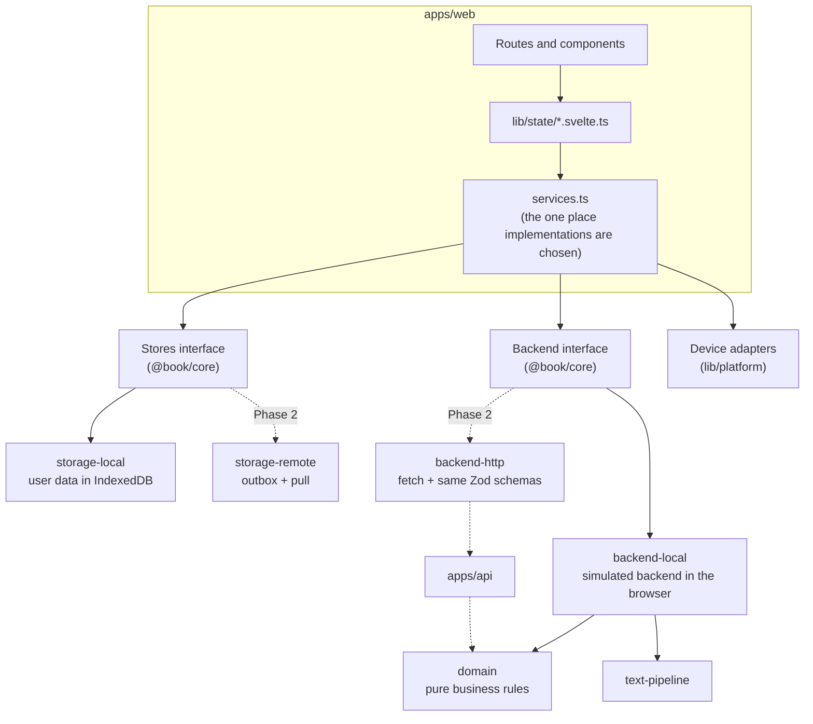
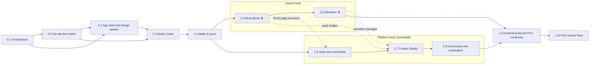
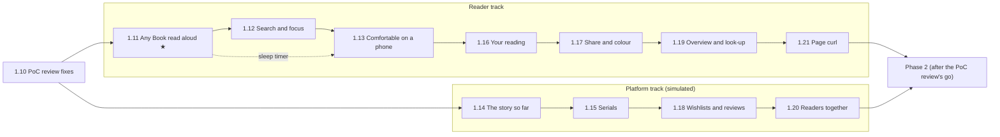
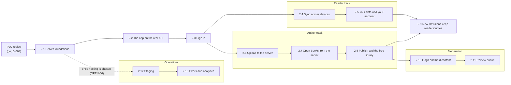

# Implementation plan: from groundwork to a product you can try

> **Status:** Accepted v1 · 11 October 2026 · v1.1 · 13 October 2026: Phase 2 split into phases 2.1–2.13 (D-032) · v1.2 · 16 October 2026: Phase 1.10 PoC review fixes (D-033) · v1.3 · 16 October 2026: front end first, phases 1.11–1.21 before any backend (D-035) · v1.4 · 16 October 2026: Phase 1.11 done; the device voice (D-036, ADR-006) · v1.5 · 16 October 2026: Phase 1.12 done; search and focus mode · v1.6 · 16 October 2026: Phase 1.13 done; the table viewer, the sleep timer and the phone's top bar (D-037) · Companion to [DESIGN.md](DESIGN.md) v0.3, which stays the source of truth.
> **Purpose:** the order of work that takes the repo from today's groundwork to a build the owner can use on desktop and on their Android phone to try every area of the product (reading, Illustrations, narration, notes, store, Creator Studio, community and moderation) with **no backend**, built so a real backend later replaces the simulated one without rewriting the app. Then, in phases 2.1–2.13, the real backend: accounts, sync across devices, author publishing and a free library.
> **How it fits with DESIGN.md:** DESIGN.md §13 defines every task (its dependencies and acceptance criteria). This plan splits DESIGN.md's Phases 0, 1 and 2 into smaller phases that each end in something to try, and adds the architecture detail, UX notes and Try-it checklists. Decisions D-021 to D-024 and D-032 (DESIGN.md §16) record what this plan changed. iOS work is in [BACKLOG.md](BACKLOG.md).

---

## 1. Summary

**Approach.** Build the core reading experience as DESIGN.md Phase 0 and Phase 1 describe. Alongside it, build a *simulated backend* that runs in the browser: a typed `Backend` interface in `@book/core`, implemented now by `@book/backend-local` (its own IndexedDB database, seeded demo data, simulated payments, a Persona switcher instead of sign-in) and in Phase 2 by an HTTP client for the real API. Shared contract tests prove both implementations behave the same. The business rules (Entitlements, Bundles, subscriptions, Flags, community policy) live in a pure `@book/domain` package that the Phase 2 API imports unchanged. The Store, Creator Studio, community and moderation areas can then be built and tried now, against the same interface the real backend will serve.

**Phases.** Each phase ends with a build the owner can open and try. Phases 0.x belong to DESIGN.md's Phase 0, phases 1.x to its Phase 1 and phases 2.x to its Phase 2, matching the task IDs (`P0-…`, `P1-…`, `P2-…`). ★ marks the features that test the core bet (DESIGN.md §1.3).

| Phase | What the owner can try at the end | Tasks | Status |
|---|---|---|---|
| **0.1** Foundations | The app on desktop and on your Android phone; a dev panel with Personas and simulation controls | P0-01, P0-02, P0-03, P0-08, P0-09 | Done (11 Oct 2026; notes in §6) |
| **0.2** De-risk the reader | *Alice* in both candidate reader engines side by side; a first narration demo with Word highlighting | P0-04 to P0-07, P0-10, P0-11 | Done: ADRs accepted by the owner on 12 Oct 2026; spike code deleted in 1.1 (notes in §6) |
| **1.1** App shell and design system | Every area clickable with demo data; the whole app themed from one seed colour | P1-UI-01 to 03, P1-APP-01, P1-APP-02 | Done (12 Oct 2026; notes in §6) |
| **1.2** Read a book | *Alice*, the status-window fixture and your own EPUBs, fully customisable, resuming at the same Word | P1-ING-01, P1-ING-02, P1-RDR-01 to 05, P1-RDR-08, P1-APP-03 | Done (12 Oct 2026; notes in §6) |
| **1.3** Make it yours | Highlights, notes, Placed Bookmarks, export; an edited re-import keeps your notes | P1-RDR-06, P1-RDR-07, P1-ING-03, P1-APP-04 | Done (12 Oct 2026; notes in §6) |
| **1.4** Illustrations ★ | All four Illustration modes with the Tenniel pack, plus a second pack | P1-LAY-01, P1-LAY-02, P1-LAY-06, P1-LAY-07 | Done (12 Oct 2026; notes in §6) |
| **1.5** Narration ★ | Synced narration for chapters 1–3: highlighting, auto-turn, tap-to-seek, lock-screen playback | P1-LAY-03, P1-LAY-04 | Done (12 Oct 2026; notes in §6) |
| **1.6** Store and ownership (simulated) | Browse, buy (simulated) and claim Books; Complete edition; Bookmark Designs; Tips; Creator Subscriptions with early-access Chapters | P1-STO-01 to 05 | Done (13 Oct 2026; notes in §6) |
| **1.7** Creator Studio (simulated) | Upload and publish a Book, publish a new Revision, build an Illustration Pack, add narration, set up plans | P1-STU-01 to 04, P1-LAY-05 | Done (13 Oct 2026; notes in §6) |
| **1.8** Community and moderation (simulated) | Submit, approve, endorse and rate community Layers; Flags and the admin review queue | P1-COM-01, P1-COM-02, P1-ADM-01, P1-ADM-02 | Done (13 Oct 2026; notes in §6) |
| **1.9** Android build and PoC readiness | The Android app, a tester build, the PoC review kit | P1-MOB-01, P1-QA-01 to 03 | Done (13 Oct 2026; notes in §6) |
| **1.10** PoC review fixes | Any Book you open for the first time starts at its text, not its licence or contents page | P1-RDR-09 | Done (16 Oct 2026; notes in §6) |
| **1.11** Any Book read aloud ★ | Every Book read aloud by the device’s own voice, with the narration’s highlighting and page turns | P1-LAY-08 | Done (16 Oct 2026; notes in §6) |
| **1.12** Search and focus | Search inside a Book and jump to a result; focus mode | P1-RDR-10, P1-RDR-11 | Done (16 Oct 2026; notes in §6) |
| **1.13** Comfortable on a phone | Squeezed tables open full screen; a sleep timer for listening | P1-RDR-12, P1-LAY-09 | Done (16 Oct 2026; notes in §6) |
| **1.14** The story so far (simulated) | Authors write recaps and a glossary; readers see only what they’ve reached | P1-STU-05, P1-RDR-13 | Not started |
| **1.15** Serials (simulated) | Scheduled Chapter releases with follower messages; align your own narration | P1-STU-06, P1-STU-07 | Not started |
| **1.16** Your reading | Time left in the Chapter and the Book; stats and streaks you can switch off | P1-RDR-14, P1-RDR-15 | Not started |
| **1.17** Share and colour | Share a quote as a card; your own page and text colours | P1-RDR-16, P1-UI-04 | Not started |
| **1.18** Wishlists and reviews (simulated) | A wishlist with sale alerts; reviews that show how far the reviewer read | P1-STO-06, P1-STO-07 | Not started |
| **1.19** Overview and look-up | Page thumbnails to scan a Chapter; look up a Word | P1-RDR-17, P1-RDR-18 | Not started |
| **1.20** Readers together (simulated) | Paragraph comments and popular highlights, both off by default | P1-COM-03, P1-COM-04 | Not started |
| **1.21** Page curl | A realistic page curl as an optional page turn | P1-RDR-19 | Not started |
| **2.1** Server foundations | Postgres, object storage, the API and the worker running on your PC from one command | P2-OPS-01 | Not started |
| **2.2** The app on the real API | The app talking to the API on your PC; what the API doesn't serve yet is hidden | P2-APP-01 | Not started |
| **2.3** Sign in | Real accounts: an email link or Google, on desktop and in the Android app | P2-AUTH-01 | Not started |
| **2.4** Sync across devices | A note made on one device appears on the other; "You were further ahead on another device" | P2-SYNC-01, P2-RDR-01 | Not started |
| **2.5** Your data and your account | Your PoC notes kept on first sign-in; export your data; delete your account | P2-SYNC-02, P2-ACC-01 | Not started |
| **2.6** Upload to the server | An EPUB uploaded in the Studio, processed by the worker, with its ingest report | P2-ING-01 | Not started |
| **2.7** Open Books from the server | Your upload previewed in the reader, served through content tokens | P2-CAT-02, P2-CAT-03 | Not started |
| **2.8** Publish and the free library | Publish a Book; as a reader, find it, add it to your library and read it anywhere | P2-CAT-01, P2-CAT-04 | Not started |
| **2.9** New Revisions keep readers' notes | DESIGN.md's Phase 2 exit flow, end to end | P2-ING-02 | Not started |
| **2.10** Flags and held content | AI labels and Flag rules on real uploads; unlabelled bursts held for review | P2-MOD-01 | Not started |
| **2.11** Review queue | Reports, the moderators' queue and action log, outcomes in the creator's inbox | P2-MOD-02 | Not started |
| **2.12** Staging | The app on the internet: `main` deploys to staging; your phone on mobile data | P2-OPS-02 | Not started |
| **2.13** Errors and analytics | Errors reported without personal data; documented, cookie-less analytics | P2-OPS-03 | Not started |

After phase 1.3 the work splits into two tracks that can run in parallel or in either order: the **Layers track** (1.4, 1.5) and the **Platform track** (1.6, 1.7, 1.8). Phase 1.10 collects small frontend fixes for the PoC review from [BACKLOG.md](BACKLOG.md) (D-033); it runs against the simulated backend, so it can go on while Phase 2 waits for its go decision. **Then the front end comes first (D-035):** phases 1.11–1.21 bring forward every front-end feature worth building without a real backend, and Phase 2 starts only after them (or those the owner keeps after the PoC review) and the review’s go decision. They split into a **Reader track** (1.11–1.13, 1.16, 1.17, 1.19, 1.21) and a **Platform track** (1.14, 1.15, 1.18, 1.20) that can run in parallel. After phase 2.3 it splits again: the **Reader track** (2.4, 2.5) and the **Author track** (2.6–2.8) meet in 2.9; **Moderation** (2.10, 2.11) follows the Author track; **Operations** (2.12, 2.13) can start any time after 2.1 once hosting is chosen. See §7.

**Phase 2's phases are smaller than Phase 1's.** Each Phase 1 phase was one working session of 4,000–10,000 changed lines, which proved too much for one session. Each Phase 2 phase is about one **L** task or two **M** tasks, roughly half that; if a phase still looks bigger when it starts, split it again before starting (D-032).

**Fastest routes to something you can feel:** the phase 0.2 spike pages (first real reading and narration on your phone), phase 1.1 (the whole product's shape, clickable) and phase 1.2 (the first reader you'd use every day).

**Sizes** in the task tables: **S** ≈ a day or less, **M** ≈ 2–4 days, **L** ≈ 1–2 weeks of focused work for one developer working with coding agents. They are for ordering work, not a schedule.

---

## 2. Where the repo is today

| Area | State |
|---|---|
| Hosting | Private GitHub repo `totallynotkasai/book-webapp`; no CI yet |
| Workspace | npm workspaces, strict TypeScript, ESLint, Prettier, Vitest, static SvelteKit build (`adapter-static`, SPA fallback) |
| `@book/core` | The v0.1 model: `Locator` (CFI + paragraph + character offset), `TextRange`, `Bookmark`, `Annotation` with a `kind` field, `ReaderSettings` with `high-contrast`, `curl` and `overview`. Helpers are unit-tested. `Stores` covers bookmarks, annotations, progress and settings |
| `@book/storage-local` | IndexedDB v1 via `idb`, IDs from `crypto.randomUUID()`, tested with `fake-indexeddb` |
| `@book/tokens` | Four hand-written `--color-*` themes, `--touch-target: 44px`, `readerTokens()` |
| `apps/web` | A Library placeholder linking to `/read/sample`; a reader placeholder with a theme, font and size popover; the *Alice* EPUB in `static/books/`, not yet rendered |
| Not started | Import-boundary lint, Playwright, CI, Capacitor, ADRs, reader engine, text pipeline, design system, Layers, any backend seam beyond `Stores` |

---

## 3. Decisions

**Made on 11 October 2026** (recorded in DESIGN.md §16):

| ID | Decision |
|---|---|
| D-021 | The PoC includes simulated Store, Creator Studio, community and moderation areas, behind feature flags so the PoC review can still show testers only the reading experience |
| D-022 | A typed `Backend` interface with a browser implementation (`backend-local`), shared contract tests and business rules in `domain` (§4). Rejected: mocking HTTP with a service worker (MSW), which is unreliable inside iOS WKWebView and awkward for binary book and audio content; running the Hono API itself in the browser, which would commit to the Proposed stack (D-004) before the PoC review |
| D-023 | Demo content: 4–6 Standard Ebooks titles (CC0) as store filler with no Layers; Arthur Rackham's 1907 *Alice* illustrations (public domain) as the demo community pack; the status-window fixture grown into a short original demo serial of about 6 chapters by a seeded author, for trying early-access Chapters and Creator Subscriptions. If an agent writes the serial, it is labelled AI-generated in the seed, which also demonstrates the AI labels |
| D-024 | iOS builds and iOS device testing go to [BACKLOG.md](BACKLOG.md): the owner has no Mac to build with and no iPhone to test on. The PoC targets web and Android, tested on the owner's Android phone instead of an emulator. Code stays iOS-ready |

**Still to decide:**

| Decision | Recommendation | Decided by |
|---|---|---|
| Reader engine (OPEN-01) | *Decided 12 Oct 2026: foliate-js (ADR-001, D-015)* | P0-04 |
| Word marking (OPEN-13) | *Decided 12 Oct 2026: Block offsets (ADR-002, D-016)* | P0-05 |
| Component approach (OPEN-02) | *Decided 12 Oct 2026: our own on Bits UI (ADR-005)* | P0-10 |
| Deterministic tokenisation (OPEN-14) | *Decided 12 Oct 2026: our own versioned tokeniser (D-026)* | P1-ING-01 |
| Placeholder brand seed colour (does not resolve OPEN-07) | *Decided 12 Oct 2026 (owner): deep teal `#00696B`*, in `PLACEHOLDER_SEED` in `packages/tokens` | P1-UI-01 |
| The device voice's voices, and where it stands in for narration (P1-LAY-08) | *Decided 16 Oct 2026 (owner): on-device voices only, so the text never leaves the device; offered wherever the reader can't play narration, including narration they don't own (D-036)* | P1-LAY-08 |
| How testers get the build | *Decided 13 Oct 2026 (owner): the web build on GitHub Pages, deployed with the built-in token only and kept host-agnostic (D-029); Android as a direct APK signed with a committed PoC-only key (D-030); one tester build, with facilitator links adding simulated areas per device (D-031). Testers with iPhones use the web build in Safari* | P1-QA-03 |

**To decide for Phase 2** (none of these is decided by this plan):

| Decision | Recommendation | Decided by |
|---|---|---|
| Go on Phase 2, and the backend stack (D-004, *Proposed*) | — | The PoC review (DESIGN.md §13.3), before 2.1 |
| Hosting for the API and worker (OPEN-06) | — | The PoC review; needed by 2.12 only |
| What a build on the real API does with areas the API doesn't serve until Phases 3–5 (Illustrations and narration, payments, community) | Hide them, as flagged-off areas are hidden now; owner builds can still choose the simulated backend to try them | P2-APP-01 |
| Reading without an account | Reading and importing need no account, as in the PoC; the store, the Studio and sync do | P2-AUTH-01 |
| Do imported Books sync between devices? (OPEN-15) | Their notes, bookmarks and progress sync; the EPUB file stays on the device that imported it, so on another device the reader imports the same file and their notes appear | P2-SYNC-01 |
| AI-detection services and thresholds (the rest of OPEN-09) | — | P2-MOD-01 |

---

## 4. Architecture: built so the backend plugs in

### 4.1 Three seams

The app reaches everything outside its own UI through three interfaces, all chosen in `apps/web/src/lib/services.ts`:

| Seam | For | PoC implementation | Phase 2 implementation |
|---|---|---|---|
| **`Stores`** (DESIGN.md §6.3) | User-owned, local-first records: imported Books, Annotations, Placed Bookmarks, Reading Progress, Reader Preferences, Layer selection | `storage-local` (IndexedDB) | `storage-remote`: wraps `storage-local` with an outbox and incremental pull |
| **`Backend`** (DESIGN.md §5.6) | Server-authoritative operations: catalogue, Entitlements, checkout, Tips and subscriptions, Layers, publishing, community, moderation, sessions | `backend-local`: a simulated backend in the browser | `backend-http`: `fetch` against `/v1`, same schemas |
| **Device adapters** (`lib/platform/`, DESIGN.md §9.7) | Audio, files, share, haptics, deep links | Web and Capacitor (Android) implementations | Unchanged; iOS added from the backlog |



### 4.2 The `Backend` interface

Defined in `packages/core/src/backend/` with a Zod schema for every input and output (DESIGN.md §10.1 already requires these schemas to live in `core`). Its modules mirror the planned API modules, so each Phase 2 route has a known caller:

| Module | What it does | Phase 2 equivalent (DESIGN.md §10.1) |
|---|---|---|
| `session` | Current user and role. In the PoC, `signInAs(personaId)` | Auth provider, `GET /v1/me` |
| `catalogue` | Shelves, search, Book pages, Creator profiles | `GET /v1/catalogue`, Book and Creator reads |
| `library` | The user's Entitlements grouped by Book; `claim(productId)` | `GET /v1/library`, `POST /v1/products/:id/claim` |
| `content` | `open(bookId)`: Entitlement check, then the Revision, Chapter access, available Layers and a loader for the Book's files | `POST /v1/books/:id/open`, `GET /v1/content/:token/*` |
| `checkout` | Quote and purchase Products, with idempotency keys | Stripe Checkout (Phase 4) |
| `support` | Tips, Creator Subscription plans, subscribe, cancel | Phase 4 |
| `layers` | Illustration Packs, Audio Tracks and Sync Maps for a Book; ratings | Phase 3 |
| `studio` | A Creator's Books, uploads, Revisions, ingest reports, publishing, packs, tracks, plans, earnings | `POST /v1/uploads`, `/v1/books/…` |
| `community` | Submissions, approvals, endorsements | Phase 5 |
| `moderation` | Reports, Flags, review queue, actions, action log | P2-MOD-01 |
| `events` | Change notifications (`entitlements`, `catalogue`, `studio`, …) so screens refresh | Sync pull, later push |

```ts
// packages/core/src/backend/backend.ts (sketch; finalised in P0-08)
export interface Backend {
  session: SessionApi;
  catalogue: CatalogueApi;
  library: LibraryApi;
  content: ContentApi;
  checkout: CheckoutApi;
  support: SupportApi;
  layers: LayersApi;
  studio: StudioApi;
  community: CommunityApi;
  moderation: ModerationApi;
  events: BackendEvents;
}

export interface LibraryApi {
  list(page?: PageRequest): Promise<Page<LibraryEntryDto>>; // { items, nextCursor }
  claim(productId: string, opts: { idempotencyKey: string }): Promise<EntitlementDto>;
}

export interface ContentApi {
  /** Checks Entitlements first; rejects with BackendError('ENTITLEMENT_REQUIRED'). */
  open(bookId: string): Promise<OpenBook>;
}

/** Codes are the §10.1 enum, so the UI handles local and remote failures the same way. */
export class BackendError extends Error {
  constructor(readonly code: ErrorCode, message: string, readonly details?: unknown) {
    super(message);
  }
}
```

`OpenBook` carries the Book's details plus a **loader** for its files. Locally the loader reads blobs from `backend-local`'s database; over HTTP it fetches under the content-token path prefix (DESIGN.md §10.3) and refreshes the token. `reader-core` only ever sees the loader, so the engine never knows where content came from (ADR-001 fixes the loader's exact shape; see P0-04 criterion 10).

### 4.3 `backend-local`: the simulated backend

- **Its own IndexedDB database** (`book-backend-local`), separate from the user's `Stores`. The app cannot read "server" tables by accident, "Reset demo data" just wipes it, and it can be deleted when the real backend arrives.
- **Seed data** in `fixtures/seed/` as versioned JSON, validated with Zod on load: Personas, Creators, Books, Products, Bundles, plans, packs, tracks, ratings, Flags. Files (EPUBs, images, audio) are served from `apps/web/static/demo/`. Catalogue EPUBs are processed with `text-pipeline` in a Web Worker on first open (the same code the Phase 2 worker will run) and cached.
- **Personas** replace sign-in: Reader (default), Author (owns the demo serial), Illustrator (a community Creator) and Moderator. User-owned `Stores` data is kept per Persona (`book-reader:<userId>`), which rehearses Phase 2's per-account data and the "keep my notes" upload on first sign-in.
- **Simulation controls**, set from the dev panel: latency (a random 150–400 ms by default in owner builds, so loading states are visible; 0 in tests), failure rate, offline, payment outcome (succeed, decline, fail), AI-detector verdict, and a **clock** that can be moved forward to try renewals, period ends and early-access windows.
- **Authorisation is enforced inside it**, not just hidden in the UI: a Studio call from a non-Creator Persona rejects with `FORBIDDEN`, as the Phase 2 API must (DESIGN.md §10.6).
- **Inputs and outputs are validated** against the Zod schemas in dev builds, so drift from the contract shows up immediately.
- **Lazy-loaded.** `services.ts` imports it dynamically and the seed is fetched as JSON, not bundled, to protect the reader route's JavaScript budget (DESIGN.md §12.3).
- **Simulations never resolve OPEN items quietly.** Where a rule isn't decided (revenue splits OPEN-08, early-access Chapters OPEN-10, subscription rules OPEN-11, age policy OPEN-12), `backend-local` uses an obviously placeholder value from one config file, marked `// SIMULATION:`, and the PR lists it.

### 4.4 Shared business rules (`packages/domain`)

Pure, unit-tested functions that decide outcomes, imported by `backend-local` now and by `apps/api` in Phase 2: Entitlement checks and Bundle expansion; subscription windows; price arithmetic in integer minor units plus currency (Invariant 17); revenue split calculation; community policy and `community_ai` checks (Invariant 19); default Layer selection (DESIGN.md §8.1); Flag rules and thresholds (§10.6). `domain` imports only `core`. Keeping these out of `backend-local` is what makes the backend a plug-in rather than a rewrite: Phase 2 adds HTTP routes and Postgres repositories around rules that already work.

### 4.5 Contract tests: the plug-in guarantee

`packages/contract-tests` (dev-only) exports `describeStoresContract(makeStores)` and `describeBackendContract(makeBackend)`. They cover every method's success path, error codes, paging, idempotency, authorisation, and Invariants 6, 15, 17 and 19. Today they run against `storage-local` and `backend-local`. In Phase 2 the same suites run against `storage-remote` and `backend-http` pointed at the Docker API. When they pass, swapping the line in `services.ts` is safe.

### 4.6 Rules that keep the plug-in cheap

1. UI code never imports `backend-local` or `storage-local`; only `services.ts` does (ESLint enforces it).
2. Everything is async and anything can fail: every screen designs loading, empty, error and offline states from the start (§8).
3. The UI sees DTOs, never `backend-local`'s internal records.
4. Errors are codes from the §10.1 enum, mapped to UI copy in one place.
5. Lists are paged as `{ items, nextCursor }`, and money mutations take an idempotency key, even though local doesn't need either yet.
6. Decisions live in `domain`, not in `backend-local` and never in components.
7. Content is reached through the `OpenBook` loader, never by assuming blob URLs.
8. Time comes from an injected clock.
9. IDs are UUIDv7 generated on the device; user records carry `createdAt`, `updatedAt` and `deletedAt` (DESIGN.md §6.3).
10. Code review asks: "Would this still work if this call crossed a network?"

### 4.7 What is real and what is simulated

| Area | Real in the PoC | Simulated until Phase 2+ |
|---|---|---|
| Reading, typography, layout, Reading Progress | All of it | — |
| EPUB import and processing | `text-pipeline`, the same code as the future worker | Runs in a Web Worker, not a job queue |
| Annotations, Placed Bookmarks, Revisions, re-anchoring | All of it | Anchor migration runs on the device when a Book opens |
| Illustrations and narration | Rendering, all modes, sync, playback | Sync Maps are made on the owner's PC with `tools/align` |
| Accounts | Roles and permission checks | A Persona switcher instead of sign-in |
| Ownership | Entitlement, Bundle and subscription rules | Stored in the simulated backend's database in the browser |
| Payments | Prices, currencies, idempotency, failure handling | No card entry and no money moves; outcomes are set in the dev panel |
| Tips and Creator Subscriptions | Flows and benefit rules | Renewals follow the dev clock |
| Publishing | Ingest report, Revisions, publish, `stale` Sync Maps | Files stay in the browser, not object storage |
| Moderation | Flag rules, queue, actions, action log | AI detection and image moderation are stubs driven from the dev panel |
| Other people | — | Ratings, followers and other readers' purchases come from seed data |
| Notifications | An in-app inbox | No email or push |
| Device voice, search, focus, stats and the other reader features of 1.11–1.21 | All of it | Stats stay on the device until a later phase syncs them |
| Recaps and glossary, serial schedules, wishlists, reviews, comments, popular highlights (1.14–1.20) | The reader and Studio screens and their rules | Stored in `backend-local`; other readers’ reviews, comments and highlights come from seed data, until Phase 6 serves them |

### 4.8 Phase 2: how the backend plugs in

1. `apps/api` (stack per D-004, confirmed at the PoC review) implements each `Backend` module's routes on top of `packages/domain` and `packages/db` (from phase 2.1, a module at a time).
2. `packages/backend-http` implements `Backend` with `fetch` and the same Zod schemas, and passes the contract suite against the Docker API, one module at a time as each phase adds it (from 2.2).
3. `packages/storage-remote` wraps `storage-local` with the outbox and pull (DESIGN.md §6.3) and passes the Stores contract suite (2.4).
4. `session` switches from Personas to the auth provider; Personas remain for development and tests only (2.3).
5. `services.ts` swaps the implementations, chosen per build so the simulated backend stays available (2.2).
6. First sign-in offers to upload the device's library and reader data (2.5).
7. `apps/worker` reuses `text-pipeline`, `alignment` and `migrateAnchors` as they are (2.6, 2.9).
8. `backend-local` stays for E2E tests and offline demos, and for trying the areas the API serves only from Phases 3–5, or is deleted.

### 4.9 Package map after this plan

```
packages/
  core/            types, Anchors, Zod schemas, Stores + Backend interfaces, error codes
  domain/          NEW  pure business rules (backend-local now, apps/api in Phase 2)
  contract-tests/  NEW  shared suites for any Stores or Backend implementation (dev only)
  storage-local/   Stores in IndexedDB
  backend-local/   NEW  Backend in the browser: own database, seed, simulation controls
  tokens/  ui/  text-pipeline/  reader-core/  alignment/      (per DESIGN.md §5.3)
tools/             align, resolve-anchors, images (dev-only CLIs)
fixtures/          test EPUBs, images, audio download script, seed/ (demo catalogue), LICENSES.md
```

Dependency direction (ESLint-enforced, DESIGN.md §5.3): `apps/*` → `packages/*` → `core`. `domain`, `text-pipeline`, `alignment` and `reader-core` import only `core`. `backend-local` imports `core`, `domain` and `text-pipeline`. `contract-tests` imports `core` and Vitest. Nothing imports from `apps/*`, and inside `apps/web` only `services.ts` may import `storage-local` or `backend-local`.

---

## 5. Product map

### 5.1 Navigation

| Window size (DESIGN.md §11.5) | App navigation |
|---|---|
| Compact (< 600 px) | Bottom navigation bar |
| Medium and expanded (≥ 600 px) | Navigation rail |

Destinations: **Library · Store · Studio** (Creator Personas only) **· You** (profile, purchases, subscriptions, Bookmark Designs, Settings, data; Admin for moderators; the dev panel in owner builds). The reader is full screen with no app navigation. `/` opens the Library. Feature flags hide Store, Studio, community and Admin in tester builds.

### 5.2 Screen inventory

| Screen | Route | Who | Skeleton in | Fully working in |
|---|---|---|---|---|
| Library (Continue reading, owned and imported Books, Import) | `/library` | Everyone | 1.1 | 1.2 |
| Reader | `/read/[bookId]` | Everyone | exists | 1.2–1.5 |
| Store home and search | `/store` | Everyone | 1.1 | 1.6 |
| Book page | `/book/[slug]` | Everyone | 1.1 | 1.6 |
| Community hub for a Book | `/book/[slug]/community` | Everyone | — | 1.8 |
| Creator profile | `/creator/[handle]` | Everyone | 1.1 | 1.6 (Tip, Subscribe), 1.8 (follow) |
| Checkout | sheet over the current page | Reader | — | 1.6 |
| You: profile, purchases, subscriptions, Bookmark Designs, data | `/you/…` | Everyone | 1.1 | 1.3 (data), 1.6 |
| Settings: appearance, reading defaults, accessibility | `/you/settings` | Everyone | 1.1 | 1.1–1.2 |
| Studio dashboard | `/studio` | Creators | 1.1 | 1.7 |
| Studio Book: details, Revisions, ingest report, publish, policy | `/studio/books/[bookId]` | Author | — | 1.7 |
| Pack builder (reader in Creator mode) | `/read/[bookId]?mode=creator&pack=[packId]` | Creators | — | 1.7 |
| Narration manager and review | `/studio/tracks/[trackId]` | Creators | — | 1.7 |
| Curation for an Author's Books | `/studio/books/[bookId]/community` | Author | — | 1.8 |
| Admin review queue and Flag detail | `/admin`, `/admin/flags/[flagId]` | Moderator | 1.1 | 1.8 |
| Dev panel | `/dev` | Owner builds | 0.1 | 0.1 |
| Sign in | `/sign-in` | Everyone | — | 2.3 |
| You → Data: sync status, account export and deletion | `/you/data` | Signed in | 1.3 | 2.4–2.5 |

---

## 6. Phases

Every task follows AGENTS.md: one task ID per branch, DESIGN.md §12.5 Definition of Done, no OPEN item resolved quietly. **Dependencies and acceptance criteria for each task are in DESIGN.md §13.** A phase is done when its tasks are done, its **Try it** list passes as Playwright specs in Chromium and WebKit, and the owner has tried it on desktop and on their Android phone. Then tick its status in §1.

### Phase 0.1 — Foundations

**Goal:** the plumbing every later phase relies on. There's little to look at, but it makes everything after cheaper and keeps the backend seam honest from day one.

| ID | Task | Size |
|---|---|---|
| P0-01 | Tooling and CI: import-boundary lint, Playwright (Chromium + WebKit), `test:e2e`, GitHub Actions | M |
| P0-02 | Align groundwork with DESIGN.md Appendix B: Anchors, renamed models, `ReaderPreferences`, UUIDv7, `deletedAt`, IndexedDB v2 | M |
| P0-03 | Capacitor shell for Android; device adapters with stubs; builds install on the owner's phone | M |
| P0-08 | Backend seam: `Backend` interface, `domain`, `contract-tests`, `backend-local` skeleton with Personas, seed loader, simulation controls and clock | L |
| P0-09 | Dev panel, feature flags and the `owner` / `tester` build profiles | M |

**Testing on your Android phone.** Two routes, both set up in P0-03:
- **Browser:** the dev server runs with `--host`, so the phone's browser opens it over your Wi-Fi. Windows may ask once to allow it through the firewall.
- **App:** with Developer options and USB debugging (or Wireless debugging) on the phone, and Android Studio on the PC (it brings the Android SDK and a JDK), `npx cap run android` installs the build. While the phone is connected, Claude can install builds and read logs over `adb`, and Chrome's `chrome://inspect` debugs the app's WebView.

**Try it**
- Open the dev server in your phone's browser.
- Open `/dev` and switch between the Reader, Author, Illustrator and Moderator Personas.
- Set latency high and failure rate to 50%; watch the (still bare) Library cope.
- Install the Capacitor build on your phone.

**Done (11 October 2026): what was built and how it differs from the plan.** All four Try-it items pass as Playwright specs (`apps/web/e2e/foundations.spec.ts`, `tester.spec.ts`) in Chromium and WebKit, and were checked on the owner's Android phone over adb (Capacitor app: Library from `backend-local`, dev panel, Persona switch; dev server in the phone's browser). Deviations:

- **One PR per phase, not per task** (owner decision, D-025). Each task still has its own commits, with the task ID in the message.
- **Backend modules arrive with their tasks.** §4.2 sketches all eleven modules "finalised in P0-08". P0-08 built `session`, `catalogue`, `library`, `studio.listBooks` (so role checks are real and contract-tested) and `events`. Each later task adds its module's methods, schemas (`backendContract` in `core/src/backend/contract.ts` makes TypeScript insist on both) and contract-suite cases: `content` (P1-APP-03), `checkout` (P1-STO-02), `support` (P1-STO-04), `layers` (P1-LAY-01), `community` (P1-COM-01), `moderation` (P1-APP-01). Designing them now would guess at screens that don't exist yet.
- **Two error codes added** to the §10.1 enum, which ends in "…": `NETWORK_ERROR` (offline or unreachable, raised client-side) and `SERVER_ERROR` (5xx). The dev panel's offline and failure-rate controls produce them.
- **The seed is one file**, `fixtures/seed/seed.json` with a `version`, not a set of files. It's fetched as a hashed asset (`?url`, never inlined) and validated for shape and for references between records. Split it when it grows.
- **The dev panel bypasses the simulation.** It uses `LocalBackendControls` (Persona list and switch, settings, clock, reset), so it still works at a 100% failure rate or offline. `controls.currentUserId()` is synchronous and never simulated, so `Stores` (`book-reader:<userId>`) opens even when the backend is "down", as a cached auth session would in Phase 2.
- **Tester builds** come from `npm run build:tester` (`vite build --mode tester`, which loads the committed `apps/web/.env.tester`) into `apps/web/build-tester/`. `VITE_FLAGS` can add simulated areas to a tester session for the PoC review; it can never enable the dev panel. Flagged-off routes answer 404 from the root layout.
- **E2E serves the built output** with a small static server (`apps/web/scripts/serve.mjs`, SPA fallback) rather than `vite preview`, so owner and tester builds run side by side (ports 4173 and 4174). Zero latency comes from a Playwright init script (`__BOOK_E2E_SIMULATION__`); the clock is fixed with `page.clock.setFixedTime`.
- **Tokens:** Appendix B's tokens row was split. P0-02 did the parts other code depends on (`--touch-target: 48px`, the `--font-ui` stack, font IDs, Reader Preferences mapping); generated M3 role tokens and self-hosted Nunito stay in P1-UI-01, as §13 already says. Until then, `medium` contrast looks like `standard`, and `high` uses the one hand-written high-contrast theme.
- **`ReadingProgress` and `LayerSelection` are keyed by `bookId`** (one per Book) and carry timestamps and `deletedAt` but no separate `id`.
- **Android tooling:** Capacitor 8 needs JDK 21. `scripts/android.mjs` (behind `npm run cap:android`) finds one (Android Studio keeps one in `~/.jdks`) plus the SDK and the phone, so nothing has to be added to PATH. The dev server binds `127.0.0.1` by default so `adb reverse` works over USB; `npm run dev:host` is the Wi-Fi route. The phone's browser must use `127.0.0.1`, not `localhost` (it resolves to IPv6).
- **Lint:** packages' `*.test.ts` files may import `@book/contract-tests`; nothing else may. A `web` Vitest project runs pure TypeScript tests in `apps/web` (Svelte component tests come with P1-UI-02).

### Phase 0.2 — De-risk the reader

**Goal:** answer the hard technical questions before building on them, and give the owner an early feel for the reading engine and synced narration. The spikes run in parallel (P0-05 follows P0-04).

| ID | Task | Size |
|---|---|---|
| P0-04 | Reader engine spike, foliate-js vs Readium ts-toolkit (OPEN-01), with a side-by-side page the owner scores for feel | L |
| P0-05 | Word-marking spike, spans vs offsets (OPEN-13) | M |
| P0-06 | Narration alignment spike, with a page that plays an aligned chapter with Word highlighting | M |
| P0-07 | Mobile capabilities spike on Android, including whether the OS can clear WebView storage | M |
| P0-10 | Component spike, `m3-svelte` vs Bits UI (OPEN-02) | S |
| P0-11 | Fixtures and demo content (D-023), with `fixtures/LICENSES.md` | M |

**Try it**
- On desktop and on your phone, open `/spike/reader`: switch engines, turn pages, change font size (does the same Word stay on screen?), select text, try spread and scroll. Say which one *feels* better; that goes into ADR-001.
- Open `/spike/narration` and listen to an aligned chapter while the Words highlight.

**Status (12 October 2026): built; waiting for the owner's checks.** Every spike is built and its ADR is drafted as *Proposed*: ADR-001 (foliate-js), ADR-002 (Block offsets), ADR-003 (whisper.cpp `base.en` with DTW, CPU hosting; coverage 0.99+), ADR-004 (draft) and ADR-005 (Bits UI). What only the owner can do is listed in the ADRs' "Still to do" sections and in the Phase 0.2 PR: score the engines' feel on desktop and phone, listen to `/spike/narration`, run `node scripts/spike-phone.ts` and the `/spike/mobile` checks with the phone unlocked, and do a TalkBack pass. New open question: **OPEN-14** (deterministic tokenisation), because Chromium and WebKit gave the same EPUB different WordIds. Deviations:

- **Spike code stays until the ADRs are accepted.** DESIGN.md §13.1 deletes it at the end of the phase, but the owner needs `/spike/*` (linked from the dev panel) to score and check. It is deleted, along with the losing libraries (`@readium/*`, `m3-svelte`, `vite-plugin-functions-mixins`), in the PR that accepts the ADRs.
- **ADRs are Proposed, not Accepted.** Accepting them is the owner's call (Phase 0 exit). DESIGN.md §16 and §17 note each proposal without resolving anything.
- **`packages/reader-core` exists from Phase 0.** Invariant 8 allows engine imports only there, so the spike adapters live in `reader-core/src/spike/`.
- **P0-05 was measured inside both engines**, using the spike's prepared documents rather than separate pages, so ADR-001 and ADR-002 share one set of runs.
- **P0-10 reverses the plan's starting recommendation.** ADR-005 recommends our own components on Bits UI over wrapping m3-svelte (accessibility, reduced motion, the build plugin, maintenance).
- **Fixtures (P0-11):** four Standard Ebooks filler titles, not five: *Through the Looking-Glass* was dropped (25 MB in the repo and the Android app); D-023 asks for 4–6. The 18 MB Standard Ebooks *Alice* reference is fetched by `npm run fixtures:download` with a SHA-256 check rather than committed. Tenniel's illustrations come from the Standard Ebooks edition, because Gutenberg #114's are small GIFs. Committed fixtures and demo files total about 18 MB (3.6 MB of it under `apps/web/static`, which ships in the app).
- **Android measurements are pending.** The phone was locked throughout, and Android freezes a locked app, so the WebView couldn't be driven. `scripts/spike-phone.ts` runs the full ADR-001 measurement in the app's WebView over adb once it's unlocked.
- **Safe areas:** the `--safe-*` tokens now prefer Capacitor 8's `--safe-area-inset-*`, because `env()` is wrong in Android WebView before 140 (ADR-004).
- **E2E:** measurement runs need `SPIKE_MEASURE=1`, and `E2E_PORT` moves the test servers so parallel checkouts don't reuse each other's.
- **Narration (P0-06):** the Sync Maps for chapters 1–2 use the spike's runtime WordIds (dumped from Chromium) until `text-pipeline` exists; P1-LAY-03 regenerates them from its word index. `packages/alignment` and the Sync Map schema in `core` are kept; `tools/align-spike/` grows into `tools/align`. The whisper transcripts are committed, so alignment can be redone without whisper. The playback `.m4a` files are generated by `npm run fixtures:narration` and gitignored. `scripts/serve.mjs` now serves byte ranges, which seeking audio needs.

**Sign-off (12 October 2026).** Before Phase 1 the owner accepted ADR-001 to ADR-005 as proposed, without the feel score and the phone checks, and chose an own deterministic tokeniser for OPEN-14 (D-026), an own Media3 audio plugin over the paid Capawesome one (D-027) and the Android Studio emulator for Phase 1 testing while the phone is busy (D-028). The spike code and the losing libraries were deleted at the start of Phase 1.1. The phone checks left in ADR-004 run on the emulator as each feature lands.

**Exit** (DESIGN.md's Phase 0 exit): ADR-001 to ADR-005 accepted; *Alice* readable on web and on your Android phone, with a font-size change keeping position; contract suites passing against `storage-local` and `backend-local`; CI green. Also: D-015 to D-018 and OPEN-01, OPEN-02 and OPEN-13 updated in DESIGN.md, and spike code deleted (DESIGN.md §13.1).

### Phase 1.1 — App shell and design system

**Goal:** a "walking skeleton": every area exists and can be clicked through with demo data, in the real design system, at every screen size. It tests the information architecture and the backend seam early, while the reader is being built.

| ID | Task | Size |
|---|---|---|
| P1-UI-01 | Theme generation and tokens from a seed colour, mode and contrast; self-hosted Nunito; placeholder seed | M |
| P1-UI-02 | Component set, built in the order screens need them | L |
| P1-UI-03 | App navigation (§5.1), responsive layout, Settings with theme customisation | M |
| P1-APP-01 | Skeleton screens backed by `backend-local`, with loading, empty, error and offline states | M |
| P1-APP-02 | State layer: `resource()` helper, refresh on `Backend.events`, error-code copy, snackbars | S |

**UX notes**
- The store skeleton uses real seed data (covers, prices, Creators), so density and proportions can be judged before buying works.
- Settings → Appearance: about 8 seed presets plus a custom colour, mode (system, light, dark), contrast (standard, medium, high), with a live preview of the app and a reading sample.
- No query library for now (TanStack Query can be reconsidered when `backend-http` arrives).

**Try it**
- Click through every area as each Persona, at desktop and phone sizes.
- Change the seed colour, mode and contrast; the whole app follows.
- Force slow, failing and offline states from the dev panel and judge how each screen copes.

**Done (12 October 2026): what was built and how it differs from the plan.** The Try-it list passes as Playwright specs in Chromium and WebKit (`e2e/app-shell.spec.ts`; components in `e2e/components.spec.ts`; axe in `e2e/accessibility.spec.ts`), and the Android build runs on the emulator (`book_phone`, API 36). Deviations:

- **Phase 0 exit came first.** The PR starts by accepting the ADRs and deleting the spike pages, `@readium/*`, `m3-svelte` and `vite-plugin-functions-mixins` (owner decision, see Phase 0.2).
- **Theme generation** (`packages/tokens/src/theme.ts`) also produces five highlight colours per scheme and the reader surface (`--reader-*`), where sepia lives. Tests check WCAG AA for every text role in every preset × mode × contrast and for several extreme custom seeds. A generated `default-theme.css` (snapshot-checked) paints before any script runs, and the user's theme is cached in localStorage so the next launch paints it straight away; Reader Preferences in `Stores` stay the source of truth. Placeholder seed `#00696B` with 8 presets.
- **Fonts:** Nunito *and* the five reading fonts are self-hosted already (Fontsource, SIL OFL), Latin and Latin Extended subsets only, to keep the app small.
- **Icons:** a generated subset of Material Symbols Rounded (Apache-2.0) as path data (`packages/ui/scripts/write-icons.mjs`), so only used icons ship.
- **Components:** beyond §11.4's list, `packages/ui` has Icon, Badge (with the "Simulated" label of plan §8), Skeleton and AdaptiveSheet (bottom sheet below 600 px, side sheet above). The snackbar is a queue service in the app (`lib/state/snackbar.svelte.ts`) plus a presentational `SnackbarHost`.
- **Component tests:** jsdom can't lay pages out, so focus trapping, floating menus and tooltips are tested in Playwright on a new owner-only **component gallery** (`/dev/components`). Reduced motion is checked twice: a static audit that all component CSS motion uses the `--duration-*` tokens, and a Playwright run under emulated reduced motion.
- **Backend:** `moderation.listQueue` arrived with P1-APP-01 as planned, plus `catalogue.listCreatorBooks` (not in the plan) for Creator profiles, and a `moderation` event topic. Seed v3 adds two demo Flags; `backend-local`'s database is v2.
- **New simulation control:** "Empty lists" empties every paged list, so empty states can be forced from the dev panel like loading, failure and offline (P1-APP-01 acceptance).
- **Routes:** an `(app)` route group holds the navigation shell; `/` redirects to `/library`; Admin and the dev panel are reached from You. The session (Persona and role) is cached on the device, so navigation still knows the role while the simulated backend is offline, as a signed-in app would.
- **Settings:** Appearance is complete. Reading defaults wait for the reader's own preferences UI (P1-RDR-04, phase 1.2), which will serve both places.
- **Accessibility:** axe runs on every route in light and dark from this phase (plan §9), not only in P1-QA-02.
- **Android (emulator):** its WebView is 133, below Chromium 140, so Capacitor pads the WebView instead of drawing edge to edge (ADR-004 check 1). Layout and insets are right, but the strips behind the system bars show the window background rather than the app's theme. P1-MOB-01 fixes that.

### Phase 1.2 — Read a book

**Goal:** a reader the owner would use every day.

| ID | Task | Size |
|---|---|---|
| P1-ING-01 | `text-pipeline`: validate, sanitise, mark Blocks, tokenise, WordIds and Ordinals, word index, manifest | L |
| P1-RDR-01 | Engine adapter implementing `ReaderEngine`; Anchor ↔ Locator mapping | L |
| P1-RDR-02 | Reader shell and navigation, TOC, scrubber, "back" | L |
| P1-RDR-03 | Layout modes including `auto`; page turns | M |
| P1-RDR-04 | Reader Preferences UI, per-Book overrides, live apply, pinch-to-zoom | M |
| P1-RDR-05 | Reading Progress: save, resume, furthest position | S |
| P1-RDR-08 | Styled block theming | M |
| P1-ING-02 | Import EPUB on web and Android, in a Web Worker with progress and an import report | M |
| P1-APP-03 | Opening Books: catalogue Books through `Backend.content`, imported Books from `Stores.library`, one Library list | M |

**UX notes**
- **Chrome.** Top bar: back to Library, Chapter title, TOC, Aa (preferences), Placed Bookmark toggle. Bottom bar: scrubber with Chapter ticks, "Page X of Y in this chapter", previous and next. The chrome fades after the first page turn and returns on a centre tap or Esc. The Illustrations button (1.4) and narration play button (1.5) get their places now, so the layout doesn't shift later.
- **Preferences** open as a half-height bottom sheet on compact screens, so the text visibly re-flows behind it, and as a side sheet on expanded screens. Tabs: Text, Page, Theme. A "This book only" switch turns changes into per-Book overrides, with "Reset to my defaults".
- **"Back"** after a jump appears as a chip for about 10 seconds, or until the next jump.
- **Keyboard and screen readers:** `?` opens the shortcuts sheet; page and Chapter changes are announced through a live region.
- **Import** shows progress, then a plain-language report: "Imported *Title*: 23 chapters, 98,000 words. 2 images have no alt text."
- *Alice* is granted to every Persona at seed (Entitlement source `grant`), so it's always in the Library.

**Try it**
- Open *Alice* from the Library. Read in single, spread and scroll. Change font, size, spacing, margins and theme mid-chapter; the same Word stays on screen.
- Jump with the TOC and the scrubber, then use "back".
- Open the status-window fixture in light, dark and sepia at 200% text size.
- Import an EPUB from your own collection, on desktop and on your phone; import the same file again (nothing happens); import a broken file (a readable reason).
- Close the app and reopen it: you're at the same Word.

**Done (12 October 2026): what was built and how it differs from the plan.** Every Try-it item is a Playwright spec in Chromium and WebKit (`apps/web/e2e/reader.spec.ts`, `import.spec.ts`, `styled-blocks.spec.ts`), plus the D-026 check that the browser's WordIds and processed files are byte-identical to Node's golden files. On Android it was checked on the API 36 emulator (WebView 133): Library, the system file picker, import, the reader, swipe page turns (ADR-004 check 3). The owner's phone wasn't used, and the `book_phone` emulator was busy with another app, so the run used the `book_compact` AVD (360 × 640 dp), which also caught the small-screen problems below. Deviations:

- **The engine adapter drives foliate-js's `<foliate-paginator>` directly**, not its `View`, and feeds it our processed Chapters as blob URLs. Relocations become Anchors in `reader-core`; foliate's CFIs never leave the adapter. Two foliate behaviours are corrected there, because they broke "the same Word stays on screen" (§9.1): its re-layout anchor is the start of the old visible range, which can be a space at the end of the previous column (the adapter makes the first Word's own range the anchor before a change, waits for layout to go quiet, then checks); and in scroll mode it treats a line starting exactly at the top edge as hidden. Overlapping changes (a slider dragged quickly) keep one pinned Word.
- **`ReaderEngine` grew a little** (DESIGN.md §9.1 updated): `relocated` says what moved it (`cause`: turn, navigation, link or scroll; the chrome fades on turns and scrolls only), new `tap`, `keydown`, `externalLink` and `pinch` events, `setPageTurn`, and a `ContentLoader` in `PublicationHandle`, so imported and catalogue Books load the same way.
- **Catalogue Books are processed in the browser by `backend-local`** with the same `text-pipeline` in the same Web Worker as imports (P1-APP-03), on first open, and cached in its own database (version 3: `content` and `revisions` stores; seed version 4 adds each Book's `epubUrl`). `Backend.content.open` checks the Entitlement and returns a content token valid for an hour (§10.3); `content.read(token, path)` serves files. **`content.read` is exempt from simulated latency and failures**: one open is dozens of reads, so a 20% failure rate there would break every Book rather than test anything. `content.open` is simulated as usual. §10.3 has the reader refresh a token before it expires; instead, a read refused for an expired token re-opens the Book once and retries, which needs no timer and also covers a device that slept past the hour.
- **Book files are stored as bytes plus a media type, not Blobs**, in both `Stores` and `backend-local`. Playwright's WebKit can't put Blobs in IndexedDB; bytes work everywhere. The APIs still hand out Blobs.
- **Imports** follow DESIGN.md §6.3: the Revision ID is the file's SHA-256 (the same file again says "Already in your library. Nothing changed."), the Book ID its `dc:identifier`. A *different* file with the same identifier is stored as a new Revision whose new WordIds continue from the old one's counter, but nothing is carried forward or re-anchored yet: that is P1-ING-03 (phase 1.3).
- **Styled blocks:** author colours are wrapped at ingest as `var(--book-text | --book-surface | --book-outline, <author colour>)`, and the reader defines those variables per theme, so the re-mapping still happens at render time (§9.6). **Monospace survives the reading font:** ingest keeps `!important` only on monospace `font-family` declarations (and strips it from others), and the reader's font override has no specificity (`:where`), so status windows keep their typewriter face and everything else takes the chosen font. Golden files were regenerated for this; WordIds didn't change.
- **Squeezed tables wrap instead of running off the page.** On a 360 px phone the stat table cut off its last column even at 100%. Cells now hyphenate, then break anywhere, once a table is narrower than its content. At 200% a four-column table wraps to a letter or two per line; a tap-to-open table viewer is backlog item RDR-01.
- **Chapter documents carry a Content-Security-Policy** (`default-src 'none'`, blob: images, styles and fonts only) as a second line of defence behind sanitising (Invariant 10).
- **TOC jumps go by Ordinal** (each TOC entry records the Ordinal it points at), not by fragment IDs, so a jump lands on the same Word in any layout.
- **"Page X of Y" is chapter-scoped** as §9.2 asks; on screen it is shortened to "Page 2 of 6" to fit a phone's bottom bar, and screen readers hear "in this chapter". Scroll mode shows the Book percentage instead.
- **Reading Progress is also saved on leaving the reader inside the app** (`beforeNavigate`), and the Library waits for that write, so "Continue reading" is right at once.
- **Per-Book theme overrides apply in the reader only**; the app's chrome keeps the global theme.
- **Settings → Reading defaults** now uses the reader's own Text and Page controls (one `ReadingControls` component), as the Phase 1.1 note promised. Theme stays under Appearance.
- **Places for later buttons:** the top bar's titles and the bottom bar's scrubber give way for the Placed Bookmark toggle (1.3), Illustrations (1.4) and Play (1.5); no inert placeholder buttons are shown.
- **Offline copy corrected:** errors said "Books you've opened still work", which isn't true of store Books (opening one needs the backend; offline downloads are Phase 6). It now says "Books you imported still work".
- **A preferences race fixed:** a change made before stored preferences finished loading was undone by the load. Changes now wait for it.
- **Dev panel test books:** "Import the status-window fixture" and the Rackham *Alice* import a fixture in one click, for the Try-it list and E2E.

### Phase 1.3 — Make it yours

| ID | Task | Size |
|---|---|---|
| P1-RDR-06 | Selection toolbar, Annotations, notes panel, export | L |
| P1-RDR-07 | Placed Bookmarks with the default Bookmark Design | S |
| P1-ING-03 | Re-import as a new Revision; WordId carry-forward; `migrateAnchors` as a pure function the Studio and the Phase 2 worker reuse | L |
| P1-APP-04 | Data safety: persistent storage request, export everything, delete device data | S |

**UX notes**
- The selection toolbar floats above the selection (below it if there's no room) and never covers it; on touch it sits clear of the native handles (per ADR-004). The 5 colour swatches have names for screen readers.
- The notes panel is a side sheet on expanded screens and a full-screen sheet on compact ones, with tabs "Notes and highlights" and "Bookmarks", grouped by Chapter, filterable by colour, and an "Orphaned" section showing each item's quoted text.
- Placed Bookmarks show as a ribbon on the page edge; `B` toggles one on the current page; the label is optional.

**Try it**
- Highlight in each colour, add a note, copy, remove a highlight; use right-click on desktop and long-press on your phone.
- Filter the notes panel, jump to a note, edit it, delete it.
- Place three bookmarks, change the font size, and check they're still on the right text.
- Export notes as Markdown and open the file.
- Re-import an edited copy of *Alice* (one paragraph changed, one deleted): notes elsewhere are untouched, and the note on deleted text shows as orphaned.

**Done (12 October 2026): what was built and how it differs from the plan.** Every Try-it item is a Playwright spec in Chromium and WebKit (`apps/web/e2e/annotations.spec.ts`, `reimport.spec.ts`, `data.spec.ts`). On the API 36 emulator (`book_compact`, 360 × 640 dp; `book_phone` was still busy) long-press selection, the toolbar, highlighting, export through the share sheet and You → Data were checked by hand, and ADR-004 checks 2 and 5 are recorded. Deviations:

- **One "Contents and notes" sheet** with three tabs, Contents, Notes and Bookmarks, instead of a separate notes panel with two. A phone's top bar has room for Back, the titles, Bookmark, one sheet button, Aa and (in 1.4) Illustrations, not for a Notes button as well. N opens the Notes tab. The tab says "Notes"; its heading for screen readers is "Notes and highlights".
- **Keyboard selection:** Shift+→/← select Words on the page from the first visible one, Tab moves into the toolbar (a WAI-ARIA toolbar: arrows, Home, End, Esc), and H highlights in the last colour used. Selection stays within the page on screen.
- **Mouse drags select through our own code**, not the browser's: in Chromium, on any page but a Chapter's first, a native drag inside foliate-js's scrolled view loses its starting point and leaves a caret. Double- and triple-click stay native; Shift+click extends.
- **Touch selections aren't re-set to snap them.** That removed Android's handles and menu (ADR-004 check 5). Long-press already selects whole Words, and the Anchor is always snapped (Invariant 5).
- **Right-click** on a selection or a highlight opens the same toolbar at the pointer rather than a separate menu list. Elsewhere the browser's own menu stays.
- **Toolbar placement:** above the selection for mouse and keyboard; on touch below it, clear of the handles, or docked at the bottom edge, never up where Android's menu is. On phones it's one row of 40 px buttons (48 px touch areas).
- **A note also underlines its highlight**, so notes can be seen on the page. Deleting a highlight or bookmark offers Undo; undo writes a new record, since a deletion is a tombstone (§6.3).
- **Bookmarks:** the toggle and B mark the first visible Word, or remove every bookmark on the page; "Page bookmarked" offers "Add label". The default Bookmark Design is a ribbon in the primary colour on the top edge; Bookmark Designs (1.6) restyle it.
- **Exports go through a new `files.saveFile`** platform capability: a download on the web, the Android share sheet in the app (`@capacitor/filesystem` 8.1.3 and `@capacitor/share` 8.0.2, MIT; a new ADR-004 row). Notes export as Markdown or plain text.
- **Carry-forward details (P1-ING-03):** matched runs shorter than three Words inside changed text don't keep their WordIds (a stray "the" would let a note "survive" in the wrong place); a diff with more than 1,000 edits treats the middle as rewritten; an unpaired Chapter (renamed or moved file) is matched to the unpaired old Chapter sharing at least half its vocabulary. Text moved between two Chapters that kept their files gets new WordIds, and its notes are re-found by quote. The manifest gains optional `previousRevisionId` and `deletedWordIds`; a first Revision's output is unchanged.
- **Migration details:** a range moves by WordIds only if both ends survive and still enclose about the same text; a one- or two-Word quote must match four Words of context, so a bookmark on "the" isn't moved to another "the". Migrated records are marked `migrated`; orphaned ones keep their old Anchor. It runs in the import worker, next to carry-forward. Catalogue Books get new Revisions only from the Studio, so migrating their readers' Anchors on next open comes with P1-STU-01 (1.7), reusing `migrateAnchors`.
- **The edited-copy test book** is Rackham's *Alice* (an import), made on the fly by the dev panel: the catalogue *Alice* can't be re-imported by a reader.
- **You → Data (P1-APP-04):** `Stores` gains `exportAll()` and `deleteAll()` (DESIGN.md §6.3). The JSON export has every record, soft-deleted ones included with `deletedAt`; Book files are listed, not included, since the EPUB can be imported again. "Delete my data on this device" clears the signed-in Persona's Stores only; store Entitlements are the backend's. Persistent storage is requested after the first highlight, bookmark or import. In the Android app the WebView never grants it but the data is the app's own (ADR-004 check 2), so the screen says "Kept with the app" there.
- **Fixes found on the way:** a click into the book made foliate-js jump to the Chapter's first page (it scrolls to whatever gains focus, here `<body>`); menus opened under sheets; and an imported Book whose `dc:identifier` is a URL gave a 404, so reader links now encode Book IDs.
- **Highlight colour names** (Yellow, Green, Blue, Pink, Purple) are in `@book/tokens` for screen readers, filters and exports.

### Phase 1.4 — Illustrations ★

| ID | Task | Size |
|---|---|---|
| P1-LAY-01 | Layer records and loader served by `Backend.layers`; `layerSelection` in Stores | M |
| P1-LAY-06 | Demo packs (Tenniel official, Rackham community) written as text quotes and resolved to Anchors by `tools/resolve-anchors`; WebP variants by `tools/images` | M |
| P1-LAY-02 | All four Illustration modes, current-Illustration rule, new-picture dot, first-use hint, lightbox | L |
| P1-LAY-07 | Layers menu in the reader: badges, AI labels, credits, enable, reorder, mode picker | S |

**UX notes**
- The picture button sits in the top-right corner of the page and **stays visible when the chrome hides**, because it's the showpiece. The dot appears when the current Illustration has changed since the last look.
- First-use hint: a one-off coach mark pointing at the button the first time a Book with Illustrations opens, gone for good once dismissed.
- The pop-up card closes on tap outside, the close button, Esc or swipe down. Swipe sideways between packs when several have a candidate.
- Per-page mode uses a left panel on medium and expanded screens; on compact, a strip above the text that collapses to a thumbnail.
- Crossfades are slow and gentle; instant under reduced motion.

**Try it**
- Open *Alice*: notice the hint, open the picture, close it, read on until the dot appears.
- Switch between pop-up, per-page, spread, in-text and off from the toolbar; your position stays put.
- Open the lightbox and zoom.
- Turn on the Rackham pack too, put it first, and swipe between packs.
- Jump far ahead with the scrubber, then back: nothing from ahead of you ever appears.

**Done (12 October 2026): what was built and how it differs from the plan.** Every Try-it item is a Playwright spec in Chromium and WebKit (`apps/web/e2e/illustrations.spec.ts`), with the never-ahead rule checked in each mode and after scrubber jumps, and the Layers contract cases in `@book/contract-tests`. Deviations:

- **`tools/resolve-anchors` and `tools/images` are one command**, `npm run layers` (`tools/src/build-packs.ts`, a new `@book/tools` workspace run with tsx; sharp 0.35.5 for images). It reads hand-checked pack sources in `fixtures/layers/*.source.json`, fails unless every quote occurs exactly once in the catalogue *Alice* and every picture has alt text, and writes `pack.json` (Anchors on the Revision `backend-local` makes) plus WebP variants under `apps/web/static/demo/layers/`. **That output isn't committed** (about 14 MB): `dev`, `build`, `build:tester` and `test` build it first when it's missing or older than its sources. `draft-pack-sources.ts` drafted the quotes from the captions and the Rackham edition's text; they were then checked by hand.
- **Variants never upscale:** the Tenniel scans are 1,184 px wide, so they get 640 and 1,184; Rackham's are smaller still. WebP quality 78 (lossless was twice the size on the engravings).
- **Rackham's alt text was written for this pack** from the pictures (Gutenberg's are titles or missing); Tenniel's is Standard Ebooks' (CC0). Placement: Tenniel inline; Rackham's colour plates full page, drawings inline. Early pictures (Chapters 1–2) are marked `spoilerSafe` for store pages in 1.6.
- **Seed version 5, backend database version 4:** Illustration Pack records with Products and grant Entitlements. Every Persona holds both packs except the Moderator, who lacks Rackham's, so the "can't turn on" path is tryable. Claiming or buying packs comes with the store (1.6).
- **`Backend.layers`** has `list(bookId)` (with `entitled` per pack) and `openPack(packId)`; images are read with `content.read` under a pack-scoped content token, so Layer files and Book files share one loader, as P1-LAY-01 says. A pack token reads only that pack's files.
- **Default selection** (every official pack held) and saved-selection clean-up (packs no longer held drop out) are rules in `@book/domain`. Nothing is written to `layerSelection` until the reader changes it.
- **The engine** gained `relayout(change)` (the per-page and spread panels resize the page; the first visible Word stays on screen) and re-paginates around `injectFigures`; figures carry their image size so pages don't shift while images load. DESIGN.md §9.1 updated. (Fixed during Phase 1.5: the figure CSS's `width: auto` overrode that size, so an image was 300 px wide until it decoded and could push the first visible Word off the page after the engine had checked it. Each figure's box is now set from its size before the image arrives.)
- **Mode switching keeps the first visible Word on screen**, as §9.1 requires; it can end up near the bottom of the new page, so several switches in a row drift back a little.
- **The mode picker is a radio list with a line about each mode** (five segments didn't fit the side sheet), in an Illustrations sheet opened from a top-bar button; I opens the picture (pop-up mode) or the sheet.
- **First-use hint** is a dismissible card under the picture button, shown in pop-up mode until "Got it" or the first look; it's remembered in Reader Preferences as `hintsSeen` (DESIGN.md §9.4), so it's per reader and syncs later.
- **The new-picture dot** compares with the picture last opened in this session (not stored).
- **Spread mode** shows the previous and current pictures side by side from 900 px wide when both are single-page; there's no double-page art in either pack yet, so `span: 'double'` is untested with real art.
- **A crossfade can show the outgoing picture for its 600 ms fade** after moving back past its Anchor; the current picture is always one at or before the last visible Word.
- **New `Overlay` component** in `@book/ui` (a modal without a title bar, card or full screen) for the pop-up card and the lightbox; `Switch` gained `hideLabel`.

### Phase 1.5 — Narration ★

| ID | Task | Size |
|---|---|---|
| P1-LAY-03 | `tools/align` CLI and Sync Maps for chapters 1–3 of *Alice* (whisper.cpp and ffmpeg on the owner's Windows PC) | M |
| P1-LAY-04 | Narration player: highlighting, auto-turn, tap-to-seek, speed, background playback through the `lib/platform` audio adapter | L |

**UX notes**
- The play button lives in the bottom bar. Once narration starts, a mini-player docks above it (play/pause, ±15 s, speed) and expands into full controls (previous and next sentence, highlight granularity, auto-turn).
- Audio never starts by itself (Invariant 11). The first time narration plays in a Book, a one-line hint says "Tap any word to move the narration there."
- If the reader turns pages by hand while narration plays, auto-turn pauses and a "Back to narration" chip appears; following resumes when they tap it or when the narration reaches what's on screen (DESIGN.md §8.3).
- Chapters without a Sync Map show the play button disabled with a reason: "Narration covers chapters 1–3".

**Try it**
- Play chapter 1; watch the highlight follow and the pages turn by themselves; switch to 1.5×.
- Tap a Word to jump the audio; page ahead by hand, then use "Back to narration".
- Lock your phone and keep listening; use the lock-screen controls.

**Done (12 October 2026): what was built and how it differs from the plan.** The Try-it items are Playwright specs in Chromium and WebKit (`apps/web/e2e/narration.spec.ts`), including the 100 ms acceptance check: the audio clock minus the Word's start when the highlight moves is p50 8 ms / p95 16 ms at 1× and p50 15 ms / p95 35 ms at 2× in Chromium, about the same in WebKit (audio output latency excluded, as in ADR-003). Background playback and the system media controls passed on the Android Studio emulator (ADR-004 check 4). Deviations:

- **`tools/align` is `npm run narration`** (`tools/src/align.ts` in `@book/tools`, beside `npm run layers`); the P0-06 spike script is deleted. Its Sync Maps now use `text-pipeline`'s Revision ID, Chapter IDs and WordIds for the catalogue *Alice*, and a root test (`tests/sync-maps.test.ts`) fails if those ever change. Coverage: 0.9958, 0.9925, 0.9947 for chapters 1–3. ADR-003 has the details.
- **An Audio Track is a Layer like a pack.** `Backend.layers.list` returns both kinds (packs first), and the new `openTrack(trackId)` gives each Chapter's Sync Map (read with `content.read` under a Layer-scoped token), its duration, coverage and status (`ready`, `needs_review` below 0.90, `stale` once the Book has a newer Revision, ready for P1-STU-03). The audio itself is a URL the platform player streams: in `backend-local` the static file (`// SIMULATION:`, readable by anyone who knows the path), in Phase 2 a signed URL that expires with the token (Invariant 16). Seed version 6, backend database version 5. Every Persona holds the narration except the Moderator, so the "you don't have it" path is tryable.
- **The `lib/platform` audio adapter plays a playlist**, a Chapter per item, so narration goes on to the next Chapter by itself, also in the background on Android. On the web it's one `<audio>` element with Media Session metadata and actions (play, pause, ±15 s, previous and next Chapter, seek).
- **Android: our own `Narration` plugin** (Kotlin, AndroidX Media3 1.11.1, Kotlin Gradle plugin 2.2.20) with a `mediaPlayback` foreground service and media session; the system controls have ±15 s buttons. It reports its position on every change and every 250 ms while playing, and the WebView extrapolates between reports, rather than polling every 50 ms as ADR-004 planned. The app's own audio is played from the APK's assets.
- **The play button** ("Listen to the narration", a headphones icon) sits in the bottom bar and becomes play/pause once narration has started. Where it can't play, it looks disabled but stays focusable and says why when pressed ("Narration covers chapters 1–3." or "You don't have the narration for this book yet."), with the same text as its accessible description: a disabled button couldn't give the reason.
- **The mini-player docks at the foot of the page and keeps its height free** (the text re-lays out above it, keeping place), lifting above the bottom bar when that shows. It has play/pause, ±15 s and a speed menu (0.5× to 3× in nine steps); "More narration controls" adds the position in the Chapter, previous and next sentence, highlighting (Word, Sentence, Off), "Turn pages with the narration", the track's credit and "Close player".
- **Play starts from the first Word on the page** (a quarter-second before it); from the top of a Chapter the recording's own introduction plays first. The narration position isn't stored separately: Reading Progress follows the narration, so the next play starts where the reader is.
- **Auto-turn** turns the page when the narrated Word is just past it and jumps when it's further. Turning pages by hand or jumping with the player open, playing or paused, stops following until the reader taps "Back to narration" or the narration reaches the page, so a paused player never pulls the reader back. When the narration moves to the next Chapter the reader turns to it as its recording starts, not only at its first Word.
- **Tap to seek works while narration plays**; while it's paused a tap keeps its usual meaning (a highlight's toolbar, the tap zones).
- **The hint shows once per reader, not once per Book** (`hintsSeen: 'narration'`): the gesture is the same in every Book. It goes after 8 s, on "Got it" or on the first tap to seek.
- **Sentences** come from the Chapter's Words by a rule in `@book/domain` (`sentenceSpans`); the engine gained `chapterText(chapterId)` for the Words' text (DESIGN.md §9.1, §8.3 updated). The narration highlight paints over the reader's own highlights.
- **Frames stop when a window is hidden**, so a 250 ms timer keeps the narrated Word and auto-turn current alongside the per-frame update.
- **E2E audio is silence**: the real `.m4a` files are generated on the owner's PC and not committed, so the specs serve a silent WAV of each Chapter's real length (with byte ranges); the Sync Maps are the real ones. For P1-QA-03: the tester build only has narration audio if the build machine runs `npm run narration` first (ffmpeg and the LibriVox download).
- **The lock screen itself is checked on the phone later**: the emulator image has no screen lock, and adding one would change its security settings. The notification the lock screen shows is the one checked in the notification shade.

### Phase 1.6 — Store and ownership (simulated)

**Goal:** the "Steam for books" experience end to end, with simulated payments.

| ID | Task | Size |
|---|---|---|
| P1-STO-01 | Catalogue and Book page: shelves, search, Illustration previews, narration sample, AI labels, ratings and warnings, "Read sample" | M |
| P1-STO-02 | Products, Entitlements and Bundles: "Add to library", simulated checkout, Complete edition, purchases; content and Layers gated by Entitlements | L |
| P1-STO-03 | Bookmark Designs shop; a default design and a design per Placed Bookmark | S |
| P1-STO-04 | Tips and Creator Subscriptions, with early-access Chapters of the demo serial and renewals on the dev clock | L |
| P1-STO-05 | AI labels everywhere; "Hide AI-generated content" setting | S |

**UX notes**
- On the Book page the primary button is the Complete edition ("Get the complete edition · £X.XX", or "Add to library" when free), with "Book only" as the secondary choice. The Layers section shows what's included, so the Bundle explains itself (DESIGN.md §18, "too many purchase choices").
- Checkout is a sheet over the current page, labelled **Simulated**, with no card fields. Success says "Added to your library", with "Read now".
- Locked content always explains itself: a locked early-access Chapter says whose it is, when it becomes free, and offers "Subscribe". Never a dead end.
- Tip and Subscribe live on Creator profiles and next to the author's name on Book pages.

**Try it** (as the Reader Persona)
- Browse and search the store; open a Book page; preview Illustrations (once phase 1.4 is done); play the narration sample; read a sample.
- Buy the Complete edition (simulated): Illustrations and narration are on when you open it. Buy another Book as "Book only": its Layers show as available to get.
- Set the payment outcome to "decline" in the dev panel and try again.
- Buy a Bookmark Design and use it in two Books.
- Tip the demo serial's author; subscribe; read an early-access Chapter; cancel; move the clock forward a month: the Chapter locks again but your purchases stay.
- Turn on "Hide AI-generated content".

**Done (13 October 2026): what was built and how it differs from the plan.** Every Try-it item is a Playwright spec in Chromium and WebKit (`apps/web/e2e/store.spec.ts`), with eleven new contract cases in `@book/contract-tests` (`store.ts`): idempotent purchases and claims, the Complete edition's Layers, samples, Tips, subscriptions ending with the clock, and spoiler-safe previews under their own token. The work was paused after Phase 1.5 at the owner's request and finished on 13 October. Deviations:

- **Seed version 7, backend database version 6** (orders, subscriptions, Tips, Bookmark Designs, plans, shelves). In owner builds the Reader now starts with *Alice* as **the book only**, so its Illustrations and narration are there to get and the Complete edition can be tried; tester builds, which have no store, still start with every official Layer (seed Entitlements carry a `profiles` list). This changes Phase 1.2's "Alice is granted to every Persona" for the Reader in owner builds only.
- **Bundle price for what you own:** a Complete edition costs its price reduced in proportion to the list price of what the reader already owns, rounded down (`bundlePriceFor` in `@book/domain`); owning everything makes it free and "Add to library". Checkout lists each item with "You have this".
- **New error code `PAYMENT_DECLINED`** in the §10.1 enum (a declined simulated payment; "Nothing was charged").
- **Early access is a Product** (`early_access`, a new `ProductKind`) that only a Creator Subscription grants, never sold alone; a serial's newest Chapters are early access until a `freeAt` date (`// SIMULATION:`, OPEN-10 and OPEN-11 stay open, proposal in the PR). Locked Chapters are listed in `content.open` (`locked`, with reason, whose they are, when they're free, and the plan that opens them) and refused under the content token. They show in Contents with a lock, and at the end of the last open Chapter the reader says what's next and offers "Subscribe" or "Get the book": never a dead end.
- **Samples:** "Read sample" opens the Book's opening, up to a tenth of its Words in whole Chapters (`sampleChapterIds`, `// SIMULATION:` until creators choose their own), through the same `content.open` with `sample: true`. Reading Progress is saved as usual, so after buying, the Book opens where the sample ended.
- **Content ratings** are a placeholder scheme (`all_ages`, `teen`, `mature`, `// SIMULATION:` until OPEN-12), with content warnings on the Book page.
- **Bookmark Designs** are drawn from a small "look" (ribbon, notched or tab; two colours; an optional mark), not images, so four seeded designs cost nothing in the bundle. Choosing one in You → Bookmarks makes it the default for new Placed Bookmarks in every Book (`bookmarkDesignProductId` in Reader Preferences); each bookmark's design can be changed in the Bookmarks tab.
- **"Hide AI-generated content"** (Settings, kept in Reader Preferences) hides AI-generated Books on the store, search and Creator profiles, and AI-generated Layers on Book pages and in the reader's Layers menus. The community hub follows in 1.8.
- **Refunds** are in the dev panel (every Persona's orders), since there is no support desk to ask.
- **Placeholders live beside the rule they feed**, each marked `// SIMULATION:` (sample share in `@book/domain`, early-access windows in the seed, rating names in `core`), rather than in one config file as §4.3 says; the PR lists them. Revenue splits (P1-STU-04) get the one config file.
- **On phones the Book page's cover is smaller** (40% of the width), so the primary button shows without scrolling.
- **CI splits E2E into four shards** run side by side, with check, lint and unit tests in their own job: one job took 18½ of its 20 minutes in Phase 1.5.
- **Fixes found on the way:** pressing a snackbar's "Undo" could close the sheet the deletion was made in (Bits UI counts the snackbar as outside the modal) and let the press turn the page; sheets, dialogs and overlays now ignore presses on the snackbar. Undoing a deleted bookmark now keeps its Bookmark Design.

### Phase 1.7 — Creator Studio (simulated)

**Goal:** the author's side: publish a Book, update it, give it Illustrations and narration, and set up support.

| ID | Task | Size |
|---|---|---|
| P1-STU-01 | Upload, ingest report, preview and publish; new Revisions with Anchor migration and `stale` Sync Maps | L |
| P1-STU-02 | Book settings: details, cover, price, rating and warnings, AI-use answer, community policy | M |
| P1-LAY-05 | Placement tool grown into the Studio pack builder (Creator mode in the reader) | L |
| P1-STU-03 | Narration manager: audio plus Sync Map per Chapter, coverage and status, review screen | M |
| P1-STU-04 | Subscription plans and a simulated earnings dashboard with placeholder revenue splits | M |

**UX notes**
- Studio dashboard: your Books (draft, processing, published), Flags and reports on them (1.8), earnings tiles (simulated), and suggested next steps ("Add illustrations to chapter 3").
- The ingest report is in plain language, with warnings grouped by severity and each linked to its place in the preview.
- Creator mode is the same reader with a visible "Creator mode" bar; the selection toolbar gains "Attach illustration"; selecting a placed Illustration shows its Anchor range. Images are re-encoded on the device to WebP, which strips EXIF data.
- Publishing is a deliberate step: "Publish revision" → a confirmation summarising what changed ("3 chapters changed; narration for chapter 2 needs re-alignment") → a "Published" snackbar.
- Stretch for P1-STU-03: align short Chapters in the browser with whisper.cpp's WebAssembly build instead of importing a Sync Map.

**Try it** (as the Author Persona)
- Upload an EPUB (a chapter of your own novel works; nothing leaves your device), read the report, preview, answer the AI question, publish.
- As the Reader, add it to your library and highlight something. As the Author, edit one paragraph and publish a new Revision. As the Reader, your highlight is still there.
- Attach three Illustrations in Creator mode and publish the pack; see them as the Reader.
- Import a Sync Map for a Chapter and step through its review screen.
- Create a subscription plan and find it on your Creator profile.

**Done (13 October 2026): what was built and how it differs from the plan.** Every Try-it item is a Playwright spec in Chromium and WebKit (`apps/web/e2e/studio.spec.ts`), and `Backend.studio` has eight contract cases (`packages/contract-tests/src/studio.ts`) run on the status-window fixture and an edited copy: publishing needs the AI answer, a reader's Anchors survive an edit, a pack can't be published without alt text, Sync Maps are checked and reviewed and go stale after an edit, plans and earnings. Deviations:

- **Uploads are processed in the background**, as a Phase 2 job would be: `studio.upload` returns the Revision while it's `processing` and emits `studio` when it's `ready` or `failed` (with a reason). The Revision ID is still the file's SHA-256: the same file again returns the Revision it made before, and a file that is already another Book is refused (`CONFLICT`). A new Book takes its title, language and cover from its first upload; its store address is set then and doesn't change with the title.
- **A Book's WordId counter covers every Revision processed**, published or not (`nextWordId` on the Book, passed as the first WordId), so a draft that is never published can't hand out an ID a later one reuses (Invariant 3).
- **Creators hold a `grant` Entitlement to everything they create** (Books, packs, tracks, early access), so their previews go through the Entitlements module like any reader's (Invariant 15). Their unpublished drafts stay out of their Library.
- **Readers' Anchors move when they next open the Book**, through a new `content.migrateAnchors` that runs `migrateAnchors` where the Revisions are (the backend, as the Phase 2 API would; it also serves Anchors made offline on an older Revision). The reader says "This book has a new version. Your 1 note or bookmark moved to it." Previews and Creator mode neither migrate nor save Reading Progress.
- **Packs are built on the Revision readers open** (or, for a Book not yet published, its newest processed upload). Publishing a new Revision moves their Illustrations with `migrateAnchors`; ones whose text changed too much are kept as orphaned and listed "Its text changed: attach it again". A listed pack goes live on every save, so a save that would break the rules (a picture without alt text) is refused rather than half-applied.
- **Pictures are prepared on the device** (`lib/studio/images.ts`): drawn again and saved as WebP at 640, 1280 and 2048 px, never wider than the original, with a dominant colour. Safari and WebKit can't encode WebP, so they save JPEG, which drops EXIF just the same. The upload carries the variants; Phase 3's `process-image` can redo them on the server.
- **Creator mode** has a tertiary-coloured bar that never fades ("Creator mode · pack · N pictures · Pictures · Publish pack · Done"), shows the draft pack in every Illustration mode, underlines each placed picture's passage, and "Show passage" marks one. "Attach picture" joins the selection toolbar there. A Creator's preview of a version (`?preview=`) has a similar bar; ingest-report warnings link to their Chapter in it.
- **Narration manager:** a Sync Map is checked against the Revision, the Chapter and its Words before it's accepted, and its coverage is recomputed rather than trusted. Low-confidence regions are runs of interpolated Words, merged when fewer than three heard Words apart (`lowConfidenceRegions` in `@book/domain`). The review screen plays each region from 1.5 s before it and has a "Sounds right" tick; once every region is ticked the Chapter counts as reviewed (`ready`), a rule §7.2 didn't state. On a new Revision, unchanged Chapters' Sync Maps move to it; changed ones become `stale` and the publish confirmation names them.
- **Narration audio for the Try-it** comes from a dev panel "narration test kit" (a silent WAV and a Sync Map with made-up timings, some marked as guessed), because `tools/align` (`npm run narration`) still aligns only the LibriVox *Alice*. Making it align any Book's EPUB and recordings is a follow-up for the owner's own novel (BACKLOG.md STU-01). The whisper.cpp-in-the-browser stretch wasn't attempted.
- **Studio narration plays in the WebView on Android**: Studio audio exists only as `blob:` URLs here, which the native player can't open, so it doesn't continue in the background (seeded narration still does). Phase 2's signed URLs remove the difference.
- **Earnings** come from simulated orders, Tips and subscriptions, split by `PLACEHOLDER_SPLITS` in `@book/domain` (`revenue.ts`, `// SIMULATION:`, OPEN-08 stays open); every figure says it's simulated and the page lists the placeholder rules. GBP only.
- **Plans** can offer early access to the Creator's own serials. A serial's "early-access chapters" setting is a placeholder (OPEN-10): the newest N Chapters for 30 days after each publish.
- **Studio Books are sold book-only plus their Layers**: no Complete edition is made for them, since pricing a Bundle automatically is a choice nobody has made yet. Prices are GBP (`// SIMULATION:` one currency until Phase 4).
- **Files the Studio keeps** (images, audio, Sync Maps, `pack.json`, `track.json`, covers) are in a new `layerFiles` store (backend database 7) under `studio:<layerId>/<path>` URLs, so readers load Studio Layers through exactly the same code as seeded ones. "Reset demo data" removes Studio uploads.
- **Fixes found on the way:** error snackbars for validation, conflicts and upload sizes now show the backend's specific reason ("1 picture needs alt text…") under the usual title; an error no longer waits behind a plain confirmation (anything with Undo is still never cut short); and Studio dialogs reset only when opened, not whenever the page behind them refreshes.
- **Dev panel → Studio test files:** the status-window fixture, edited copies of it and of *The Lamplighter's Ledger* (one paragraph changed), and the narration test kit.

### Phase 1.8 — Community and moderation (simulated)

| ID | Task | Size |
|---|---|---|
| P1-COM-01 | Community submissions under each `community_policy` and `community_ai` setting | M |
| P1-COM-02 | Per-Book community hub and Creator profiles: rate, enable, endorse, follow | M |
| P1-ADM-01 | Flag rules in `domain`, a stub AI detector and the held-for-review state | M |
| P1-ADM-02 | Reports, admin review queue, actions and action log; author curation view | L |

**Try it**
- As the Illustrator, submit a pack for the demo serial (policy `approval`). As the Author, approve and endorse it. As the Reader, enable it, rate it, and see the endorsed badge.
- As the Author, set the serial to `closed`; the Illustrator can no longer submit.
- As the Reader, report a community pack. As the Moderator, work the queue: require relabelling, then approve.
- Set the AI detector to "suspect" in the dev panel, upload an unlabelled pack as the Illustrator, and see it held for review.
- Use the dev panel's bulk-upload helper as the Author and watch `upload_volume` fire.

**Done (13 October 2026): what was built and how it differs from the plan.** Every Try-it item is a Playwright spec in Chromium and WebKit (`apps/web/e2e/community.spec.ts`, with axe on the hub, curation and Flag screens), and `@book/contract-tests` has community and moderation cases (`community.ts`): Invariant 19 for every policy × AI combination, approval and endorsement, one rating per reader, follows, reports, moderators' actions, and `FORBIDDEN` for everyone else. Every Flag rule is unit-tested below, at and above its threshold (`packages/domain/src/flags.ts`). Deviations:

- **Listing states grew** for Books and Layers: `draft`, `pending` (waiting for the author), `listed`, `held` (for a moderator; private, the creator can still see it), `declined`, `delisted` (hidden; owners keep it) and `removed`. A removed pack or narration no longer opens for readers.
- **Invariant 19 is checked twice**, when a Creator starts a Layer for someone else's Book (`closed` refuses) and when they submit it (`approval` → pending, `open` → listed; AI-generated work refused where the author refuses it), with `FORBIDDEN` and the author's reason. Community work is made with the same Studio tools as an author's own (Creator mode, the narration manager), started from the Book's community hub.
- **"Author-endorsed" doesn't make a Layer official.** §6.6 lets an endorsed community Product be marked official; here endorsement shows a badge and sorts it first, but it isn't switched on by default for readers the way official Layers are (§8.1). Proposal: keep them separate, so a reader never gets a community Layer they didn't choose.
- **The author's curation view is a "Community" tab** on the Studio Book page rather than its own route: submissions to approve or decline (with a note for the creator), community work to endorse, hide or list again, and Flags and reports on the Book and its Layers. The Studio dashboard's next steps lead with submissions waiting and Flags; Creators see their work for other authors' Books there too.
- **Ratings** are for Layers the reader holds, one per reader (rating again replaces it). **Follows** count on the Creator's profile, which also shows their portfolio; following doesn't notify anyone yet (serial notifications are Phase 6). Other readers' ratings and follows come from the seed (plan §4.7).
- **Reports** need a reason ("Something else" also needs words); one per reader per item, a second one updates it. Several reports raise the Flag's priority, never lower it. Books are reported from their page, Layers from the hub.
- **Moderation actions:** approve, require relabelling, hide, remove, warn, suspend, each with a reason, logged append-only and sent to the creator's inbox with how to appeal (appeals themselves are text for now). Requiring relabelling holds the content and keeps the Flag open; the creator answers the AI question again (Creator mode → Details, or the narration's Details), then a moderator approves. Approving held content lists it again, or sends it back to the author's queue if it never got there. A suspended Creator can't start or publish anything (`FORBIDDEN`).
- **Flag rules** (`DEFAULT_FLAG_THRESHOLDS`, one config): "labelled AI" means AI-assisted or AI-generated; the stub detector (`// SIMULATION:`, scores 0.93 or 0.04 from the dev panel's verdict; OPEN-09's detail stays open) looks only at content answered "No AI"; `upload_volume` counts each Creator's publishes in a new `publishes` store, Books by distinct Book, and keeps one open Flag per Creator; `rapid_new_account` uses the Persona's `joinedAt` (the Illustrator joined on 9 October 2026 in the seed), so it fires only for their paid work in the first week. Books can be held too, during an upload burst or on the detector's word.
- **Inbox** (You → Inbox, with the number of new messages): submissions for authors, decisions and endorsements for creators, moderation outcomes. Opening it marks messages read. No email or push (plan §4.7).
- **Seed version 8** (backend database 8): the serial takes community work with approval and Alice is open (Rackham's community pack is on it); the seeded `upload_volume` Flag is gone, so the bulk-upload helper visibly raises one. The seeded Rackham pack is static files, so the Studio can't edit it; the Try-it uses packs made in the session.
- **Dev panel → Studio test files → Bulk upload** publishes the status-window fixture ten times under new titles without an AI label (signed in as the Author): `upload_volume` fires and the tenth is held.

### Phase 1.9 — Android build and PoC readiness

| ID | Task | Size |
|---|---|---|
| P1-MOB-01 | Android build of everything above; icons and splash screen; `docs/device-checklist.md` | M |
| P1-QA-01 | Performance pass against DESIGN.md §12.3 on your phone (with CPU throttling if it's much faster than the reference class) | M |
| P1-QA-02 | Accessibility pass: axe on every route, TalkBack and desktop screen-reader walkthroughs, keyboard map, reduced-motion audit | M |
| P1-QA-03 | Tester build (`tester` profile, first-run welcome), static web deploy, Android internal testing, `docs/poc-review.md` | M |

**Exit:** DESIGN.md's Phase 1 exit passes (automatically on web, by hand on your Android phone) and so does its simulated areas exit, for the phases kept in scope; then the owner runs the PoC review (DESIGN.md §13.3).

**Done (13 October 2026): what was built and how it differs from the plan.** The Phase 1 exit flow passes automatically on the web (Playwright, Chromium and WebKit) and inside the Android app on the emulator: `apps/web/scripts/android-smoke.mjs` drives the installed app through Playwright's Android support, 9 of 9 steps on the tester APK and 11 of 11 on the owner build with its simulated areas. What needs the phone itself (the lock screen, TalkBack's speech, installing a download, the camera roll) is on `docs/device-checklist.md` for when it's free (D-028). The owner's choices, recorded as D-029 to D-031: GitHub Pages with no API tokens and easy to move; a committed PoC-only signing key; a placeholder teal book icon; one tester build with facilitator links. Notes and deviations:

*P1-MOB-01 (Android build):*
- **Placeholder icon and splash:** a white open book on teal `#00696B`, drawn once in `apps/web/icons/book.svg` and rendered by `npm run icons -w @book/web` (Playwright's Chromium) into the adaptive icon with a monochrome layer for themed icons, legacy icons for Android 7, the splash screens (Android 12+ draws its own from the launch theme), the favicon (it was still Svelte's) and an Apple touch icon. The name stays "Book Reader (PoC)".
- **The strips behind the system bars** (the Phase 1.1 note) now match the page: our small `AppWindow` plugin (Kotlin, in the app like the narration plugin) paints them from the page's colours, through a new `systemBars` platform adapter: the reading page in a book, elsewhere the surface on top and the navigation bar's colour below on compact screens. On the web it sets `theme-color`. The window background starts as the default theme's surface, light or dark, until the app paints it.
- **Debug builds get their own app ID** (`…bookpoc.dev`, "Book Reader (dev)"), so the owner's build and the tester APK install side by side (D-030).
- **Found on the emulator and fixed:** (1) leaving the app didn't save the reading place at once: Capacitor keeps the WebView running in the background, so the page gets no `visibilitychange` or `pagehide`; a `lifecycle` platform adapter adds the App plugin's `pause`. (2) Back left the reader with a sheet still open, and on the Library went "back" to `/`; it now closes what's open first, then goes back, and on a top-level screen puts the app in the background. (3) Dialogs taller than a small phone hid their buttons; the body now scrolls between title and buttons (`packages/ui` Dialog). `@capacitor/app` 8.1.1 (official, MIT) provides `pause`, Back and the facilitator links.
- **Checked on the emulator by hand:** rotation, 130% system font size, dark mode, the facilitator link's intent. TalkBack is installed there but adb can't perform its gestures or record its speech, so its walkthrough is a checklist for the phone (P1-QA-02 below).

*P1-QA-01 (performance):* every DESIGN.md §12.3 budget is met at 4× and 6× CPU on desktop Chromium (4G for the cold open) and inside the app on the emulator; `docs/perf/p1-qa-01.md` has the numbers and method.
- **The cold open was over budget** (2.6 s at 4× over 4G): route code, the EPUB, the import worker, the fonts and the engine downloaded one after another. The reader now starts the engine and fonts as it opens and the simulated backend warms its worker while the EPUB downloads (`Pipeline.warm`): 1.4 s. The test server now gzips as static hosts do.
- **In CI, as DESIGN.md asks "where measurable":** the reader route's JavaScript (`npm run budget`, 215.7 of 250 KB gzipped, run after the build) and the import pipeline (`ingest.budget.test.ts`); the E2E import spec already timed the browser import. The other budgets are measured on demand (`npm run test:perf`, `scripts/perf-android.mjs`), not gated: timings on shared CI runners are too noisy for a pass/fail line.
- **DevTools CPU throttling doesn't slow Web Workers,** so the spec times the worker's jobs (`performance.measure('pipeline:<op>')`) and adds them back at the same slowdown; the pass/fail figure includes that.
- Headroom: 34 KB on the reader route; Zod is 32 KB of it (BACKLOG RDR-03). With the real backend (Phase 2) the cold open loses the in-browser EPUB processing altogether.

*P1-QA-02 (accessibility):*
- **axe on every route** now includes the reader with each of its panels (contents and notes, the three preference tabs, Illustrations, keyboard shortcuts, the selection toolbar, the pop-up picture, the narration player), Help, Bookmark designs, Purchases, Your data and the welcome; light and dark, Chromium and WebKit. axe waits for animations to finish, so contrast isn't measured on a dialog still fading in.
- **Keyboard map in Help** (You → Help), shared with the reader's `?` dialog (`lib/reader/shortcuts.ts`), plus the app-wide keys.
- **Reduced-motion audit:** every transition and animation uses the duration tokens, which are 0 under reduced motion, and page turns become instant. One bug: an indeterminate progress bar ended its zero-length animation out of view, so it showed nothing while loading; it now stands still. A spec checks nothing moves under reduced motion.
- **Deviation: the screen-reader walkthroughs aren't done yet.** On the emulator the Android accessibility tree TalkBack reads was checked (whole paragraphs, named controls, hidden controls out of reach; ADR-002's check), but the spoken TalkBack walkthrough and a desktop one (NVDA or Narrator) are step-by-step checklists in `docs/device-checklist.md` for the owner.

*P1-QA-03 (tester build and review kit):*
- **One tester build with facilitator links** (D-031) instead of building one per kind of session: `?areas=store,community` on the web, `bookpoc://open?areas=…` in the Android app; the device remembers them; `?areas=none` resets; never the dev panel. `apps/web/static/sessions.html` (not linked from the app) has a link of each kind per session, the Android ones as intent links Chrome follows.
- **First-run welcome**, once per device: what the build is, and Start reading, which opens *Alice* at Chapter I. Project Gutenberg's front matter (its licence) came first otherwise; the general "open at the text" rule was BACKLOG RDR-02, now P1-RDR-09 (Phase 1.10). The chapter leaves the address once used, so a reload resumes. You → Help → Show the welcome again.
- **Web deploy (D-029):** `.github/workflows/tester.yml`, run by hand, uses only the built-in `GITHUB_TOKEN`: it encodes the narration audio (ffmpeg; the committed transcripts mean no whisper), builds the APK and the web app with the Pages base path, and publishes both. The build is host-agnostic (`BASE_PATH`, `404.html`), marked `noindex`, and shows its date and commit in Help (`VITE_BUILD_ID`). **The owner turns Pages on and runs the first deploy;** Pages needs a public repository or a paid plan.
- **Android: a signed APK (D-030),** not Play Console internal testing (BACKLOG AND-01). `npm run apk:tester -w @book/web` signs `build-tester` with the committed PoC key; CI builds it on every PR as an artifact (no narration audio there; the tester workflow's has it).
- **`docs/poc-review.md`:** before the first session, preparing each one, a session script, the observation sheet, the §13.3 questions and what to record afterwards, and the limits testers may meet.

### Phase 1.10 — PoC review fixes

**Goal:** fix what testers would trip over in the PoC review, while Phase 2 waits for its go decision (D-033). Items come from [BACKLOG.md](BACKLOG.md) or from review sessions; each gets a task ID here when picked up. Everything runs against `backend-local`, so nothing waits on the backend.

| ID | Task | Size |
|---|---|---|
| P1-RDR-09 | Open a new Book at its text: record EPUB 3 `bodymatter` and EPUB 2 guide `text` at ingest; `textStart` in `domain`, with a table-of-contents heuristic when a Book has neither (D-034) | S |

**UX notes**
- **No new screen.** A Book with no Reading Progress opens on the first page of its text: Chapter I, not a licence, a contents page or a title page. The front matter is still there, a page back, and in Contents.
- **Reading Progress wins.** A Book you've read before opens where you got to, as before. The welcome's Start reading still opens *Alice* at Chapter I (its own link, so it doesn't depend on the heuristic).
- **The heuristic is a guess, so it's cautious:** it never skips more than a tenth of a Book. When nothing fits it opens where the reader always did, at the first page with text.

**Try it**
- Open *Alice* from the Library (not the welcome) on a fresh device: Chapter I, not Project Gutenberg's licence. Turn a few pages, go back to the Library, open it again: you're where you were.
- Add *Treasure Island* from the store (free) and open it: Part I, not the title page, imprint or dedication.
- Import an EPUB of your own with front matter, and the dev panel's Rackham *Alice*: each opens at its first chapter.

**Done (16 October 2026): what was built and how it differs from the plan.** The Try-it items are Playwright specs in Chromium and WebKit (`apps/web/e2e/text-start.spec.ts`; `reimport.spec.ts` now expects Rackham's *Alice* to open at Chapter I). Unit tests cover the landmark, guide and each heuristic step (`packages/domain/src/text-start.test.ts`, the landmark cases in `ingest.test.ts`), and `tests/text-start.test.ts` checks every seeded Book opens at its first chapter, with landmarks and from its table of contents alone. Notes:

- **Landmarks are recorded at ingest, the decision is made on opening.** The manifest gains an optional `landmarks` list (EPUB 3 `bodymatter`, EPUB 2 `text`), each resolved to the first Word at or after its target like a TOC entry. It's left out when an EPUB has none, so *Alice*'s Revision and the narration's Sync Maps are unchanged; the golden digests changed only for the EPUBs that have one. `textStart` reads only the manifest, so a heuristic change reaches every Book at once, and Revisions processed before this phase (the seeded Books cached on testers' devices) work too: every seeded Book's table of contents leads the heuristic to the same chapter as its landmark.
- **No migration:** the field is optional and Revision folders are immutable, so older Revisions simply have no landmarks.
- **The start is a PointAnchor** on the text's first Word: the Chapter's first WordId from the manifest, or from the Chapter's word index when a landmark points inside it. Its quote is left empty because it's only where to open, never stored; the engine reports the full Anchor once the page is laid out, and Reading Progress saves that.
- **What the seeded Books show:** Gutenberg's *Alice* has no landmarks and its contents lists "CHAPTER I." (step a). Rackham's *Alice* lists only its plates, so it opens at the first Chapter after the contents page (step b). The Standard Ebooks titles and our own fixtures have `bodymatter`. Gutenberg also mislabels its page list as `landmarks`; it holds no `bodymatter`, so it's ignored.
- **Bundle:** the reader route is 217.1 KB of its 250 KB budget (gzipped), up 1.4 KB.

### Phases 1.11–1.21: front end first (D-035)

Every front-end feature worth building without a real backend, before any backend work: from DESIGN.md's Phases 3 and 6 and from [BACKLOG.md](BACKLOG.md). Throughout:

- **Against `backend-local`.** Reader features are real. Phases marked *(simulated)* keep their data in `backend-local`, with `Backend` schemas and contract cases, as phases 1.6–1.8 did; they become real in their original phase (DESIGN.md §13.7), not in Phase 2.
- **Two tracks** that can run in parallel: Reader (1.11–1.13, 1.16, 1.17, 1.19, 1.21) and Platform (1.14, 1.15, 1.18, 1.20). The numbers give the suggested order within each track.
- **The PoC review can happen at any point.** Each review round uses one tester build; new phases reach testers when the owner redeploys between rounds. The review's findings may reorder or drop phases.
- **New reader features load on first use,** so the reader route stays within its 250 KB budget (`npm run budget`).
- One branch and PR per phase (`p1-11-device-voice`, D-025), with a "Done" note here when each finishes.

### Phase 1.11 — Any Book read aloud ★

**Goal:** narration's highlighting and page turns for every Book, not only *Alice*'s chapters 1–3, using the device's own voice. It tests the core bet on any Book a tester brings.

| ID | Task | Size |
|---|---|---|
| P1-LAY-08 | Device voice: a spike on Chromium, WebKit and the Android WebView (ADR-006), a `speech` platform adapter (Web Speech API; our own Android plugin on `TextToSpeech`), and the narration player driving it | L |

**UX notes**
- **The same player as narration,** headed "Device voice" with the voice's name, so it's never mistaken for a narrator's recording. Speed, voice choice and Word or sentence highlighting; tap a Word to move there.
- **Narration first:** where a Chapter has narration, the play button plays it; the device voice is offered for the other Chapters and Books.
- **Never starts by itself** (Invariant 11); off until the reader presses play.

**Try it**
- Open *Treasure Island* and press play: each Word lights up as it's spoken and the page turns by itself. Change speed and voice.
- In *Alice*, chapters 1–3 play the LibriVox narration and Chapter 4 offers the device voice.
- On your phone, lock the screen while it speaks (ADR-006 says whether it carries on).

**Done (16 October 2026): what was built and how it differs from the plan.** The Try-it items are Playwright specs in Chromium and WebKit (`apps/web/e2e/device-voice.spec.ts`), with a scripted stand-in for the Web Speech API (`e2e/speech.ts`), since CI's headless Chromium has no voices and Playwright's WebKit on Windows has no speech API at all. On the Android emulator the device voice read *Alice* with each Word lit as it was said and kept speaking with the screen off (ADR-006); the lock-screen view and minutes-long listening are on `docs/device-checklist.md` for the phone. The owner chose before the work started (D-036): **on-device voices only**, and **the device voice wherever the reader can't play narration, including narration they don't own**, with the narration offered in the store from the player. Notes and deviations:

- **ADR-006 (the spike):** Edge on Windows has three on-device voices with a boundary event for every Word; headless Chromium has Windows' voices once they've loaded, and none on Linux; Playwright's WebKit on Windows and the Android WebView have no Web Speech API, so Android uses our own plugin, as DESIGN.md planned. **It keeps speaking with the screen locked** (screen off for 20 s on the emulator: Word 249 to 338, and on waking the page had moved on).
- **The `speech` adapter** (`lib/platform`) speaks a queue of sentences and reports the sentence and the Word in it; `BookSpeech` turns that back into the Word on the page. On the web, the Web Speech API a sentence at a time. On Android, our `Speech` plugin (Kotlin): `TextToSpeech` in a `mediaPlayback` foreground service with a Media3 media session, so the lock screen shows the Chapter, "Device voice" and the Book, with play/pause and previous/next sentence. A Chapter's sentences are queued natively and the next Chapter as soon as one starts, so it reads on with the WebView asleep. It takes audio focus and pauses when headphones are unplugged.
- **The player** is narration's, headed "Device voice · *the voice's name*" with "Read by your device’s own voice, not a recording." A synthetic voice has no clock, so the mini-player skips a sentence back and forward instead of 15 s and there's no position slider; the choice of voice is in the expanded controls (it didn't fit beside the others on a 360 px phone). The play button says "Read aloud with the device voice" where the voice would read, and "Listen to the narration" where the narration would.
- **Its own speed, and a voice per language** (`deviceVoice` in Reader Preferences, merged over defaults, so no migration): a synthetic voice at 1× isn't a narrator's pace, and a voice chosen for English Books isn't used on a French one. A Book in a language no on-device voice speaks doesn't offer the device voice. Highlighting and auto-turn are narration's settings.
- **Word or sentence:** a voice that reports no Word boundaries (or Android before 8) gets the sentence highlight even when Word is chosen, and the expanded player says why.
- **Found and fixed: narration's sentences were whole paragraphs.** `chapterText` gave each Word without its punctuation, though its type said otherwise, so `sentenceSpans` never found a sentence's end. Words now carry their punctuation (`DocWordMap.punctuatedTexts`), which the voice also needs for its intonation; `tests/reader-mapping.test.ts` checks every seeded Book's Words fall into sentences in order. Also fixed: once narration was paused, its timer called itself until the stack overflowed, every 250 ms.
- **Not loaded in Creator mode**, where narration isn't either.
- **Bundle:** the reader route is 220.7 KB of its 250 KB budget (gzipped), up 3.6 KB: the player, the play button and the small web adapter. The device voice's own logic (`BookSpeech`) loads after the Book has opened.
- **Testing on this PC:** three WebKit narration specs (`narration.spec.ts`: the page-turning, chapter-to-chapter and highlight-lag ones) fail here on `main` too, so they're Playwright's WebKit playing audio on Windows, not this phase; CI (Linux) runs them. E2E now starts every spec with no Web Speech API, since headless Chromium has the system's voices on Windows and none on Linux.
- **Backlog:** IOS-15 (the device voice on an iPhone) and STU-02 (an author's switch to turn the device voice off for their Book, which D-036 left for later).

### Phase 1.12 — Search and focus

**Goal:** find anything in a Book; read one paragraph at a time.

| ID | Task | Size |
|---|---|---|
| P1-RDR-10 | Search in the Book over the word indexes; results by Chapter; jump and highlight | M |
| P1-RDR-11 | Focus mode: dim everything but the current paragraph | S |

**UX notes**
- **Search** opens from the top bar and `/`, as a sheet with results grouped by Chapter, each with its line of context; Enter jumps to the first. "Back" returns to where the reader was.
- **Focus mode** is a switch in reading preferences; arrow keys or taps move the focus a paragraph at a time. It reuses the narration's sentence highlight, so it stays calm.

**Try it**
- Search *Alice* for "Cheshire": every result, by Chapter; jump to one, then Back.
- Turn on focus mode and read a page a paragraph at a time, in light and dark.

**Done (16 October 2026): what was built and how it differs from the plan.** The Try-it items are Playwright specs in Chromium and WebKit (`apps/web/e2e/search-focus.spec.ts`); axe checks the search sheet with the reader's other panels; unit tests cover folding, matching, context and focus's steps (`search.test.ts`, `focus.test.ts`). P1-RDR-10's budget is measured at phone speed in the perf suite (`phone.perf.ts`, `npm run test:perf`): at 4× CPU, typing a search into the 150 000-word test Book, keystrokes reach the next frame in 56 ms at p95 (72 ms at worst) against the 100 ms budget, and every result is in 0.36 s after the last keystroke. Notes and deviations:

*P1-RDR-10 (search):*
- **Over Words, from what the reader already has.** Each Chapter's Words come from the engine's `chapterText` (the word index plus the Chapter's text), folded once (capitals, accents, curly apostrophes) and kept for the session; no new stored index, so nothing to migrate. A phrase is a run of Words, so it's found across a line break (`crocodile<br/> Improve`) or inline markup (`fall <i>never</i> come`).
- **Read on the page's thread, a Chapter at a time,** with a pause between Chapters, from when the sheet first opens; not in a Web Worker as the import is: a Chapter's text comes from parsing its XHTML, which a Worker can't do without text-pipeline's own parser in another bundle. The numbers above show it doesn't need one.
- **Matching:** whole Words, plus a Word's possessive ("Alice" finds "Alice's"); the query's last Word also matches the start of a Word, so results come while typing ("cat" also finds "Caterpillar"). Phrases don't overlap.
- **The sheet:** results by Chapter with a count, each with up to seven Words of context either side from its own paragraph; 200 at a time with "Show more"; Enter goes to the first result; ↓ and ↑ move through the results. It says "Searching…" from the first keystroke, never "No results" for a search that hasn't run.
- **Jump and Back:** the result is painted with the `search` decoration until the reader turns the page or goes Back. **Back returns to where the reader was before searching,** not to the previous result, however many results they visit; its chip stays a minute rather than the usual 10 seconds.
- **Loads on first use:** the search code is its own chunk, loaded when search first opens.

*P1-RDR-11 (focus mode):*
- **A switch under Reading preferences → Page** (and Settings → Reading defaults, which share it), `focusMode` in Reader Preferences (merged over defaults: no migration).
- **Deviation: it dims with opacity, not with narration's sentence highlight** as the UX notes suggested. A highlight can only recolour text, so it can't dim pictures, and dimming by colour would fight each theme's colours; opacity on the other paragraphs leaves the focused one exactly as it was, so its AA contrast holds in every theme (checked in light, dark and sepia). The engine gains a `focus` decoration style (DESIGN.md §9.1); opacity never changes the layout. It fades over 200 ms, not at all under reduced motion.
- **A paragraph is a run of Words in one Block,** so a heading, a list item or a table cell is one too. →, ↓ and Space move to the next (←, ↑, Shift+Space back), and so do the side tap zones; when the next paragraph isn't on the page the page turns. Page Down, Page Up and swipes still turn pages, and the focus moves to the first paragraph on the new page. While narration or the device voice reads, the paragraph being read is the bright one.
- **Bundle:** the reader route is 222.6 KB, up 1.9 KB from Phase 1.11: the search button and focus mode's steps and keys; search itself loads when it's first opened of its 250 KB budget (gzipped).

*Also:*
- **Words are joined as on the page** in search contexts and in what the device voice says: no space after a hyphen or dash that joined two Words ("Rabbit-Hole", "mine—a").
- **For Phase 1.13 (Comfortable on a phone):** with Search added, the reader's top bar has six buttons, and on a 360 px phone the Book and Chapter titles shrink to a few letters. Moving some buttons into an overflow menu on compact screens belongs with that phase's phone work.
- **Testing on this PC:** the same three WebKit narration specs fail here on `main` too (see 1.11).

### Phase 1.13 — Comfortable on a phone

**Goal:** the two things that bother phone readers: squeezed tables and falling asleep to narration.

| ID | Task | Size |
|---|---|---|
| P1-RDR-12 | Table viewer: tap a squeezed table to open it full screen, pan and zoom (was BACKLOG RDR-01) | M |
| P1-LAY-09 | Sleep timer for narration and the device voice: minutes or end of Chapter | S |

**UX notes**
- A squeezed table shows a small "Open table" button at its corner; the viewer is the image lightbox's, so gestures match.
- The sleep timer lives in the player: 5, 15, 30, 60 minutes or "End of chapter"; the player shows what's left; audio fades out over a few seconds.

**Try it**
- The status-window fixture at 200% on your phone: open its stat table and read it whole.
- Start narration, set "End of chapter", lock the screen: it stops at the chapter's end.

**Done (16 October 2026): what was built and how it differs from the plan.** The Try-it items and both tasks' acceptance criteria are Playwright specs in Chromium and WebKit (`apps/web/e2e/phone-comfort.spec.ts`; the swipe test is Chromium's, which can send touches); the sleep timer's counting, fading and stopping are unit tests of both web adapters with a fake clock (`platform/sleep.test.ts`), and the table copy's allowlist is `reader-core/src/tables.test.ts`. Locking the phone's screen is on `docs/device-checklist.md`. The owner chose before the work started (D-037): **the sleep timer counts only listening time**, **the last choice is marked in the menu but never turns itself on**, and **an overflow menu for the reader's top bar on phones**. Notes and deviations:

*P1-RDR-12 (table viewer):*
- **"Squeezed" means the page breaks the table's words to fit it:** the engine lays out a hidden copy at its narrowest with every word whole (`width: min-content`, no hyphens) and compares it with the room the table has. So the stat table gets the button on a 360 px phone at 100% and 200%, and no table does on a desktop. Widths are a fragment's own: a table split across pages (columns) has a bounding box, and an `offsetWidth`, as wide as all its pieces.
- **Only the "Open table" button opens it,** not a tap anywhere on the table as the task's title has it: a tap on the table keeps its meaning (the side tap zones turn the page, a Word moves the narration). The button is a row above the table's corner, so it never covers the table's text; the row changes the layout, and foliate-js keeps the reader's place as it does for a late image. It's checked after layout, when fonts load, when a table's size changes and after a typography change, and goes when a table no longer needs it.
- **The viewer is the lightbox's** full-screen overlay, buttons and gestures (pinch, Ctrl+wheel and double-tap zoom; Esc, Close and Android's Back close it), **but it pans by scrolling, not by dragging the picture:** it glides under a finger, the arrow keys scroll it and screen readers can move through it, and the table stays real, selectable text. It opens at the reader's own text size (their 200%), on a sheet the colour of the page around the table; zooming out fits its whole width.
- **The copy for the viewer is rebuilt, not cloned** (Invariant 10): elements and attributes from an allowlist (table structure, `colspan`, `scope`, inline formatting, lists), text as text, links as their text, pictures only from the Revision's own blob URLs (else their alt text), and the look the page computed (fonts, colours, borders, padding) set inline. Nothing of the Book's markup or CSS crosses to the app's document.
- **Loads on first use:** the viewer is its own chunk; the engine's part (the check, the row, the copy) is in the engine's chunk, which loads on demand anyway.

*P1-LAY-09 (sleep timer):*
- **It lives in the platform adapters, not the page** (DESIGN.md §9.7): on Android the WebView's timers sleep with the screen locked, so the `Narration` and `Speech` plugins count, fade and stop natively (`sleep/SleepTimer.kt`, beside the player in its foreground service; it outlives the WebView). The plugins report what's left with their state, and the web adapter extrapolates between reports, as it does the position.
- **In the player:** "Sleep timer" in the full controls (a menu: 5, 15, 30, 60 minutes, End of chapter, and Turn off once it's set), and the time left beside the mini-player's clock (to the minute for screen readers). On a 360 px phone the clock drops the Chapter's length while a timer runs, so both fit.
- **A recording fades out over its last 6 seconds** (the volume; iPhones ignore it, BACKLOG IOS-16). **"End of chapter" stops at the end of the recording's Chapter** (ExoPlayer pauses at the item's end) **and leaves it ready at the start of the next**, so play goes on from there and the page turns to it.
- **Deviation: the device voice doesn't fade.** A synthetic voice can't be faded mid-sentence on the web, so when the time is up it finishes the sentence it's saying and stops before the next one; "End of chapter" stops before the next Chapter's first sentence. Android never hands the speech engine a sentence past where the timer stops it.
- **Remembered** as `narration.sleepTimer` in Reader Preferences (global, merged over defaults: no migration). Closing the player turns the timer off.
- **On the Android emulator** (`book_compact`, the screen turned off with `adb shell input keyevent 223`, as it has no screen lock): narration set to "End of chapter" 25 s before Chapter I's end stopped there with the screen off (its media session paused at 0:00 of Chapter II), and on waking the player and the page were at Chapter II; the device voice stopped before Chapter V's first sentence; 5 minutes, set 2 s after pressing play, paused narration 5:02 into the Chapter. (The emulator was muted, so the fade is the owner's to hear.) Locking the owner's phone is on `docs/device-checklist.md`.
- **Found and fixed on the way:**
  - *The narration player's position slider froze* after its first update (since Phase 1.5): Bits UI snaps a value between its 1 s steps and reports the snap as a change, which the player took for the reader dragging it. The player now passes the position on a step, and `Slider` passes on only the reader's own changes (not, say, a clamp to the next, shorter Chapter).
  - *The device voice said its sentence again from the Word it had reached whenever any preference changed* (since Phase 1.11), such as saving the sleep timer's choice: only a new speed or voice restarts it now.
  - *With the screen off, a page turn can't finish until it's back on,* and narration that stopped at the next Chapter in the meantime left the page behind. Following now looks again when a turn ends.
  - *The narration adapter catches up with the native player* when the app comes back into view (`getState`, as the device voice's already did), and reports a jump in a paused player's position (a `seek` event), so the clock and the page follow it.

*Also: the phone's top bar (from Phase 1.12's note):*
- **Under 600 px wide the reader's top bar keeps Back, the titles, the bookmark and the contents, and puts search, Illustrations and reading preferences under "More reading options"** (D-037). **Deviation:** the owner agreed to moving reading preferences and Illustrations; search went too, since a Book without pictures would otherwise gain no room. On a 360 px phone the titles go from a few letters to "Alice's Adventures in Wo…" and "CHAPTER I. Down t…". `/` still opens search.
- **Bundle:** the reader route is 225.0 KB of its 250 KB budget (gzipped), up 2.4 KB from Phase 1.12: the player's sleep timer, the adapters' timers and the More menu. The viewer loads when a table is first opened.
- **Testing on this PC:** the whole suite passed in Chromium and WebKit (320 tests), including the three WebKit narration specs that failed here in phases 1.11 and 1.12 (the frozen position slider may have been part of it). An earlier run of this phase, under more load, failed those three and two of the new narration sleep specs in WebKit; they passed when run again.

### Phase 1.14 — The story so far (simulated)

**Goal:** readers coming back after a break catch up without spoilers. Authors write the recap and glossary; AI drafts come later (DESIGN.md §7.4).

| ID | Task | Size |
|---|---|---|
| P1-STU-05 | Recaps per Chapter and glossary entries in the Studio; first appearances found in the text and stored as Anchors | M |
| P1-RDR-13 | The story so far in the reader: recap and glossary up to the furthest position (Invariant 6) | M |

**UX notes**
- **Studio:** a "Story so far" tab on the Book: a recap box per Chapter; glossary entries with name, description and an optional picture, showing where each first appears.
- **Reader:** "Story so far" in the Contents sheet: the recap of every Chapter passed, then the glossary entries met so far. Selecting a glossary name in the text adds "In the glossary" to the selection toolbar, only once the name has appeared.
- Seeded: a recap and glossary for *The Lamplighter's Ledger*, written by its Author Persona.

**Try it**
- As the Author, write a recap for Chapter 2 and a glossary entry; publish.
- As the Reader, open the Ledger at Chapter 3: the recaps of 1–2 and only the names met so far.

### Phase 1.15 — Serials (simulated)

**Goal:** what the web-serial authors of the launch audience need: chapters that come out on a schedule, and readers who hear about them; and narration for an author's own Book.

| ID | Task | Size |
|---|---|---|
| P1-STU-06 | Scheduled Chapter releases; an inbox message to followers on release; the dev clock moves time | M |
| P1-STU-07 | `tools/align` for any Book (was BACKLOG STU-01) | S |

**UX notes**
- In the Studio's Revision view, each unreleased Chapter gets a release date; the Book page shows "Next chapter: Friday".
- Followers get one inbox message per release, linking to the Chapter.

**Try it**
- As the Author, upload a new version of the Ledger with a seventh Chapter and schedule it for tomorrow; as the Reader, follow the Author; move the dev clock a day: the message arrives and the Chapter opens.
- Narrate a chapter of your own novel, align it with `npm run narration`, import it in the Studio.

### Phase 1.16 — Your reading

**Goal:** a sense of progress that helps people keep going, and is easy to turn off.

| ID | Task | Size |
|---|---|---|
| P1-RDR-14 | Reading time left in the Chapter and the Book, from the reader's own pace | S |
| P1-RDR-15 | Stats, a daily streak and a few achievements, on this device, with one switch to turn them off | M |

**UX notes**
- **Time left** sits beside the page indicator ("8 min left in chapter") and in the scrubber's tooltip for the Book; it starts from a typical pace and learns the reader's own.
- **Stats** are in You: time read this week, Words, Books finished, the streak. Achievements are a handful of quiet badges, no pop-ups while reading. One switch hides it all and stops collecting.

**Try it**
- Read for ten minutes: time left settles to your pace.
- Look at You → Your reading; turn it off; it's gone, and the export has no new records.

### Phase 1.17 — Share and colour

**Goal:** passages that travel (word of mouth) and a page in exactly the colours a reader needs.

| ID | Task | Size |
|---|---|---|
| P1-RDR-16 | Share quote: a text or image card of the selection, with title and author | M |
| P1-UI-04 | Advanced custom colours: own page and text colours, with a live contrast check | M |

**UX notes**
- **Share** is in the selection toolbar: a preview of the card in the reader's theme, then the share sheet on Android or a copy and download on the web.
- **Custom colours** sit under Theme → Custom: two colour pickers and the contrast ratio, which turns into a warning with a "Use nearest readable colour" fix below AA.

**Try it**
- Select a sentence in *Alice* and share it as an image to yourself on your phone.
- Set a dark green page with cream text; try a pair that fails AA.

### Phase 1.18 — Wishlists and reviews (simulated)

**Goal:** the store's last reader-facing pieces: saving Books for later and reading other readers' opinions.

| ID | Task | Size |
|---|---|---|
| P1-STO-06 | Wishlists and sale alerts in the inbox | M |
| P1-STO-07 | Reviews showing how far the reviewer read; seeded reviews; report | M |

**UX notes**
- A heart on every Book page and store card; the wishlist is in You. A simulated price drop (the Author's Book settings) sends one inbox message.
- Reviews on the Book page: stars, text, and "Read 45% when reviewing". Write one from the Book page once you own it.

**Try it**
- Wishlist *Treasure Island*; as its Author, lower its price; as the Reader, see the alert.
- Review *Alice* halfway through; see your progress on the review.

### Phase 1.19 — Overview and look-up

**Goal:** scan a Chapter at a glance; look up a word without leaving the Book.

| ID | Task | Size |
|---|---|---|
| P1-RDR-17 | Overview mode: 4-up page thumbnails of the current Chapter | M |
| P1-RDR-18 | Tap-to-define, after the owner decides OPEN-16 (which dictionary) | M |

**UX notes**
- **Overview** opens from the page indicator: the Chapter's pages as thumbnails; tap one to go there. It's for finding a place, not for reading.
- **Define** is in the selection toolbar for a single Word: a small card with the definition and where it came from.

**Try it**
- Open the overview in a long Chapter and jump to a page.
- Look up "antipathies" in Chapter I of *Alice*, with the phone offline.

### Phase 1.20 — Readers together (simulated)

**Goal:** the social layer, quiet by default: other readers' comments and highlights.

| ID | Task | Size |
|---|---|---|
| P1-COM-03 | Paragraph comments behind a count, with replies and reports | M |
| P1-COM-04 | Popular highlights, opt-in, above a minimum number of readers | M |

**UX notes**
- Both are off by default, switched on per Book in its reading preferences. Comments show as a small count beside a paragraph; tap it to read and reply. Popular highlights are a faint underline with "12 readers highlighted this".
- Seeded comments and highlights come from other Personas; reports go to the moderation queue.

**Try it**
- Turn on comments in *Alice*, read the seeded ones in Chapter I, reply, and report one; as the Moderator, see it in the queue.
- Turn on popular highlights and find the most highlighted line.

### Phase 1.21 — Page curl

**Goal:** a realistic page curl as an optional page turn, last because it's costly on cheap phones and depends on the engine (ADR-001).

| ID | Task | Size |
|---|---|---|
| P1-RDR-19 | Page-curl skin, within the page-turn budget, off under reduced motion | L |

**UX notes**
- A fourth choice under Page → Page turn; the curl follows a finger on touch screens and plays through on a tap or key.

**Try it**
- Turn pages with the curl on your phone, at 200% text, in spread mode on a tablet; turn on reduced motion: the curl is gone.

### Phase 2: what applies to every phase

DESIGN.md's Phase 2 (§13.4) is split into phases 2.1–2.13 (D-032). Throughout:

- **It starts after the front-end phases 1.10–1.21** (or those the owner keeps, D-035) **and the PoC review** (DESIGN.md §13.3): its go decision, and confirming the backend stack (D-004). Hosting (OPEN-06) is needed only by 2.12; until then everything runs on the owner's PC in Docker.
- **Two backends side by side.** A build setting chooses `backend-local` (simulated) or `backend-http` (the API). Each phase adds its modules to `apps/api` and `backend-http` and runs their contract cases against the Docker API. `backend-local` keeps passing every case, so the areas the API serves only from Phases 3–5 stay tryable in simulated builds.
- **Each phase's Try-it list is Playwright specs against the Docker API**, in Chromium and WebKit, in a CI job of its own beside the simulated-backend specs. API modules also get integration tests (Vitest with Docker Postgres and MinIO, DESIGN.md §12.1).
- **On Android** the app reaches the API on the PC over Wi-Fi or `adb reverse`, as it reaches the dev server now; from 2.12, staging over mobile data.
- **No push yet.** `events` fire after the app's own changes and when a screen refreshes; other devices' changes arrive with the next pull (DESIGN.md §6.3).
- **A free library.** Prices stay at zero until Phase 4; checkout, Tips, subscriptions and earnings appear only in simulated builds.
- **Small phases** (§1), one branch and PR each (`p2-1-server-foundations`, D-025), with a "Done" note added here when each one finishes, as in Phase 1.

### Phase 2.1 — Server foundations

**Goal:** the server-side plumbing, running on the owner's PC. Like 0.1 there's little to look at, but every later phase builds on it.

| ID | Task | Size |
|---|---|---|
| P2-OPS-01 | `apps/api` (Hono: `/v1/health`, the §10.1 error envelope, a Zod helper over `@book/core` schemas, CORS for the web and Capacitor origins), `apps/worker` (pg-boss), `packages/db` (Drizzle, drizzle-kit migrations), `docker-compose.yml` (Postgres, MinIO), `.env.example`; import boundaries for the new workspaces; API integration tests in CI | L |

**Try it**
- Start Postgres, MinIO, the API and the worker with one command, and open `/v1/health`: each part says it's up.
- Stop Postgres: health says so, and the API recovers when it's back.
- Open a PR: CI runs the API integration tests against Docker services.

### Phase 2.2 — The app on the real API

**Goal:** the app talks to a real server for the first time, with the simulated backend still one build setting away.

| ID | Task | Size |
|---|---|---|
| P2-APP-01 | `packages/backend-http` (`fetch`, the same Zod schemas, §10.1 errors as `BackendError`, `NETWORK_ERROR` when offline, `Idempotency-Key`, paging); the contract suite run module by module; `services.ts` chooses the backend per build; areas the API doesn't serve yet are hidden; the API's test mode (Persona sign-in and a settable clock, for contract tests and E2E, never in staging); `session` over HTTP | M |

**UX notes**
- The dev panel says which backend the app is using and which areas the API serves. Controls that mean nothing to a real server (latency, failure rate, payment outcome, AI-detector verdict) show only with the simulated backend; offline works with either.
- `Stores` stay on the device in this phase.

**Try it**
- Start the stack and the app on the API: you're signed in as a test Persona, your imported Books open as before, and the store, Studio and Admin are hidden because the API doesn't serve them yet.
- Switch the build back to the simulated backend: every area returns with its demo data.
- Stop the API: the app shows its offline state, and imported Books still open.

### Phase 2.3 — Sign in

**Goal:** real accounts. Personas stay for development and tests only.

| ID | Task | Size |
|---|---|---|
| P2-AUTH-01 | Sign-in with an email link and Google on web and Android, through the auth provider confirmed with D-004 (Apple is BACKLOG IOS-14); the API verifies tokens and upserts `users`; `GET/PATCH /v1/me`; roles; sign out; `Stores` kept per account | L |

**UX notes**
- Sign in from You, or when an action needs an account (Add to library, the Studio). One screen: an email field with "Email me a link", then "Continue with Google".
- In the Android app the email link and Google return to the app through its deep link (the `bookpoc://` scheme from P1-QA-03).
- Locally, sign-in emails go to a mail catcher in Docker, so nothing is sent.
- Roles (creator, moderator) are given with a command for now; there's no screen for them.

**Try it**
- Sign in on desktop with an email link, then with Google, and sign out.
- Do the same in the Android app.
- Sign in as two accounts in turn on one device: each has its own notes.
- End the session from the auth provider's side: the app asks you to sign in again and nothing on the device is lost.

### Phase 2.4 — Sync across devices

**Goal:** notes, bookmarks, reading place and preferences follow the reader between devices, still local-first.

| ID | Task | Size |
|---|---|---|
| P2-SYNC-01 | `storage-remote` wrapping `storage-local`: outbox, incremental pull, conflict rules (DESIGN.md §6.3, §9.5); API routes and tables for Annotations, Placed Bookmarks, Reading Progress and Reader Preferences (§10.1). Layer selection stays on the device until Phase 3 | L |
| P2-RDR-01 | Cross-device progress prompt (§9.5) | S |

**UX notes**
- Sync is quiet: nothing in the reader waits on it. You → Data says "Synced just now" or "3 changes waiting for a connection".
- The progress prompt appears when a Book opens, never while reading.

**Try it**
- Import the same EPUB on desktop and on your phone (whether imported files themselves sync is OPEN-15). Highlight on desktop: it appears on the phone.
- Turn the phone's network off, add a note and a bookmark, turn it back on: they reach the desktop.
- Edit the same note on both while offline: the later edit wins on both.
- Read on in the phone, then open the Book on desktop: "You were further ahead on another device. Jump there?"

### Phase 2.5 — Your data and your account

**Goal:** people keep what they made in the PoC, can take everything with them, and can leave.

| ID | Task | Size |
|---|---|---|
| P2-SYNC-02 | "Keep my notes and bookmarks": on first sign-in, offer to copy the device's data from before sign-in (signed out, or a PoC build's Reader) into the account | M |
| P2-ACC-01 | Account data export (`GET /v1/me/export`) and account deletion (`DELETE /v1/me`), in You → Data | M |

**Try it**
- On a device with PoC notes, install the new build and sign in: "Keep my notes and bookmarks" brings them into your account on the same Words, and they reach your other device.
- Say no on another device: nothing is uploaded, and the notes stay on that device.
- Export your account's data and open the file.
- Delete a test account: it's signed out everywhere and its data is gone.

### Phase 2.6 — Upload to the server

**Goal:** the author's side moves to the server, starting with the worker processing an upload.

| ID | Task | Size |
|---|---|---|
| P2-ING-01 | Presigned uploads with DESIGN.md §10.2's limits and checks; the `ingest-epub` job running `text-pipeline` in the worker (epubcheck report-only); Revisions, Chapters and deleted WordIds stored per §6.4 and §6.7; the ingest report; a first upload makes a draft Book | L |

**Try it**
- As an author account, upload your launch title's EPUB in the Studio: it shows processing, then the ingest report from the server.
- Upload a broken EPUB (a readable reason), the same file again (nothing new) and a file over the limit (refused before it uploads).
- Look for the Studio as a reader account: it isn't there, and the API refuses too.

### Phase 2.7 — Open Books from the server

**Goal:** the reader opens Books served by the API, with access decided by Entitlements.

| ID | Task | Size |
|---|---|---|
| P2-CAT-02 | Products and Entitlements: the one access function, reusing `domain`; Creators' `grant`s; "Add to library" (free claim); a default Bookmark Design for every account; the cloud Library | M |
| P2-CAT-03 | `POST /v1/books/:bookId/open`, content tokens and `/v1/content/:token/*` (DESIGN.md §10.3); a Creator's preview of their own Revisions | M |

**Try it**
- Preview your upload: it opens in the reader from the server with its images and styles; change the font size and the same Word stays on screen.
- Open a chapter's content address in a browser that isn't signed in: refused. Let the token expire on the test clock: reading carries on.
- As another account, open the preview's address: the Book doesn't open, because it isn't theirs.

### Phase 2.8 — Publish and the free library

**Goal:** an author publishes; readers find the Book, add it and read it anywhere.

| ID | Task | Size |
|---|---|---|
| P2-CAT-01 | Book management: settings (details, cover, content rating and warnings, the AI-use answer, `community_policy`, `community_ai`), publishing and listing states; Creator profiles | M |
| P2-CAT-04 | Catalogue, search and the public Book and Creator pages, readable signed out | M |

**UX notes**
- In API builds the Book page offers "Add to library" only; Layers, Tip and Subscribe stay hidden until their phases.

**Try it**
- As the author, fill in the Book's settings, answer the AI question and publish; edit your Creator profile.
- Signed out, browse and search the store and open the Book page.
- As a reader, add the Book to your library, read on desktop and carry on at the same Word on your phone.
- Place a bookmark: it's drawn with the default Bookmark Design every account owns.

### Phase 2.9 — New Revisions keep readers' notes

**Goal:** DESIGN.md's Phase 2 exit flow on the real platform.

| ID | Task | Size |
|---|---|---|
| P2-ING-02 | `migrate-anchors` on publish: a worker job moves every reader's synced Anchors on the Book to the new Revision (DESIGN.md §6.2); Anchors made offline on an older Revision move when that device next opens the Book; orphan notifications in the inbox | M |

**Try it**
- The Phase 2 exit flow: as the author, upload and publish your launch title. As a reader, sign up bringing your PoC notes, add the Book, read and annotate on desktop, and carry on at the same Word on your phone. As the author, edit one paragraph and publish a new Revision: the reader's other notes and bookmarks are unaffected.
- A note on the deleted paragraph is re-found by its quote, or listed as orphaned with a message in the reader's inbox.
- Make a note on the phone while it's offline, publish another Revision meanwhile, then reconnect: the note moves too.

### Phase 2.10 — Flags and held content

**Goal:** the automatic side of moderation (DESIGN.md §10.6) on real uploads.

| ID | Task | Size |
|---|---|---|
| P2-MOD-01 | AI-use labels from the API and "Hide AI-generated content" on its data; the Flag rules from `domain` run on publish, with thresholds in one config; the held-for-review state; AI detection as OPEN-09's remaining detail decides | M |

**UX notes**
- `rapid_new_account` fires on paid content, and Phase 2 has none, so it's wired up and unit-tested but can't be tried until Phase 4.

**Try it**
- Answer "AI-generated" for a Book: the label shows in the store and on its page, and "Hide AI-generated content" hides it.
- As one author, publish ten Books in quick succession with a dev helper (as in 1.8): `upload_volume` fires, and the unlabelled ones are held, visible only to you.

### Phase 2.11 — Review queue

**Goal:** the people side of moderation: reports, moderators' decisions, and creators told what happened.

| ID | Task | Size |
|---|---|---|
| P2-MOD-02 | Reports (reason required); the admin review queue, Flag detail, actions with reasons and the append-only action log; outcomes and how to appeal in the creator's inbox; authors see Flags and reports on their own Books | L |

**Try it**
- As a reader, report a Book. As a moderator, require relabelling; as the author, answer the AI question again; as the moderator, approve.
- Hide a Book and list it again; warn and suspend a test account: the suspended author can't publish.
- As the author, see the Flags and reports on your Books, and the outcomes in your inbox.
- As a reader account, try the admin addresses: hidden in the app and refused by the API.

### Phase 2.12 — Staging

**Goal:** the platform on the internet, so the owner can try it anywhere and later show testers. Can start any time after 2.1 once hosting is chosen (OPEN-06); doing it before 2.9 lets the exit flow be tried on staging.

| ID | Task | Size |
|---|---|---|
| P2-OPS-02 | Staging on the chosen host: API and worker containers, managed Postgres, R2, the web app on a CDN, `main` deploying to staging (DESIGN.md §12.4), backups with a tried restore; an Android build pointed at staging | L |

**Notes**
- Staging needs secrets (database, auth provider, token signing), kept in the host's secret store and never committed. D-029's "built-in token only" was for the PoC's static site.

**Try it**
- Merge a PR: staging updates on its own.
- On your phone, over mobile data, sign in to staging and carry on reading where you were on desktop.
- Restore last night's backup into a scratch database.

### Phase 2.13 — Errors and analytics

**Goal:** see what breaks and what's used, without collecting what people read (DESIGN.md §10.5).

| ID | Task | Size |
|---|---|---|
| P2-OPS-03 | Error reporting (Sentry) in the web app, the Android app, the API and the worker, with personal data scrubbed; privacy-preserving, cookie-less analytics with every event documented in `docs/analytics.md` | M |

**Try it**
- Trigger the test error in the app, the API and the worker: each reaches Sentry, without your email, book text or notes.
- Read a Book on staging: only the events in `docs/analytics.md` are sent, and no cookie is set.

**Exit** (DESIGN.md's Phase 2 exit): the flow in 2.9 passes automatically against the Docker API and by hand on staging, on desktop and on your Android phone.

---

## 7. Dependencies and parallel tracks



**Front end first (D-035)**



- **Front-end phases:** the order within each track is a suggestion; only the dotted link is a real dependency (the sleep timer, P1-LAY-09, also stops the device voice from 1.11). P1-RDR-18 waits for the owner's answer to OPEN-16. The PoC review can run at any point; its findings may reorder or drop phases, and Phase 2 waits for both tracks and the go decision.
- **Within 0.1–0.2:** P0-03, P0-06, P0-10 and P0-11 can start as soon as P0-01 lands; P0-08 runs alongside the spikes.
- **Within 0.2–1.1:** the design-system work (P1-UI-01, P1-APP-02) needs no spike result except P0-10, so the app shell grows while the reader is being de-risked.
- **After 1.3:** the dotted links hold back single tasks, not whole phases. Phase 1.6 can start before 1.4; its Book pages show Illustration previews once 1.4 lands. Phase 1.7 can start before 1.4 and 1.5 too, but its pack builder (P1-LAY-05) waits for P1-LAY-02 and its narration manager (P1-STU-03) waits for P1-LAY-04.
- **If time runs short before the PoC review:** drop 1.8 first, then 1.7. Phases 0.1–1.5 and 1.9 are the PoC DESIGN.md requires; nothing in 1.9 depends on 1.6–1.8.

**Phase 2**



- **After 2.3** the Reader and Author tracks can run in parallel or in either order. 2.9 needs both: its exit flow brings PoC notes (2.5) and publishes a Book (2.8).
- **Moderation** needs publishing (2.8), not 2.9.
- **Operations** needs only 2.1 and the hosting decision. Doing 2.12 before 2.9 lets the exit flow be tried on staging.

---

## 8. UX standards for every screen

1. **Five states, designed up front:** loading (skeletons appear only after about 300 ms, so fast responses don't flicker), empty (says what to do next, DESIGN.md §11.6), error (what happened, how to fix it, a retry), offline (what still works), and success.
2. **Local-first writes are instant.** Annotations, bookmarks, progress and preferences never wait on anything. Backend actions show a pending state on the control itself and confirm with a snackbar that keeps the action's name ("Add to library" → "Added to library").
3. **Simulated means labelled.** Checkout, Tips, subscriptions and earnings carry a visible "Simulated" marker, so neither the owner nor testers mistake them for real money.
4. **Responsive by window class**, checked at 360, 600, 840 and 1280 px wide: bottom sheets on compact screens, side sheets or dialogs on expanded ones; navigation bar vs rail; nothing depends on hover; safe-area insets respected.
5. **Calm reader, expressive app** (DESIGN.md §11.1): the reading surface stays quiet and its chrome fades; personality lives in the app layer and the Illustration panel.
6. **Accessibility floor** (DESIGN.md §11.7): 48 px targets, visible focus, full keyboard use, labelled controls, live-region announcements, reduced motion makes every transition instant.
7. **Copy** (DESIGN.md §11.6): sentence case, readers' words ("Narration", "Illustrations", "Bookmarks"), errors that explain without apologising.

---

## 9. Testing and quality

| Layer | From phase | Covers |
|---|---|---|
| Unit (Vitest) | 0.1 | `core`, `domain` rules, theme generation, `text-pipeline`, `alignment`, `reader-core` mapping |
| Contract | 0.1 | Every `Stores` and `Backend` implementation: the local ones, then `backend-http` (from 2.2, module by module) and `storage-remote` (from 2.4) against the Docker API |
| API integration (Vitest + Docker Postgres + MinIO) | 2.1 | Every API module and worker job |
| Golden files | 1.2 | Ingestion: fixture EPUB → XHTML, word index and manifest |
| Component (@testing-library/svelte) | 1.1 | `ui` components and reader components: keyboard, focus, reduced motion |
| End to end (Playwright, Chromium + WebKit) | 0.1 (smoke) | One spec per phase's Try-it list; DESIGN.md's Phase 1 exit flows. WebKit is also the only stand-in for iOS until the backlog item is picked up |
| Accessibility | 1.1 | axe on every route; TalkBack and a desktop screen reader walkthrough in 1.9 |
| Device | 0.1 | The owner's Android phone, per `docs/device-checklist.md` from 1.9 (the emulator meanwhile, D-028; `scripts/android-smoke.mjs` runs the Phase 1 exit flow in the installed app); iPhone checks are in the backlog |
| Performance | 1.9 | The reader route's JavaScript and the import pipeline in CI; all of DESIGN.md §12.3 at phone speed on demand (`npm run test:perf`, `scripts/perf-android.mjs`) |

E2E tests run `backend-local` with zero latency, no injected failures and a fixed clock, plus dedicated specs that switch failures on to check the error states. From 2.2, each Phase 2 phase's Try-it specs also run against the Docker API in its test mode (a settable clock and Persona sign-in), in a CI job of their own.

---

## 10. Risks specific to this plan

| Risk | Mitigation |
|---|---|
| Simulated areas take time from the core bet | The Platform track starts only after 1.3; each simulated task is a thin vertical slice (main path and main errors, no edge-case polish); 1.8 and then 1.7 can be dropped before the PoC review |
| The simulation drifts from what a real backend can do (instant cross-user effects, client-side secrets, unchecked permissions) | Contract tests; rules in `domain`; `backend-local` keeps its own database and enforces permissions; the "would this work over a network?" review question |
| Testers mistake simulated purchases for real ones | "Simulated" labels, no card fields, and the tester profile can hide the store entirely |
| Neither reader engine passes the spike | DESIGN.md's fallback (a minimal in-house CSS-columns paginator); 1.1 and the backend seam continue meanwhile |
| iOS problems surface late (D-024) | Playwright WebKit on every PR; feature code uses only `lib/platform` adapters; testers with iPhones use the web build in Safari during the PoC review; [BACKLOG.md](BACKLOG.md) lists what to verify |
| The owner's phone is faster than the reference device, hiding performance problems | Budgets are also checked with Chrome's CPU throttling (P1-QA-01) |
| Browser or WebView storage is cleared and testers lose notes | P1-APP-04 (persistent storage, export); P0-07 checks the WebView case |
| Demo content licensing | Public domain and CC0 sources only, each recorded in `fixtures/LICENSES.md` |
| Personas tangle user data | Stores data is kept per Persona and the app reloads on switch |
| Phase 2's phases grow back to Phase 1's size | About one L or two M tasks per phase; a phase that looks bigger is split again before it starts (D-032) |
| Builds on the API and simulated builds drift apart, or the owner can't tell which one they're using | Every module the API serves runs the same contract cases against both; the dev panel names the backend; areas the API doesn't serve yet stay in simulated builds |
| Sign-in on Android (the email link or Google returning to the app) breaks late | Checked in the Android app in 2.3, the phase that adds it |
| The front-end phases (D-035) put off the real backend for months | Each is one session; the owner reorders or drops any after the PoC review; the Reader and Platform tracks run in parallel |
| Features simulated in 1.14–1.20 grow the server work of Phases 2–6 | Each simulated module has `Backend` schemas and contract cases from the start, as in 1.6–1.8, so its API module is a port, not a redesign; none of them joins Phase 2’s scope |
| The reader route outgrows its 250 KB budget as features are added | New reader features load on first use, not with the route; `npm run budget` in CI; BACKLOG RDR-03 comes back when it gets close |

---

## 11. Keeping this plan and DESIGN.md in step

- DESIGN.md §13 defines tasks; this plan orders them. A new task gets its ID and acceptance criteria in DESIGN.md first, then a row here.
- When a phase is done, set its status in §1 and note anything learned that changes a later phase.
- Decisions go in DESIGN.md §16, never only here.
- Deferred work goes in [BACKLOG.md](BACKLOG.md) with the trigger that would bring it back.
