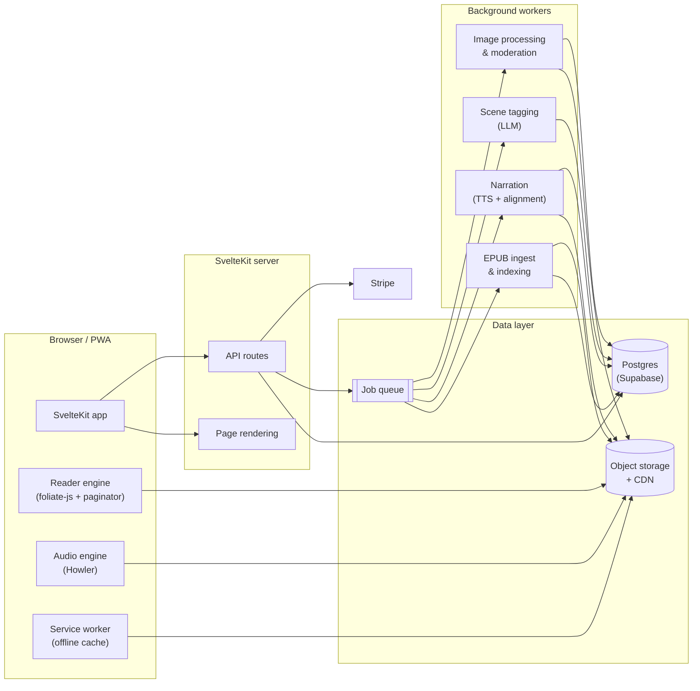

# Interactive Book Reader: Architecture & Design Doc

**Status:** Draft v0.1
**Author:** Kasai
**Last updated:** 28 September 2026

---

## 1. Overview

### 1.1 Problem

Many people find books hard to get into. The two most common asks are audio and pictures, but pairing an audiobook with an ebook means juggling two apps, two purchases and manual syncing. That friction is often enough to stop someone reading at all.

### 1.2 Vision

A web-based reader where the book, its illustrations and its audio live in one place and stay in sync automatically. Authors and communities can contribute illustration sets, and readers pick which ones (if any) accompany their reading. Audio (narration and/or ambient soundscapes) is assigned to positions in the text, so it follows the reader rather than the other way round.

### 1.3 Goals

- Lower the barrier to starting and continuing a book.
- Keep illustrations, audio, notes and bookmarks in sync with the text regardless of font, size or view mode.
- Let readers fully customise the reading experience.
- Give authors and communities tools to enrich books and a reason to publish here.

### 1.4 Non-goals (for v1)

- Native mobile apps (the web app is a PWA instead).
- Licensing traditionally published books from major publishers.
- Real-time collaborative reading or social feeds.
- A general-purpose ebook store competing on catalogue size.

---

## 2. Users

| Persona | Needs |
|---|---|
| **Reluctant reader** | Low effort to start, audio and visual support, no setup |
| **Regular reader** | Comfortable typography, notes, bookmarks, progress sync across devices |
| **Author** | Easy upload, control over official illustrations and audio, reader analytics, monetisation |
| **Community artist** | A place to publish illustration sets for books they love, recognition and feedback |
| **Moderator / admin** | Tools to review uploads, handle reports and takedowns |

---

## 3. Core Features

### 3.1 Interactive Book Reader

- **Page navigation:** flip left/right buttons, keyboard arrows, swipe on touch devices, click on page edges.
- **Scrubber bar:** drag to any position in the book. Shows chapter name and percentage while dragging, with a preview of the chapter title before release.
- **View modes:**
  - *Single page*: default on mobile and narrow screens.
  - *Two-page spread*: default on desktop and landscape tablets.
  - *Spread overview (four pages)*: a navigation/overview mode rather than a reading mode, since reflowable text at a readable size is too cramped in four columns on most screens. Useful for scanning and for fixed-layout books.
  - *Continuous scroll*: optional mode for readers who prefer it, and an accessibility fallback.
- **Page-flip animation:** realistic curl effect, with a setting to switch to slide or instant for accessibility and low-end devices. Respects `prefers-reduced-motion`.
- **Zoom:** for reflowable books, zoom maps to font scale and triggers repagination. For fixed-layout books (picture books, comics, scanned works), zoom is true visual zoom with pan.

### 3.2 Illustrations Panel

- A panel above the book (or beside it on wide screens, and collapsible on mobile) that shows the illustration anchored to the current reading position.
- **Illustration sets:** each book can have several sets, such as the author's official set and community sets. Readers choose one set, mix sets, or turn illustrations off.
- **Display rule:** show the most recent illustration whose anchor is at or before the current position. Transitions crossfade.
- **Spoiler safety:** illustrations never appear ahead of the reader's position. Set previews on the book page only use images the set creator has marked as spoiler-free.
- **Tap to expand:** full-screen view with caption and artist credit.

### 3.3 Position-Anchored Audio

Two separate audio types, each independently optional:

- **Narration:** a spoken reading of the text. Sources are author-uploaded recordings or AI text-to-speech. Uses forced alignment to produce word-level timings, which enables read-along highlighting and auto page-turn.
- **Ambient soundscape:** music, ambience and sound effects attached to text ranges (for example "tavern", "rainstorm", "battle"). Assigned by AI scene tagging with author review and overrides.

Controls:

- Separate volume sliders for narration, music, ambience and effects, each with its own mute.
- Ambient tracks loop and crossfade when the reader's position crosses into a new segment, rather than playing on a fixed timeline. This avoids having to predict reading speed.
- Audio is always off by default until the reader opts in, so nobody is surprised by sound.

### 3.4 Reader Customisation

- Font family (bundled set including a serif, sans-serif and dyslexia-friendly option, plus the book's embedded font where licensed).
- Font size, line height, paragraph spacing, margins and text alignment.
- Themes: light, sepia, dark, high contrast, plus custom colours.
- All changes repaginate live. Illustrations, audio, bookmarks and notes stay attached to the text because they are anchored to text positions, not page numbers (see §5.3).
- Settings sync per user, with optional per-book overrides.

### 3.5 Digital Bookmarks

- **Functional bookmarking is free and unlimited.** A bookmark saves a text position with an optional label.
- **Bookmark designs are a cosmetic purchase.** Once bought, a design can be used in any book, on any number of bookmarks.
- Bookmark list panel with jump-to, rename and delete.
- Bookmarks show as a ribbon on the page edge using the chosen design.

### 3.6 Notes & Highlights

- Select text to open a popover with **Highlight**, **Add note**, **Copy** and **Share quote**. On desktop, right-click opens the same menu.
- Notes are private by default.
- Notes panel lists all notes and highlights for the book, filterable by chapter and colour, with jump-to.
- Export notes as Markdown or plain text.

---

## 4. Stretch Features

Grouped by the value they add. Items marked ★ are recommended as the first stretch features to build.

### 4.1 Reading support

- ★ **Read-along highlighting:** highlights each word as the narration speaks it. Strongly supports reluctant and developing readers.
- ★ **Spoiler-safe recap:** a "previously on…" summary generated only from text the reader has already passed, for people returning after a break.
- **Character and place glossary:** built from text already read, so it never spoils.
- **Tap-to-define:** dictionary lookup on a word.
- **Reading time estimates:** time left in chapter and book based on the reader's own pace.
- **Focus mode:** dims everything except the current paragraph.
- **Bionic-style or guided reading aids:** optional, for readers who find them helpful.

### 4.2 Community

- ★ **Paragraph comments:** readers comment on specific passages. Hidden by default with a count indicator, so they don't distract.
- **Illustration set voting and curation:** top-rated sets surface first, and authors can "endorse" community sets.
- **Public highlights:** optionally show passages many readers highlighted.
- **Reading groups:** shared progress and discussion for a small group reading together.
- **Artist profiles:** portfolios of illustration sets across books, with follow and tip options.

### 4.3 Authors

- ★ **Author analytics dashboard:** reads, completion rate, drop-off points by chapter, illustration set popularity, audio usage.
- **Serial publishing:** release chapters on a schedule, with notifications for followers. Fits web serial authors well.
- **Illustration and audio editor:** a timeline-style tool for placing illustrations and audio cues against the text, reviewing AI suggestions and overriding them.
- **Monetisation options:** paid books, early-access chapters, tips, and a revenue share from illustration sets and bookmark designs linked to their books.

### 4.4 Rich content

- ★ **Native stat blocks and system windows:** styled components for LitRPG/progression-fantasy status screens, skill notifications and system messages, instead of monospaced text hacks. These stay readable at every font size and theme. A distinctive feature for a genre whose readers are already on web-serial platforms.
- **Maps:** an interactive map panel where authors can mark locations that link to passages.
- **Fixed-layout support:** picture books, comics and illustrated editions where page layout matters.
- **Character art cards:** tappable character names that show their portrait from the chosen illustration set.

### 4.5 Platform

- ★ **Offline reading:** PWA caching of downloaded books, illustrations and audio.
- **Cross-device handoff:** "continue where you left off" prompt on another device.
- **Reading streaks and goals:** optional and easy to turn off, since gamification annoys some readers.
- **Import personal EPUBs:** read your own DRM-free books with notes, bookmarks and themes (no community content attached).

---

## 5. Architecture

### 5.1 Technology Stack

| Layer | Choice | Notes |
|---|---|---|
| Language | TypeScript | Used across client and server |
| Framework | SvelteKit (Svelte 5) | Server rendering for public book pages, API routes, PWA support |
| UI components | Bits UI (headless) + custom styling | Accessible behaviour without an imposed look |
| Styling | CSS custom properties (design tokens), scoped Svelte styles, optional Tailwind | Tokens power user themes |
| Book rendering | foliate-js (alternative: Readium TS toolkit) | EPUB parsing, reflowable pagination, CFI locators |
| Page-flip | StPageFlip (`page-flip`) | Used directly, no wrapper |
| Audio | Howler.js / Web Audio API | Layered channels, crossfades |
| Database | PostgreSQL via Supabase | Row-level security for per-user data |
| Auth | Supabase Auth | Email, OAuth providers |
| Object storage | Cloudflare R2 (or S3) behind a CDN | EPUBs, images, audio |
| Background jobs | Queue (pgmq, Inngest or Trigger.dev) + Python worker | Ingest, TTS, alignment, scene tagging, image processing |
| AI services | TTS API (e.g. ElevenLabs, Google Cloud TTS, OpenAI), WhisperX or aeneas for alignment, an LLM for scene tagging and recaps | Swappable behind internal interfaces |
| Payments | Stripe (Checkout, Connect for creator payouts) | Web payments avoid app-store fees |
| Search | Postgres full-text search, then Meilisearch as the catalogue grows | Catalogue and in-book search |
| Moderation | Image moderation API + manual review queue | For community uploads |
| Hosting | Vercel or Cloudflare Pages for SvelteKit; separate container host for the Python worker | |
| Observability | Sentry (errors), PostHog or Plausible (product analytics) | |

### 5.2 System Diagram



### 5.3 The Anchoring Model (critical)

Because readers can change font and size, **page numbers are display-only and never stored.** Every piece of attached content points to a position in the text.

```ts
type Locator = {
  editionId: string;       // specific version of the book text
  cfi: string;             // EPUB Canonical Fragment Identifier
  paragraphId: string;     // stable ID assigned at ingest
  charOffset: number;      // offset within the paragraph
  textQuote?: {            // fallback for re-anchoring after edits
    exact: string;
    prefix: string;
    suffix: string;
  };
};

type Range = { start: Locator; end: Locator };
```

- **Illustrations** anchor to a `Locator` (where they begin).
- **Audio segments** anchor to a `Range`.
- **Bookmarks** anchor to a `Locator`.
- **Notes and highlights** anchor to a `Range` (following the W3C Web Annotation model).
- **Reading progress** is a `Locator`.

**At ingest**, each block-level element gets a stable `paragraphId` written into the processed EPUB, and a paragraph index is stored in the database.

**When an author publishes a new edition**, existing anchors are migrated: first by `paragraphId`, then by fuzzy `textQuote` match. Anchors that can't be resolved confidently are flagged for the author (illustrations and audio) or shown to the user as "orphaned" (notes), never silently dropped.

### 5.4 Reader Engine

- Content renders in an isolated container (iframe or shadow DOM) so book CSS can't leak into the app and vice versa.
- **Pagination** uses CSS multi-column layout. A page map (page index → range) is computed for the current settings and viewport, cached per settings combination, and recomputed in the background when settings change.
- **Position tracking** emits the currently visible `Range` on every page turn or scroll. The illustration panel, audio engine and progress sync all subscribe to this single source of truth (a Svelte store).
- **Scrubber** maps drag position to a book-wide percentage, which maps to a `Locator`, which is converted to the nearest page for the current layout.
- **Book formats:** reflowable EPUB 3 first. Fixed-layout EPUB and PDF are a stretch goal (§4.4).

### 5.5 Audio Engine

- Maintains four channels: narration, music, ambience, effects. Each has its own gain node and user volume.
- **Narration** uses EPUB 3 Media Overlays (SMIL) or an internal equivalent: a map from text ranges to audio timestamps, generated by forced alignment. Drives read-along highlighting and auto page-turn.
- **Ambient** segments are looked up by the current visible range. On entering a new segment, the engine crossfades over about two seconds. Sound effects fire once when their anchor becomes visible.
- Preloads audio for the next few segments. Uses streaming formats (Opus in WebM/Ogg with AAC fallback) to keep bandwidth down.
- Pauses automatically when the tab is hidden, unless narration mode is active.

### 5.6 AI Pipelines

All AI output is a **suggestion** that authors can review, edit or reject before publishing.

1. **Narration**
   `text → TTS (per chapter) → forced alignment (WhisperX/aeneas) → SMIL/timing map → storage`
   Voice selection per book, with optional per-character voices as a later enhancement.
2. **Ambient assignment**
   `chapters → LLM scene segmentation → tags (setting, mood, intensity, events) → match against tagged audio library → proposed segments → author review`
3. **Recaps and glossary**
   Generated per chapter at ingest and stored, then assembled on request only from chapters before the reader's position.

Cost control: pipelines run once per edition, not per reader. Results are cached and only regenerated for changed chapters.

### 5.7 Data Model (initial)

| Table | Key fields |
|---|---|
| `users` | id, display_name, avatar, created_at |
| `reader_settings` | user_id, book_id (nullable for global), font, size, line_height, margins, theme, view_mode |
| `books` | id, author_id, title, slug, description, cover, genres, status, content_warnings |
| `editions` | id, book_id, version, epub_path, published_at |
| `paragraphs` | edition_id, paragraph_id, chapter_index, order, text_hash |
| `illustration_sets` | id, book_id, creator_id, name, type (official/community), status, ai_generated flag |
| `illustrations` | id, set_id, locator, image_path, caption, credit, spoiler_safe |
| `audio_tracks` | id, book_id, kind (narration/music/ambience/sfx), source, path, license |
| `audio_segments` | id, track_id, edition_id, range, loop, volume |
| `narration_alignments` | edition_id, chapter_index, timing_map_path |
| `bookmarks` | id, user_id, edition_id, locator, label, design_id |
| `bookmark_designs` | id, name, artist_id, asset_path, price |
| `user_designs` | user_id, design_id, purchased_at |
| `annotations` | id, user_id, edition_id, range, kind (highlight/note), colour, body, visibility |
| `reading_progress` | user_id, edition_id, locator, percent, max_locator, updated_at |
| `reports` | id, reporter_id, target_type, target_id, reason, status |
| `purchases` | id, user_id, item_type, item_id, stripe_ref, amount |

`reading_progress.max_locator` tracks the furthest point reached, which is used for spoiler gating (recaps, glossary, illustration previews).

### 5.8 Key API Surface

- `GET /books/:slug`: public book page (server-rendered)
- `GET /read/:editionId/manifest`: EPUB location, available illustration sets and audio tracks
- `GET /read/:editionId/illustrations?set=…`: illustration anchors for a set
- `GET /read/:editionId/audio`: segments and alignment maps
- `PUT /progress/:editionId`: sync position (debounced client-side)
- `CRUD /bookmarks`, `/annotations`
- `POST /uploads/illustration-set`: returns signed upload URLs, queues moderation
- `POST /checkout/bookmark-design`: Stripe Checkout session
- `POST /webhooks/stripe`: purchase fulfilment

### 5.9 Security & Privacy

- Row-level security on all user-owned tables. Users can only read their own notes, bookmarks, progress and settings.
- Uploads go directly to storage via short-lived signed URLs, then through type validation, size limits, virus scanning and image moderation before becoming visible.
- Paid assets are served via signed CDN URLs.
- Rate limiting on uploads, comments and auth endpoints.
- UK GDPR compliance: data export, account deletion, clear privacy policy, cookie consent for analytics.
- Age policy and content ratings for books and illustration sets, since community uploads could include mature content.

### 5.10 Performance Targets

- Book opens to first readable page in under 2 seconds on a mid-range phone over 4G.
- Page turn under 100 ms after the page map is computed.
- Repagination after a settings change under 1 second for a typical novel, with the current page shown immediately and the rest computed in the background.
- Illustrations served as responsive AVIF/WebP with lazy loading.

---

## 6. Design System

### 6.1 Principles

1. **The book comes first.** The reading surface is calm and near-invisible, and controls fade out while reading.
2. **Personality lives in the app layer.** The library, book pages, store and community areas carry the brand.
3. **The illustration panel is the showpiece.** It's what makes the product distinctive, so it can be more expressive.
4. **Everything is customisable through tokens.** Themes are just token sets.

### 6.2 Two Layers

| Layer | Contents | Styling |
|---|---|---|
| **App layer** | Library, discovery, book pages, author dashboard, store, profiles | Brand typefaces, colours and components |
| **Reader layer** | Reading surface, toolbars, panels | Minimal chrome, user-controlled typography and colours |

### 6.3 Tokens

```css
:root {
  /* Colour */
  --color-bg: …;
  --color-surface: …;
  --color-text: …;
  --color-text-muted: …;
  --color-accent: …;
  --color-highlight-1 … --color-highlight-5: …;

  /* Reader */
  --reader-font: …;
  --reader-size: …;
  --reader-line-height: …;
  --reader-margin: …;

  /* UI typography */
  --font-ui: …;
  --font-display: …;

  /* Shape & spacing */
  --radius-sm / md / lg: …;
  --space-1 … --space-8: …;

  /* Motion */
  --duration-fast / base / slow: …;
}
```

Preset themes (light, sepia, dark, high contrast) are token overrides. Custom themes let users change the colour tokens. Book-specific skins (optional, author-provided) can only change app-layer and illustration-panel tokens, never the reader's chosen text settings.

### 6.4 Visual Direction

To be decided. Next step: choose a mood, a small palette and UI typefaces (separate from reading fonts), then mock up the reader screen and a book page.

### 6.5 Accessibility

- WCAG 2.2 AA as a minimum across the app layer.
- Full keyboard navigation in the reader, with documented shortcuts.
- Screen reader support: the book text is real text in the DOM, and page turns are announced.
- Reduced-motion support disables page-curl and crossfades.
- Captions or transcripts are unnecessary for narration (the text is the transcript), but ambient audio has a visual indicator of what is playing.

---

## 7. Content & Community Policy

- **Rights:** uploaders confirm they own or have the right to publish the book or artwork, and grant the platform a licence to display it.
- **Community illustrations of third-party books:** allowed only for books on the platform whose author has enabled community sets. Authors can hide or remove sets from their books.
- **AI-generated art:** allowed but must be labelled. Readers can filter it out.
- **Audio licensing:** ambient library limited to royalty-free or commissioned audio with licences recorded per track.
- **Takedowns:** a documented copyright complaint process, plus a report button on every piece of user content.

---

## 8. Competitive Landscape

| Product | Overlap | Difference |
|---|---|---|
| **Booktrack** | Synchronised soundtracks paced to reading position | Audio only. Mixed reception suggests audio must be optional and finely controllable |
| **Kindle Whispersync / Immersion Reading** | Ebook and narration in sync | Requires separate Audible purchase, no illustrations, closed ecosystem |
| **Apple Books read-along** | Narration with highlighting | Limited titles, Apple devices only |
| **Wattpad, Royal Road, Webnovel, Tapas** | Serial fiction, community, comments | Plain text readers, no illustration sets or synced audio |
| **Webtoon** | Visual storytelling | Comics rather than prose |
| **Scribd / Everand** | Ebooks and audiobooks in one subscription | Separate experiences, not synced |
| **Internet Archive / Open Library** | Flip-book UI | Scanned books, no enrichment |

**Differentiator:** selectable, community-driven illustration sets combined with position-anchored audio in a single reader.

---

## 9. Risks & Open Questions

| Risk / question | Mitigation or next step |
|---|---|
| Content cold start: no books means no readers | Launch with web serial authors who own their rights; offer tools they can't get elsewhere |
| Ambient audio may annoy readers (see Booktrack) | Off by default, separate channel controls, measure usage before investing further |
| AI narration cost at scale | Generate once per edition, cache, allow author-supplied recordings |
| Anchor drift when authors edit text | Stable paragraph IDs plus text-quote re-anchoring and author review (§5.3) |
| Moderation workload for community uploads | Automated screening first, author controls on their own books, community reporting |
| Legal exposure from community art | Author opt-in for community sets, licence terms on upload, takedown process |
| Pagination performance on long books and low-end phones | Background page-map computation, chapter-level virtualisation |
| **Open:** narration, ambient audio, or both in v1? | Recommendation: narration first, ambient later |
| **Open:** business model beyond bookmark designs? | Options: reader subscription, author revenue share, paid books |
| **Open:** support fixed-layout books in v1? | Recommendation: no, reflowable EPUB only |

---

## 10. Roadmap

### Phase 1: Reader MVP
- EPUB ingest with paragraph IDs
- Reader: single and two-page views, flip animation, scrubber, zoom (font scale)
- Customisation: fonts, size, spacing, themes
- Anchoring model, free bookmarks, notes and highlights
- Accounts and progress sync
- Author upload of a book and one official illustration set

### Phase 2: Audio
- AI and uploaded narration with forced alignment
- Read-along highlighting and auto page-turn
- Audio engine with per-channel controls

### Phase 3: Community
- Community illustration sets with moderation, voting and author controls
- Paragraph comments
- Artist profiles
- Author analytics dashboard

### Phase 4: Monetisation & Ambience
- Bookmark design store (Stripe)
- Ambient soundscapes with AI tagging and author review
- Creator payouts (Stripe Connect)

### Phase 5: Stretch
- Spoiler-safe recaps and glossary
- Native stat blocks / system windows
- Offline PWA reading
- Maps, reading groups, fixed-layout support

---

## 11. Success Metrics

- **Activation:** percentage of new readers who get past the first chapter.
- **Completion:** book completion rate compared with a plain-text baseline.
- **Feature use:** share of reading sessions with illustrations on, and with narration or ambient audio on.
- **Retention:** readers returning weekly.
- **Creator health:** number of active authors and community illustration sets, and author-reported satisfaction.
